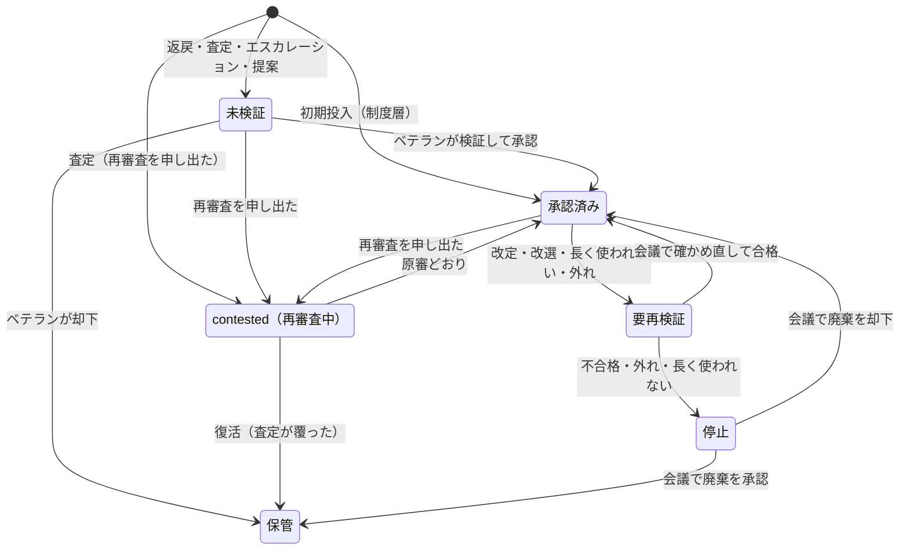
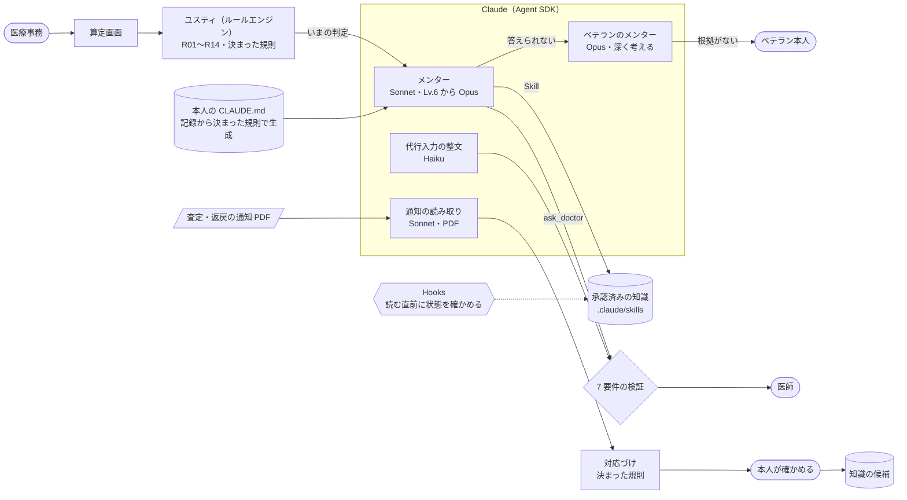

# レセメン（仮）

在宅医療のクリニックでレセプト請求を担う医療事務一人ひとりに、隣で働く同僚としての AI メンターをつけるアプリです。

- 算定の正否は、決まった規則で動くルールエンジン「ユスティ」（正義の女神ユスティティアから）が判定します。
- メンター（Claude）は答えを出さずに、理由と筋道を示します。
- 医師への確認はメンターが引き受け、わからないことはメンター同士で解きます。

Built with Claude: Japan 2026 提出作品です。この README は、デモ動画（約 3 分）と同じ順に並べています。

| 動画の流れ | README の節 |
|---|---|
| 医療事務って大変（冒頭） | [1. 課題](#1-課題医療事務って大変) |
| AI が進化しても、算定はなくならない | [2. なぜなくならないのか](#2-ai-が進化してもレセプト算定はなくならない) |
| メンター紹介 → ユスティ → ローカルルール | [3. レセメンのしくみ](#3-レセメンのしくみ) |
| 課題を 1 つずつ割る | [4. 課題ごとの解決](#4-課題ごとの解決) |
| 全体の構成図・モデルの使い分け | [5. 全体の構成と Claude の使い方](#5-全体の構成と-claude-の使い方) |
| 楽しく働いて、キャリアアップ！／COMING SOON | [6. キャリアアップとこれから](#6-キャリアアップとこれから) |

## 1. 課題：医療事務って大変

医療事務は、医師の診療を診療報酬の請求に変える仕事です。ただ、その中身は外から見えにくくなっています。

- **資格は要らないが、知識は要る**：採用の基準は経験だけで、科目が違えば算定も変わります。
- **全部ひとりで**：レセプトに加えて、電話・受付・窓口・書類・郵送まで抱えます。
- **年収 334 万円**：一般診療所の常勤事務職員の平均です（[第25回医療経済実態調査 令和6年度](https://www.mhlw.go.jp/content/10808000/001599544.pdf)）。
- **カルテの文脈が難しい**：記載が足りない、略語が多い、コピペもあります。
- **聞ける人がいない**：先輩は手一杯で、知識はベテランの頭と付箋の中にあります。
- **休めない**：毎月 10 日が締め切りです。
- **決まりは全国共通だけではない**：地域で違い、審査する人も替わります。院内にも古いローカルルールが積み重なります。
- **評価されにくく、キャリアアップの道も細い**：診療報酬請求事務能力認定試験は、2025 年 12 月の第 63 回で終わりました（[日本医療保険事務協会](https://www.iryojimu.or.jp/)）。

<details>
<summary>背景の数字（もう少し詳しく）</summary>

医療機関は、医師・看護師を人材紹介会社経由で採用するたびに、高い紹介手数料を払っています。

- 厚生労働省の集計では、令和6年度の 1 件あたり平均手数料は医師 107.8 万円、看護師 72.5 万円です（[厚生労働省](https://www.mhlw.go.jp/content/11600000/001754261.pdf)）。
- 国会では、医療・介護全体の紹介手数料が 2024 年度に 1,139 億円にのぼると指摘されました（[2026-05-15 衆議院厚生労働委員会](https://kokkai.ndl.go.jp/txt/122104260X00920260515/55)）。
- 職業安定局長は、手数料率を賃金の 20〜30% と答弁しています（[2025-06-04 衆議院厚生労働委員会](https://kokkai.ndl.go.jp/txt/121704260X02420250604/117)）。

医療事務は、辞められると困るのに、紹介料を払ってまでは採らない職種です（上記の厚労省の手数料公表対象職種に含まれていません）。医療事務に固有の離職統計もありません。

公式に測られている指標は次のとおりです（[支払基金 審査状況 令和7年度](https://www.hpdx.or.jp/tokeijoho/shinsatokei/shinsajokyo_r07.html)）。算定漏れの規模を示す公開統計はありません。

- 査定率：約 0.40%（請求 1 万点あたり 40.4 点）
- 返戻率：0.460%
- 再審査の復活率：35.6%

</details>

## 2. AI が進化しても、レセプト算定はなくならない

全国共通の決まりは、ルールエンジン（ユスティ）が片付けられます。それでも人の仕事は残ります。

- **審査基準が都道府県ごとに違う**：都道府県別の審査基準は、支払基金に約 33,000 件、国保連に約 18,000 件ありました（2021 年 3 月時点。2024 年 4 月までに統一の検討が一巡。[厚生労働省](https://www.mhlw.go.jp/content/12401000/000834623.pdf)）。
- **審査する人が 2 年ごとに替わる**：審査委員の任期は 2 年で、支払基金は奇数年の 6 月 1 日に改選されます。
- **正しかったかは、後からしかわからない**：査定・返戻の通知が届くまで、請求が通るかはわかりません。

地域のクセは、現場の知識の中にあります。レセメンは、その知識を集めて確かめ、古くなったら見直します。

## 3. レセメンのしくみ

### メンター：4 人から本人が選ぶ

メンターは、男女を含む 4 人から本人が選びます。一人に 1 セッションです。

| 名前 | 口調 |
|---|---|
| マッキー | 静かに優しい |
| ナツ | 明るくはきはき |
| ユキ | 冷静で平坦 |
| ハル | 強く引っ張る |

- 選んだメンターは、声（ElevenLabs）で名乗り、呼び方を聞きます。
- 訪問の記録やレセプトを開くと、メンターのほうから声をかけます。
- 算定の画面では、答えは言わず、見る場所と理由を言います。

### ユスティ：決まった規則で正否を出す

ユスティは R01〜R14 の規則で動く、決定的なルールエンジンです（`src/engine/`）。

1. レセプトの行と事実（要介護度・別表第七・別表第八の二など）を受け取る
2. R01〜R14 のそれぞれが、当てはまるかを見てから確かめる
3. 判定に要る事実がわからなければ、推測せずに「情報不足」を返す
4. 指摘があっても、合計点数は変えない
5. 同じ入力なら、毎回同じ答えを返す

### ローカルルール：判定には混ぜず、メンターが補う

地域・ベテランの判断・院内のローカルルールは、ユスティの中には入れません。同じレセプトに別に当てはめ、算定画面の「ローカルルール」の欄に、ユスティの判定と並べて出します。承認済みのもの（院内を除く）は、メンターが Skill として読み、本人に伝えます。

例（合成データの K6）：

- ユスティの判定：BNP の判断料は区分ごとに月 1 回（R11）で、誤りはありません。
- ローカルルールの欄：「東京都・支払基金：BNP が査定された（2025-02 診療分）」が出ます。
- メンター：答えは言わず、今月のカルテと摘要をもう一度見るよう促します。

地域の傾向は、査定の結果で当たり外れが出る知識です。判定に混ぜると、外れたときにユスティの判定まで信用できなくなるため、分けています。当てはめは AI ではなく、県・審査支払機関・区分などの宣言的な条件で行います（`src/lifecycle/match.ts`）。

### ローカルルールには、見直しが要る

知識は 4 層（制度・地域・ベテランの判断・院内）です。次のどれかが起きると「要再検証」になり、毎週のレセメン会議で責任者が判断します。

- 診療報酬の改定（偶数年 6 月）
- 審査委員の改選（奇数年 6 月）
- 180 日使われない



状態を動かすのは、決まった規則と人の判断だけです。AI は状態を決めません。査定・返戻の結果は記録するだけで、知識を直すのは毎週のレセメン会議です。

## 4. 課題ごとの解決

| 課題 | レセメンの機能 | Claude の役割 |
|---|---|---|
| 聞ける人がいない | **算定の伴走（1 件＝1 問）**：メンターのヒント → 本人が確定 → ユスティの判定 → メンターの解説。スコアは件数と連続正解だけ<br>**メンター同士**：答えられない問いはベテランのメンターへ、解けなければベテラン本人へ。解決した問いは知識の候補になる | メンター：Sonnet<br>ベテランのメンター：Opus |
| 知識が要る | **ユスティの判定**：R01〜R14 で正否を出す。メンターには判定のルールと行だけを渡す | なし（決まった規則） |
| 決まりは全国共通だけではない | **ローカルルールの集約**：査定・返戻の通知 PDF を読み、決まった規則で区分・請求先に対応づけ、本人が確かめて知識の候補にする<br>**見直し**：改定・改選・180 日で要再検証へ | 通知の読み取り：Sonnet |
| カルテの文脈が難しい | **カルテの取り込み**：電子カルテの画面を撮った画像から、病名・診療記録・処方を書いてあるまま書き写す（画像は保存しない）<br>**カルテとの照合**：UKE の傷病名と処方を突き合わせ、合っていない点を出す | 書き写し：Sonnet<br>SOAP への振り分け：Haiku |
| 全部ひとりで | **医師確認**：記載が足りないとき、選択式で中立に医師へ聞く（AHIMA/ACDIS 2026 年版の 7 要件）。点数・金額は出さず、選択肢には必ず「その他」「判定不能」を入れる<br>**代行入力**：下書きを整え、足りない項目は推定せずに聞く。必ず医師の確認・承認を挟む | 整文：Haiku |
| 休めない（締め切り） | **UKE の取り込みと月末の点検**：締め切り前に、まとめて一度に見直す | なし（決まった規則） |
| 評価されない・キャリアアップもない | **レベル**と、提出前に防いだ指摘の記録（防いだ額は推定。本人向けは既定で非表示、事務長向けは集計だけ） | なし |

## 5. 全体の構成と Claude の使い方

判定はユスティ、判断は人が持ち、Claude は「読む・話す・整える」を受け持ちます。役割ごとにモデルと考える深さを変えています（`config/models.json`）。



| 役割 | モデル | していること |
|---|---|---|
| 新人の隣のメンター | Sonnet（考える深さ：低。確定後の解説は中）。Lv.6 からは Opus | レセプトを開くと先に声をかけ、確定すると解説を始める。速さを優先 |
| ベテランのメンター | Opus（考える深さ：高） | 新人のメンターが答えられない問いに、承認済みの知識を根拠に答える。根拠がなければベテラン本人に回す |
| 代行入力の整文 | Haiku | 下書きを整える。足りない項目は推定せずに聞く |
| 査定・返戻の通知の読み取り | Sonnet | PDF から書かれていることを取り出す。区分・請求・審査支払機関への対応づけは決まった規則で行う |
| 電子カルテの画像の書き写し | Sonnet | 画面の小さい日本語を読み、病名・診療記録・処方を書いてあるまま書き写す |
| 訪問カルテからの事実の取り出し | Sonnet | 算定に要る事実を取り出す。取り出した事実は本人が確かめる |
| SOAP への振り分け | Haiku | 自由に書いたカルテを SOAP の欄に並べ替える |
| 名前の読み | Haiku | 声で答えた名前に漢字が混じっていたら、ひらがなの読みに直す |

- **知識は Skill として読む**：承認済みの知識だけを `.claude/skills/` に同期し、メンターは Skill のツールで必要なものだけを読みます。読む直前に Hooks で知識の状態を確かめ、承認済みでなければ読ませません。読んだ知識は Hooks で記録し、引用されたもののうち実際に読んだものだけを「使われた」と数えます。
- **医師に聞く前に決まりを読む**：医師確認を作る直前に Hooks で、このレセプトに当てはまる決まり（ユスティが当てはめたルールと、カルテとの照合の規則）のどれかを読んだかを確かめます。当てはまる決まりがない話題は、ベテランのメンターに回します。カルテとの照合で見つかった不一致（例：DOAC と「心房細動」だけの病名）があるときは、メンターは質問を書きません。どれのことかを本人が画面で選び、聞く軸の決まった質問で送ります（話題の見分けを AI にさせない）。
- **一人ひとりの CLAUDE.md**：医療事務ごとに作業場所を作り、レベルや直近で確認が入ったルールを書いた CLAUDE.md を、記録から決まった規則で書き換えます（AI には書かせません）。作業場所は、上の階層に CLAUDE.md がない場所に置きます（既定は OS の一時フォルダ。`RESEMEN_WORKSPACES` で変えられます）。
- **答えを言わない仕組み**：確定する前のメンターには、判定のうちルールと行だけを渡し、指摘の中身と点数は渡しません。返事が答え（足すべき項目の名前・指摘の種類・点数）に触れていたら、決まった規則で見つけて一度だけ書き直させます。
- **所要時間の記録**：呼び出しごとにモデル・所要時間・トークン数をサーバーのログに残します（プロンプトと本文は残しません）。

## 6. キャリアアップとこれから

レセメンの主語は、医療事務本人です。解くほどレベル（Lv.1〜10）が上がり、Lv.6 からはメンターが Opus で深く考えるようになります。ひとりで抱えずに算定ができ、楽しく働いてキャリアアップを目指せる職場を目指します。

### COMING SOON

- **経営機能モード**：全体の数字の動きがわかる
- **事務作業補助モード**：患者さんへの請求書の発行や、メール対応などを補助する
- **責任者算定試験モード**：「次は、あなたが責任者に。」

### ほかに考えていること

- **やる気のある人向けの経営分析**：既定の表示は余白を大事にし、金額は出しません。もっと深く見たい人は、オプトインで次のような分析に進めるようにしたいと考えています。
  - 防いだ額の推移
  - 医師記載起因の傾向（事務長から医師へのフィードバック）
  - 査定・返戻の区分別の傾向
  - 知識の育ち方

  いずれも「正しく取る・取りこぼさない」ための分析で、取れない算定を取りにいかせる方向には使いません。
- **知識のつながりを図で見る（知識グラフ）**：知識はすでに「どの知識から生まれたか」でつながっています。知識が増えたら、改定の影響がどこまで届くかや、関連する知識をまとめて見られるようにします。新しいつながりを AI が提案しても、確定するのは責任者です。
- **改定情報を拾って知らせる**：厚労省の改定情報を Web 検索で拾い、見直しが必要かもしれない知識を責任者に知らせます。拾った情報は知らせるまでにとどめ、数字は採用値だけを使います。
- 医療事務以外の医療従事者への展開

## 守っていること

- 点数は **2024年度改定後（2025年4月のDX加算改定前）** のもの。合成レセプトの診療年月は 2025 年 3 月
- レセ電コードはすべて **架空コード**。実在のマスターとは無関係
- 医療事務（請求・記載）の支援であり、**診断・治療に関与しない**
- **代行入力は医師の確認・承認を前提とする**（医政発第1228001号）
- **数字は EM（evidence-master）の採用値のみ**を使う（`design/iji-context/sources/evidence-master-iji-context.md`）
- データは合成データだけ。実在の患者データ・個人情報は使わない。AI は病名・施行事実を作り足さない
- 知識の状態（承認・降格など）は決まった規則だけで動き、AI（LLM）には決めさせない

## 動かし方

```bash
npm install
```

`.env.local` に `ANTHROPIC_API_KEY` を置いてから起動します（キーはコードに書きません）。メンターの声を使うときは、`ELEVENLABS_API_KEY` も置きます（見本は `env.local.example`）。

```bash
npm run dev
```

デモの状態に戻すときは次を実行し、開発サーバーを起動し直します。デモの時計は 2025-03-10 から始まります。

```bash
npx tsx scripts/reset-demo.ts --yes
```

制度層の知識（R01〜R14）は `knowledge/` に入っています。作り直すときは次を実行します。

```bash
npx tsx scripts/seed-knowledge.ts
```

合成の査定通知（K6・2 月分の BNP。点数欄なし）は次で作り直せます（PDF 化に手元の Google Chrome を使います）。

```bash
npx tsx scripts/gen-notice.ts
```

合成 UKE（国保連あて K1〜K5、支払基金あて K6）は次で作り直せます。

```bash
npx tsx scripts/gen-uke.ts
```

### 公開（本番）

公開版は Google Cloud の VM で Docker Compose で動かし、Caddy で https にしています。手順は [docs/deploy-gcp.md](docs/deploy-gcp.md) です。

- 使う人はログイン ID とパスワードで登録・ログインします。パスワードは scrypt のハッシュだけを保存し、セッションは httpOnly の cookie で渡します。
- ログインした人ごとに専用のクリニック（DB・知識・医師確認の記録・デモの時計）を持つので、人どうしの操作は混ざりません。
- Claude の API キーは **Secret Manager** に置き、VM は自分のサービスアカウントの権限で起動のたびに読み出します。キーは git・Docker のイメージ・VM のファイルのどれにも書きません。

## 構成とテスト

- TypeScript のみ。Next.js（App Router・API Route）、Claude Agent SDK（メンター 1 人 1 セッション）、SQLite（better-sqlite3・Drizzle）
- `src/engine/`：ユスティ（ルールエンジン。R01〜R14、決定的）
- `src/lifecycle/`：知識の状態遷移・当てはめ・見直し・レセメン会議
- `src/uke/`：合成 UKE の読み書き（記録条件仕様 令和6年6月版の主要列）とカルテとの照合
- `src/query/`：医師確認（7 要件の検証・記録・承認・リマインド）
- `src/mentor/`：メンター・ベテランのメンター・代行入力の整文・作業場所（CLAUDE.md と Skill の Hooks）・役割ごとのモデル
- `src/chart/`：カルテ（画像からの書き写し・SOAP への振り分け・事実の取り出し）
- `src/notice/`：査定・返戻の通知（PDF）の読み取りと対応づけ
- `src/voice/`：メンターの声（ElevenLabs）
- `src/practice/`・`src/prevented/`：1 件＝1 問の流れ、レベル、防いだ額
- `eval/`：prompt-eval（本番と同じ関数・モデルで 10 件を回し、決まった規則で判定する。開発サーバーの `/api/eval` から実行）
- `video/opening/`・`video/demo/`：デモ動画（冒頭と本編）。HTML の舞台を 1 コマずつ描いて書き出す（`npx tsx video/demo/render.ts f3 --full`）

```bash
npx vitest run
```

```bash
npx tsc --noEmit
```

## 資料

- 仕様：`design/iji-context/spec.md`
- 設計（ユスティと知識ライフサイクル）：`design/iji-context/design.md`
- 反論台帳と反証の記録：`design/iji-context/ledger.md`、`design/iji-context/reviews/`
- 採用値と出典：`design/iji-context/sources/evidence-master-iji-context.md`
