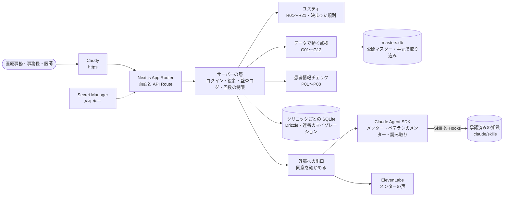

# レセメン（仮）

## レセメン（仮）とは

在宅療養支援診療所（在支診）の医療事務のための、レセプトの点検ツールです。点検の隣には、同僚として働く AI のメンターがいます。

- 算定の正否は、決まった規則で動くルールエンジン「ユスティ」が判定します。AI は判定しません。
- メンター（Claude）は、答えを言わずに、見る場所と理由を示します。医師に聞くことの下書きも手伝います。
- 月末に、レセコンが書き出した UKE をまとめて取り込み、提出の前に全件を点検します。レセメンは算定を一から計算するレセコンではなく、レセコンが計算した請求を点検する道具です。

**このプロダクトはお試し用です。ご自身の責任において情報の授受をお願いします。**

背景：一般診療所の常勤事務職員の平均年収は 334 万円です（[第25回医療経済実態調査 令和6年度](https://www.mhlw.go.jp/content/10808000/001599544.pdf)）。締め切りは毎月 10 日で、知識はベテランの頭と付箋の中にあります。審査の基準は都道府県ごとにも違い、支払基金に約 33,000 件、国保連に約 18,000 件ありました（2021 年 3 月時点。[厚生労働省](https://www.mhlw.go.jp/content/12401000/000834623.pdf)）。公式に測られている査定率は約 0.40%、返戻率は 0.460% で（[支払基金 審査状況 令和7年度](https://www.hpdx.or.jp/tokeijoho/shinsatokei/shinsajokyo_r07.html)）、算定もれの規模を示す公開統計はありません。

## 月末の点検で何ができるか

実務の流れの順に並べます。くわしくは [docs/checks.md](docs/checks.md) です。

1. **UKE の取り込み**：レセコンが書き出した提出用のファイルを取り込みます。対応していないコードの行があっても断らず、その行を「点検の対象外」として残し、点検した行の小計と請求の合計を分けて出します。診療年月に当たる改定の版がないレセプトは判定せず、版を選んだ試算だけを見せます（保存せず、提出にも使いません）。
2. **聞き取り（介護保険・ほかの医療機関）**：レセプトからは分からない事実（住まいの種別・短期入所・要介護の認定・ほかに関わる機関など）を、患者ごとに確かめて残します。答えがないあいだは「見ていません」と出します。
3. **点検**：2 つの系統で見ます。
   - 手書きのルール R01〜R21：在医総管の区分、併せて算定できない組、摘要欄の記載、施設の種別、単一建物の人数、介護保険・ほかの機関との調整など。公開マスターがなくても動きます。
   - データで動く点検 G01〜G12：公開マスター（厚生労働省の基本マスター、審査支払機関の電子点数表・コメント関連テーブル・チェックマスタ）を手元で取り込むと動きます。コード・点数の検算・包括・背反・回数・必須コメント・傷病名・適応と併用・施設基準・取り忘れ・酸素。
4. **取り忘れの候補**：本人が確かめたカルテの「行ったこと」と、電子カルテの構造化データ（訪問の時刻・処方のオーダー・在宅療養の機器）から、カルテにあって請求にないものを条件つきで出します。記録にない算定を促すものではありません。
5. **医師確認**：カルテに書かれていない事実は、推し量らずに医師へ聞きます。聞き方は AHIMA/ACDIS 2026 年版の 7 要件に沿い、点数・金額には触れず、選択肢には必ず「その他」「判定不能」を入れます。仕様では、カルテの分からない略語も推し量らずに印を付け、医師確認で毎回聞くと決めています（FR-211）。
6. **提出**：直したら、提出はいつもどおりレセコンとオンライン請求で行います。届いた査定・返戻は、レセメンに取り込んで提出前の点検と突き合わせられます。

## 指摘の読み方

指摘には 4 つの段階があります。宛先はどれも医療事務です。

| 段階 | 意味 | 医療事務がすること |
|---|---|---|
| 確定 | レセプトの行と確かめた事実だけで、決まりに合わないと言い切れる | 請求を直す。直せない理由があれば、メンターかベテランに相談する |
| 条件つき | 前提（「申告のとおりなら」「表の外と読めば」など）が付く。審査支払機関のチェックの対象に当たる、なども含む | 前提が当たっているかを確かめてから、直すかを決める。査定されると決まったわけではない |
| 情報不足 | 判定に要る事実（要介護度・別表に当たるか・施設の申告など）が分からない | 事実を確かめて入れる。カルテに書かれていなければ医師確認を送る。本人の間違いではない |
| 見ていません | その点検を動かしていない（マスターがない、聞き取りの答えがない、構造化データの項目が取れない など） | 足りないものを入れれば見られる。「問題なし」とは読まない |

「指摘はありません」は、動いた点検についてだけ言います。点検の画面には、動いた点検と動かなかった点検、その理由を必ず出します。

## 機能の一覧

- **施設基準の申告**：施設基準ごとに、届出の有無・届出日・要件・確かめた人と日・次に確かめ直す日を事務長（またはベテラン）が申告します。請求の行が要る施設基準を持っているかを見ます（G10・R18）。注14 の当てはまりを数える計算の道具もあります。
- **取り忘れ**：カルテにあって請求にないものを条件つきで出します（G11）。包括・背反・施設基準で算定できないものは出しません。→ [docs/checks.md](docs/checks.md)
- **摘要欄**：必ず要る記載のもれと形式（R17・G07）。条件が文章で書かれた記載は、判定せずに数だけ畳んで出します。
- **介護保険・ほかの機関**：聞き取りの申告のとおりなら算定できない行を、条件つきで出します（R20・R21）。
- **検算**：点数をマスターから計算し直します（G02）。包括の検査の表は、採血の回数と検体が UKE に書かれていないので、確定を置かない三段で見ます。酸素は、在宅酸素療法の月の酸素・上限を超えた単価・届け出た単価との違いを見ます（G12）。→ [docs/checks.md](docs/checks.md)
- **医師確認**：7 要件を検証してから送り、医師の回答と承認を記録します。代行入力の下書きも、必ず医師の確認・承認を挟みます。
- **査定・返戻の突き合わせ**：増減点連絡書・返戻内訳書の CSV を、提出した UKE と決まった規則で突き合わせ、提出前に指摘できていたかを数えます。→ [docs/review-test.md](docs/review-test.md)
- **メンター**：男女を含む 4 人（マッキー・ナツ・ユキ・ハル）から本人が選びます。一人に 1 セッションで、声（ElevenLabs）でも話します。答えられない問いはベテランのメンターへ、それでも根拠がなければベテラン本人へ回します。
- **ローカルルールと知識の見直し**：地域・ベテランの判断・院内の決まりは、ユスティの判定に混ぜず、別の欄に並べます。知識は「未検証 → 承認済み」の状態を持ち、改定（偶数年 6 月）・審査委員の改選（奇数年 6 月）・180 日使われないことで「要再検証」になり、毎週のレセメン会議で責任者が決めます。公的情報（疑義解釈など）は要旨とリンクで持ち、ローカルルールとの突き合わせは決まった規則で行います。
- **改定の版と比較**：点数とルールは改定の版に属し、診療年月で版を選びます。年度の途中で値が変わる区分（ベースアップ評価料・物価対応料は 2027 年 6 月診療分から）は 2 つ目の版を持ちます。「改定の比較」の画面では、令和6年度の版と並べて区分ごとの差を出します（比較と試算の表示だけで、請求の判定には使いません）。→ [docs/revision-howto.md](docs/revision-howto.md)
- **患者情報チェック**：保険者番号・公費の番号の桁と検証番号、レセプト種別など、患者と保険の情報の誤りを、ユスティとは別の系統（P01〜P08）で出します。

## 使い始める

### 公開版で試す

**https://34-85-108-51.sslip.io**

登録は招待制です。招待コードがあれば、ログイン ID とパスワードを決めるだけで使えます。インストールは要りません。クリニックごとに専用の DB を持つので、ほかのクリニックの操作とは混ざりません。

### 自分のサーバーで動かす

Google Cloud の VM に Docker Compose で置き、Caddy で https にする手順は [docs/deploy-gcp.md](docs/deploy-gcp.md) です。手元で動かすだけなら、下の「手元で動かす（開発者向け）」を見てください。

### 導入したら最初にすること

1. **使い方を選ぶ**：クリニックを作るときに「デモで試す」か「実在のデータで使う」かを選びます（後から変えられません）。デモは合成のデータとデモの日付で始まり、実在のデータでは合成のデータを入れず、今日は実際の日付です。
2. **施設の申告**：「設定」の画面の「施設の申告」で、施設基準と施設の種別を入れます。分からない項目は「分からない」のままで構いません（その施設基準に依る判定は「問題なし」と言いません）。
3. **公開マスターを入れる**：`npm run masters:fetch` で落とすものを確かめ、`npm run masters:fetch -- --yes` で落とし、`npm run masters:build` で取り込みます。データは同梱していません。入っているかは、事務長の「設定」の画面で見られます。→ [docs/masters.md](docs/masters.md)
4. **聞き取り**：UKE を取り込んだら、「点検の前に確かめること」の画面で、介護保険とほかの機関の事実を患者ごとに答えます。

## データと安全

- **外部に出るもの**：カルテの文・画像、メンターへの相談、査定・返戻の通知の PDF は、Anthropic（音声は ElevenLabs）に送られます。レセプト・患者マスタから作る文脈は、氏名・生年月日・保険や公費の番号・医療機関コード・カルテ番号を外してから送ります。カルテの自由記述や画像、通知の中の氏名は外せません。
- **外部に出ないもの**：UKE の中身と患者マスタは、AI にも音声のサービスにも送りません。査定・返戻の突き合わせの画面は AI を使いません。連携（ORCA・FHIR）の接続先は環境変数の許可リストだけで、既定で無効です。
- **同意**：はじめに注意書きへの同意を求めます。同意は、入口と、外部へ送る直前の 2 か所で確かめます。
- **消し方**：取り込んだ UKE はファイルごとに、訪問カルテは 1 件ごとに消せます。AI のサービス側に送った内容は、こちらからは消せません。サーバーへの保存は暗号化していません。
- **社内テストの同意**：実際の査定・返戻の記録を突き合わせに使うときは、先に院長の同意を取り、件数だけを報告に書いて、数え終えたら消します。手順は [docs/review-test.md](docs/review-test.md) です。

何がどこへ出るか・何を消せるかの全体は [docs/security.md](docs/security.md) にまとめています。

## 守っていること

- 点数は令和8年度改定後のもの（医科点数表は令和8年6月1日適用）。版のない診療年月は判定しません。令和6年度の版は、改定の比較と試算の表示にだけ使います。
- レセ電コードは実在の診療行為コードで、採用値の表にある行だけを版ごとに持ちます。マスター本体は同梱しません。
- 医療事務（請求・記載）の支援であり、診断・治療に関与しません。AI は病名・施行事実を作り足しません。
- 代行入力は、医師の確認・承認を前提とします（医政発第1228001号）。
- 医師確認では、点数・金額に触れず、選択肢に必ず「その他」「判定不能」を入れます。
- 同梱するデータは合成データだけです。利用者が入れるデータは、注意書きへの同意を先に取ってから受け取ります。
- 知識の状態は決まった規則と人の判断だけで動き、AI には決めさせません。知識はどのロールにも開いています。
- 公的情報は要旨とリンクで持ち、原文を転載しません。

## 全体の構成と技術スタック



| 層 | 使っているもの |
|---|---|
| 言語・画面 | TypeScript だけ。Next.js（App Router・API Route） |
| DB | SQLite（better-sqlite3）と Drizzle。クリニックごとに DB を分け、表の変更は連番のマイグレーション（`src/db/migrate.ts`） |
| AI | Claude Agent SDK。役割ごとにモデルと考える深さを変える（`config/models.json`：メンターは Sonnet、ベテランのメンターは Opus、整文は Haiku など） |
| 知識の読み方 | 承認済みの知識だけを Skill として `.claude/skills/` に同期し、読む直前に Hooks で状態を確かめる |
| 音声 | ElevenLabs（読み上げと聞き取り） |
| 公開 | GCP の VM、Docker Compose、Caddy（https）、Secret Manager（API キー）。パスワードは scrypt のハッシュだけを保存 |
| CI | GitHub Actions（型・テスト・ビルド・依存の脆弱性・文言の決まり） |

### 設計の芯

- 判定は決まった規則で行います。LLM は判定しません（読む・話す・整えるだけ）。
- 改定の版を診療年月で選びます。版がなければ判定しません。
- 分からないことは確定と言いません。情報不足・条件つき・見ていません、と分けて出します。
- 数字は、採用値の表（EM）と公開マスターから読む値だけを使います。
- クリニックごとに DB を分け、役割（事務・ベテラン・事務長・医師）で操作を絞り、操作を監査ログに残します。

### 品質の担保

- **テストと検査スクリプト**
  - `npm run typecheck`（通常と strict の 2 つの設定）
  - `npm test`（vitest）を、マスターなしと、マスターあり（`RESEMEN_MASTER_DIR` を付ける）の両方で回す。マスターが要るテストは、なければ「飛ばした」と出る
  - `npm run check:masters`（取り込んだマスターの錨・件数・版の表との食い違い）
  - `npm run check:banned-words`（文書と画面の文言の決まり）
  - `npm run check:codes`（作り物の診療行為コードを残さない）
  - `npm run check:dates`（診療年月をコードに直書きしない）
  - `scripts/check-bundles.ts`（包括の検査の群と告示の号の対応）
- **進め方と記録**：ルールエンジンと知識の扱いは、仕様 → 設計 → 2 社のモデル（Claude と OpenAI の Codex）の批評 → 利用者の承認 → 実装 → 反証 の順で進めます。指摘と直し方は反論台帳（`design/iji-context/ledger.md`）に、批評と反証の記録は `design/iji-context/reviews/` に残しています。

## 手元で動かす（開発者向け）

```bash
npm ci
```

`.env.local` に `ANTHROPIC_API_KEY` を置きます（キーはコードに書きません）。メンターの声を使うときだけ、`ELEVENLABS_API_KEY` も置きます（見本は `env.local.example`）。

```bash
RESEMEN_OPEN_SIGNUP=1 npm run dev
```

- DB の表は起動時に作られ、承認済みの知識の Skill への同期も自動です。
- 登録は招待制です。`RESEMEN_OPEN_SIGNUP=1` を付けて起動したときだけ、ログイン画面の「はじめて使う」から招待なしで登録できます（登録した人は、自分のクリニックの持ち主になります）。2 人目からは、「設定」で招待コードを出して渡します。最初の 1 人を作ったら、この設定を外して起動し直します。
- データの置き場所は `RESEMEN_DATA`（なければ `data/`）です。

ここから下は、作り直すときだけ使います。作り済みのものはリポジトリに入っています。

| したいこと | コマンド |
|---|---|
| デモのクリニックを初めの状態に戻す（実在のデータのクリニックは消さない） | `npx tsx scripts/reset-demo.ts --yes` |
| 制度層の知識（R01〜R21）を作り直す | `npx tsx scripts/seed-knowledge.ts` |
| 合成の査定通知を作り直す（PDF 化に手元の Google Chrome を使う） | `npx tsx scripts/gen-notice.ts` |
| 合成の UKE を作り直す | `npx tsx scripts/gen-uke.ts`、`npx tsx scripts/gen-care-uke.ts` |
| 公開マスターを落として取り込む | `npm run masters:fetch -- --yes`、`npm run masters:build` |

## フォルダの構成とテスト

| フォルダ | 中身 |
|---|---|
| `app/` | 画面と API Route |
| `src/engine/` | ユスティ（R01〜R21）。`revisions/` に改定の版（点数表・コード・摘要欄の記載） |
| `src/generic/` | データで動く点検（G01〜G12）と、手書きのルールとの重なりの規則 |
| `src/masters/` | 公開マスターの取り込みと確かめ、`masters.db` の読み取り |
| `src/uke/` | UKE の読み書きとカルテとの照合 |
| `src/facility/` | 施設の申告・施設基準・注14・酸素の単価 |
| `src/care/`・`src/claim/`・`src/patient/` | 聞き取りの申告、請求ごとの事実、患者マスタと患者情報チェック（P01〜P08） |
| `src/structured/` | 電子カルテの構造化データの当て方と、規則で出す算定 |
| `src/chart/`・`src/visit/` | カルテ（書き写し・SOAP への振り分け・事実の取り出し）、訪問の時点の点検 |
| `src/query/` | 医師確認（7 要件の検証・記録・承認・リマインド） |
| `src/review/` | 査定・返戻の突き合わせ |
| `src/mentor/`・`src/voice/` | メンター・作業場所（CLAUDE.md・Skill・Hooks）、声 |
| `src/lifecycle/`・`src/official/` | 知識の状態と見直し・レセメン会議、公的文書の要旨とリンク |
| `src/notice/` | 査定・返戻の通知（PDF）の読み取りと対応づけ |
| `src/llm/` | 外部の AI への唯一の出口（同意の確かめ） |
| `src/server/`・`src/db/` | ログイン・役割・監査ログ・回数の制限、表とマイグレーション |
| `src/connect/` | 連携の境界とコネクタ（既定で無効） |
| `config/` | 設定（モデル・施設・診療年月・言い切りにする指摘の一覧など） |
| `knowledge/`・`official/` | 知識の本文、公的文書の要旨 |
| `fixtures/` | 合成データ（症例・UKE・通知・カルテ） |
| `tests/` | 自動テスト |

```bash
npm run typecheck
npm test
RESEMEN_MASTER_DIR=<データ置き場>/masters npm test
```

## 資料

| 資料 | 中身 |
|---|---|
| [docs/checks.md](docs/checks.md) | 月末の点検のくわしい説明（UKE・試算・聞き取り・R01〜R21・G01〜G12） |
| [docs/masters.md](docs/masters.md) | 公開マスターの一覧・利用条件・取り込みの手順 |
| [docs/security.md](docs/security.md) | 外部に出るデータ・同意・消せるもの・残るリスク |
| [docs/review-test.md](docs/review-test.md) | 査定・返戻の突き合わせの社内テストの手順 |
| [docs/connectors.md](docs/connectors.md) | UKE のアップロードと連携（コネクタ） |
| [docs/deploy-gcp.md](docs/deploy-gcp.md) | GCP の VM に公開する手順 |
| [docs/revision-howto.md](docs/revision-howto.md) | 次の改定で版を足す手順 |
| [docs/route-migration.md](docs/route-migration.md) | 新しい API ルートを足すときの手順 |

- 仕様：[design/iji-context/spec.md](design/iji-context/spec.md)
- 設計（ユスティ・知識の扱い・データで動く点検）：[design/iji-context/design.md](design/iji-context/design.md)
- 反論台帳と批評・反証の記録：[design/iji-context/ledger.md](design/iji-context/ledger.md)、`design/iji-context/reviews/`
- 採用値と出典（EM）：[design/iji-context/sources/evidence-master-iji-context.md](design/iji-context/sources/evidence-master-iji-context.md)
