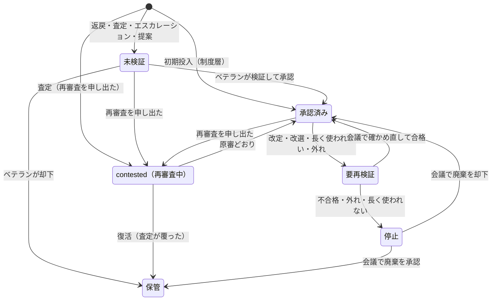
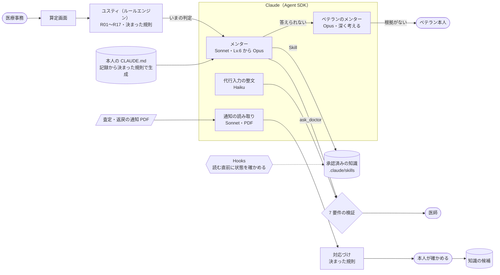

# レセメン（仮）

在宅医療のクリニックでレセプト請求を担う医療事務一人ひとりに、隣で働く同僚としての AI メンターをつけるアプリです。

- 算定の正否は、決まった規則で動くルールエンジン「ユスティ」（正義の女神ユスティティアから）が判定します。
- メンター（Claude）は答えを出さずに、理由と筋道を示します。
- 医師への確認はメンターが引き受け、わからないことはメンター同士で解きます。

Built with Claude: Japan 2026 提出作品です。この README は、デモ動画（約 3 分）と同じ順に並べています。

## 触ってみる（公開版）

**https://34-85-108-51.sslip.io**

登録は招待制です。招待コードがあれば、ログイン ID とパスワードを決めるだけで使えます。インストールは要りません。

- クリニックごとに専用の DB・知識・医師確認の記録・デモの時計を持つので、ほかのクリニックの操作とは混ざりません。招待された人は、招待したクリニックに、決められたロールで入ります。
- 同梱のデータ（症例・見本）はすべて合成データです。
- **このプロダクトはお試し用です。ご自身の責任において情報の授受をお願いします。** 入力したカルテの文・画像、相談の内容、査定・返戻の通知は、外部の AI サービス（Anthropic。音声は ElevenLabs）に送られます。査定・返戻の通知は、氏名と番号を含めて送られます。レセプト・患者マスタから作る文脈は、氏名・生年月日・保険や公費の番号・医療機関コードを外してから送りますが、カルテの自由記述と画像の中の氏名は外せません。取り込んだデータは、このサーバーに暗号化せずに保存されます。AI のサービス側に送った内容は、こちらからは消せません。はじめに注意書きへの同意を求めます。何がどこへ出るか・何を消せるかは [docs/security.md](docs/security.md) にまとめています。
- Google Cloud の VM で Docker Compose で動かし、Caddy で https にしています。パスワードは scrypt のハッシュだけを保存し、セッションは httpOnly の cookie で渡します。
- Claude の API キーは **Secret Manager** に置き、VM は起動のたびに自分のサービスアカウントの権限で読み出します。キーは git・Docker のイメージ・VM のファイルのどれにも書きません。手順は [docs/deploy-gcp.md](docs/deploy-gcp.md) です。

| 動画の流れ | README の節 |
|---|---|
| 医療事務って大変（冒頭） | [1. 課題](#1-課題医療事務って大変) |
| AI が進化しても、算定はなくならない | [2. なぜなくならないのか](#2-ai-が進化してもレセプト算定はなくならない) |
| メンター紹介 → ユスティ → ローカルルール | [3. レセメンのしくみ](#3-レセメンのしくみ) |
| 課題を 1 つずつ割る | [4. 課題ごとの解決](#4-課題ごとの解決) |
| 全体の構成図・モデルの使い分け | [5. 全体の構成と Claude の使い方](#5-全体の構成と-claude-の使い方) |
| 楽しく働いて、キャリアアップ！／COMING SOON | [6. キャリアアップとこれから](#6-キャリアアップとこれから) |

## 1. 課題：医療事務って大変

医療事務は、医師の診療を診療報酬の請求に変える仕事です。ただ、その中身は外から見えにくくなっています。

- **資格は要らないが、知識は要る**：採用の基準は経験だけで、科目が違えば算定も変わります。
- **全部ひとりで**：レセプトに加えて、電話・受付・窓口・書類・郵送まで抱えます。
- **年収 334 万円**：一般診療所の常勤事務職員の平均です（[第25回医療経済実態調査 令和6年度](https://www.mhlw.go.jp/content/10808000/001599544.pdf)）。
- **カルテの文脈が難しい**：記載が足りない、略語が多い、コピペもあります。
- **聞ける人がいない**：先輩は手一杯で、知識はベテランの頭と付箋の中にあります。
- **休めない**：毎月 10 日が締め切りです。
- **決まりは全国共通だけではない**：地域で違い、審査する人も替わります。院内にも古いローカルルールが積み重なります。
- **評価されにくく、キャリアアップの道も細い**：診療報酬請求事務能力認定試験は、2025 年 12 月の第 63 回で終わりました（[日本医療保険事務協会](https://www.iryojimu.or.jp/)）。

<details>
<summary>背景の数字（もう少し詳しく）</summary>

医療機関は、医師・看護師を人材紹介会社経由で採用するたびに、高い紹介手数料を払っています。

- 厚生労働省の集計では、令和6年度の 1 件あたり平均手数料は医師 107.8 万円、看護師 72.5 万円です（[厚生労働省](https://www.mhlw.go.jp/content/11600000/001754261.pdf)）。
- 国会では、医療・介護全体の紹介手数料が 2024 年度に 1,139 億円にのぼると指摘されました（[2026-05-15 衆議院厚生労働委員会](https://kokkai.ndl.go.jp/txt/122104260X00920260515/55)）。
- 職業安定局長は、手数料率を賃金の 20〜30% と答弁しています（[2025-06-04 衆議院厚生労働委員会](https://kokkai.ndl.go.jp/txt/121704260X02420250604/117)）。

医療事務は、辞められると困るのに、紹介料を払ってまでは採らない職種です（上記の厚労省の手数料公表対象職種に含まれていません）。医療事務に固有の離職統計もありません。

公式に測られている指標は次のとおりです（[支払基金 審査状況 令和7年度](https://www.hpdx.or.jp/tokeijoho/shinsatokei/shinsajokyo_r07.html)）。算定漏れの規模を示す公開統計はありません。

- 査定率：約 0.40%（請求 1 万点あたり 40.4 点）
- 返戻率：0.460%
- 再審査の復活率：35.6%

</details>

## 2. AI が進化しても、レセプト算定はなくならない

全国共通の決まりは、ルールエンジン（ユスティ）が片付けられます。それでも人の仕事は残ります。

- **審査基準が都道府県ごとに違う**：都道府県別の審査基準は、支払基金に約 33,000 件、国保連に約 18,000 件ありました（2021 年 3 月時点。2024 年 4 月までに統一の検討が一巡。[厚生労働省](https://www.mhlw.go.jp/content/12401000/000834623.pdf)）。
- **審査する人が 2 年ごとに替わる**：審査委員の任期は 2 年で、支払基金は奇数年の 6 月 1 日に改選されます（支払基金は 2026 年 10 月に「医療情報基盤・診療報酬審査支払機構（DX審査支払機構）」へ名称が変わりました。画面にはこの名称で出します。改組後の改選日は、公開資料では未確認です）。
- **正しかったかは、後からしかわからない**：査定・返戻の通知が届くまで、請求が通るかはわかりません。

地域のクセは、現場の知識の中にあります。レセメンは、その知識を集めて確かめ、古くなったら見直します。

## 3. レセメンのしくみ

### メンター：4 人から本人が選ぶ

メンターは、男女を含む 4 人から本人が選びます。一人に 1 セッションです。

| 名前 | 口調 |
|---|---|
| マッキー | 静かに優しい |
| ナツ | 明るくはきはき |
| ユキ | 冷静で平坦 |
| ハル | 強く引っ張る |

- 選んだメンターは、声（ElevenLabs）で名乗り、呼び方を聞きます。
- 訪問の記録やレセプトを開くと、メンターのほうから声をかけます。
- 算定の画面では、答えは言わず、見る場所と理由を言います。

### ユスティ：決まった規則で正否を出す

ユスティは R01〜R17 の規則で動く、決定的なルールエンジンです（`src/engine/`）。点数とルールは改定の版に属し、診療年月から版を 1 つに決めます。

1. レセプトの行と事実（要介護度・別表第七・別表第八の二など）を受け取る
2. R01〜R17 のそれぞれが、当てはまるかを見てから確かめる
3. 判定に要る事実や施設の設定がわからなければ、推測せずに「情報不足」を返す
4. 指摘があっても、合計点数は変えない
5. 同じ入力なら、毎回同じ答えを返す

**改定の比較**（画面「改定の比較」）：同じ訪問と患者の状態を、仮に前の版の点数表で算定した場合と並べ、区分ごとに 前の版／後の版／差 と、変わった点（採用値の表の行つき）を出します。比べるのは、カルテの記録から決まった規則で導いた算定行で、実際にその年度に請求した結果ではありません。令和6年度改定の版（最終状態の値）は、この比較と、カルテの算定プレビューで版を選ぶ試算の表示にだけ使い、請求の判定には使いません。試算の結果は保存せず、提出や件数にも数えません。

### ローカルルール：判定には混ぜず、メンターが補う

地域・ベテランの判断・院内のローカルルールは、ユスティの中には入れません。同じレセプトに別に当てはめ、算定画面の「ローカルルール」の欄に、ユスティの判定と並べて出します。承認済みのもの（院内を除く）は、メンターが Skill として読み、本人に伝えます。

例（合成データの K6）：

- ユスティの判定：BNP の判断料は区分ごとに月 1 回（R11）で、誤りはありません。
- ローカルルールの欄：「東京都・支払基金：BNP が査定された（2026-09 診療分）」が、通知に書かれた理由（条件の注記）つきで出ます。
- メンター：答えは言わず、今月のカルテと傷病名をもう一度見るよう促します。

地域の傾向は、査定の結果で当たり外れが出る知識です。判定に混ぜると、外れたときにユスティの判定まで信用できなくなるため、分けています。当てはめは AI ではなく、県・審査支払機関・区分などの宣言的な条件で行います（`src/lifecycle/match.ts`）。

### ローカルルールには、見直しが要る

知識は 4 層（制度・地域・ベテランの判断・院内）です。次のどれかが起きると「要再検証」になり、毎週のレセメン会議で責任者が判断します。

- 診療報酬の改定（偶数年 6 月）
- 審査委員の改選（奇数年 6 月）
- 180 日使われない



状態を動かすのは、決まった規則と人の判断だけです。AI は状態を決めません。査定・返戻の結果は記録するだけで、知識を直すのは毎週のレセメン会議です。

## 4. 課題ごとの解決

| 課題 | レセメンの機能 | Claude の役割 |
|---|---|---|
| 聞ける人がいない | **算定の伴走（1 件＝1 問）**：メンターのヒント → 本人が確定 → ユスティの判定 → メンターの解説。スコアは件数と連続正解だけ<br>**メンター同士**：答えられない問いはベテランのメンターへ、解けなければベテラン本人へ。解決した問いは知識の候補になる | メンター：Sonnet<br>ベテランのメンター：Opus |
| 知識が要る | **ユスティの判定**：R01〜R17 で正否を出す。メンターには判定のルールと行だけを渡す | なし（決まった規則） |
| 決まりは全国共通だけではない | **ローカルルールの集約**：査定・返戻の通知 PDF を読み、決まった規則で区分・請求先に対応づけ、本人が確かめて知識の候補にする<br>**見直し**：改定・改選・180 日で要再検証へ | 通知の読み取り：Sonnet |
| カルテの文脈が難しい | **カルテの取り込み**：電子カルテの画面を撮った画像から、病名・診療記録・処方を書いてあるまま書き写す（画像は保存しない）<br>**カルテとの照合**：UKE の傷病名と処方を突き合わせ、合っていない点を出す | 書き写し：Sonnet<br>SOAP への振り分け：Haiku |
| 全部ひとりで | **医師確認**：記載が足りないとき、選択式で中立に医師へ聞く（AHIMA/ACDIS 2026 年版の 7 要件）。点数・金額は出さず、選択肢には必ず「その他」「判定不能」を入れる<br>**代行入力**：下書きを整え、足りない項目は推定せずに聞く。必ず医師の確認・承認を挟む | 整文：Haiku |
| 休めない（締め切り） | **UKE の取り込みと月末の点検**：締め切り前に、まとめて一度に見直す | なし（決まった規則） |
| 評価されない・キャリアアップもない | **レベル**と、提出前に防いだ指摘の記録（防いだ額は推定。本人向けは既定で非表示、事務長向けは集計だけ） | なし |

## 5. 全体の構成と Claude の使い方

判定はユスティ、判断は人が持ち、Claude は「読む・話す・整える」を受け持ちます。役割ごとにモデルと考える深さを変えています（`config/models.json`）。



| 役割 | モデル | していること |
|---|---|---|
| 新人の隣のメンター | Sonnet（考える深さ：低。確定後の解説は中）。Lv.6 からは Opus | レセプトを開くと先に声をかけ、確定すると解説を始める。速さを優先 |
| ベテランのメンター | Opus（考える深さ：高） | 新人のメンターが答えられない問いに、承認済みの知識を根拠に答える。根拠がなければベテラン本人に回す |
| 代行入力の整文 | Haiku | 下書きを整える。足りない項目は推定せずに聞く |
| 査定・返戻の通知の読み取り | Sonnet | PDF から書かれていることを取り出す。区分・請求・審査支払機関への対応づけは決まった規則で行う |
| 電子カルテの画像の書き写し | Sonnet | 画面の小さい日本語を読み、病名・診療記録・処方を書いてあるまま書き写す |
| 訪問カルテからの事実の取り出し | Sonnet | 算定に要る事実を取り出す。取り出した事実は本人が確かめる |
| SOAP への振り分け | Haiku | 自由に書いたカルテを SOAP の欄に並べ替える |
| 名前の読み | Haiku | 声で答えた名前に漢字が混じっていたら、ひらがなの読みに直す |

- **知識は Skill として読む**：承認済みの知識だけを `.claude/skills/` に同期し、メンターは Skill のツールで必要なものだけを読みます。読む直前に Hooks で知識の状態を確かめ、承認済みでなければ読ませません。読んだ知識は Hooks で記録し、引用されたもののうち実際に読んだものだけを「使われた」と数えます。
- **医師に聞く前に決まりを読む**：医師確認を作る直前に Hooks で、このレセプトに当てはまる決まり（ユスティが当てはめたルールと、カルテとの照合の規則）のどれかを読んだかを確かめます。当てはまる決まりがない話題は、ベテランのメンターに回します。カルテとの照合で見つかった不一致（例：DOAC と「心房細動」だけの病名）があるときは、メンターは質問を書きません。どれのことかを本人が画面で選び、聞く軸の決まった質問で送ります（話題の見分けを AI にさせない）。
- **一人ひとりの CLAUDE.md**：医療事務ごとに作業場所を作り、レベルや直近で確認が入ったルールを書いた CLAUDE.md を、記録から決まった規則で書き換えます（AI には書かせません）。作業場所は、上の階層に CLAUDE.md がない場所に置きます（既定は OS の一時フォルダ。`RESEMEN_WORKSPACES` で変えられます）。
- **答えを言わない仕組み**：確定する前のメンターには、判定のうちルールと行だけを渡し、指摘の中身と点数は渡しません。返事が答え（足すべき項目の名前・指摘の種類・点数）に触れていたら、決まった規則で見つけて一度だけ書き直させます。
- **所要時間の記録**：呼び出しごとにモデル・所要時間・トークン数をサーバーのログに残します（プロンプトと本文は残しません）。

## 6. キャリアアップとこれから

レセメンの主語は、医療事務本人です。解くほどレベル（Lv.1〜10）が上がり、Lv.6 からはメンターが Opus で深く考えるようになります。ひとりで抱えずに算定ができ、楽しく働いてキャリアアップを目指せる職場を目指します。

### COMING SOON

- **経営機能モード**：全体の数字の動きがわかる
- **事務作業補助モード**：患者さんへの請求書の発行や、メール対応などを補助する
- **責任者算定試験モード**：「次は、あなたが責任者に。」

### ほかに考えていること

- **やる気のある人向けの経営分析**：既定の表示は余白を大事にし、金額は出しません。もっと深く見たい人は、オプトインで次のような分析に進めるようにしたいと考えています。
  - 防いだ額の推移
  - 医師記載起因の傾向（事務長から医師へのフィードバック）
  - 査定・返戻の区分別の傾向
  - 知識の育ち方

  いずれも「正しく取る・取りこぼさない」ための分析で、取れない算定を取りにいかせる方向には使いません。
- **知識のつながりを図で見る（知識グラフ）**：知識はすでに「どの知識から生まれたか」でつながっています。知識が増えたら、改定の影響がどこまで届くかや、関連する知識をまとめて見られるようにします。新しいつながりを AI が提案しても、確定するのは責任者です。
- **改定情報を拾って知らせる**：厚労省の改定情報を Web 検索で拾い、見直しが必要かもしれない知識を責任者に知らせます。拾った情報は知らせるまでにとどめ、数字は採用値だけを使います。
- 医療事務以外の医療従事者への展開

## 守っていること

- 点数は **令和8年度改定後（診療年月 2026年10月）** のもの。医科点数表は令和8年6月1日適用。外来・在宅ベースアップ評価料と物価対応料は 2027年6月診療分から値が変わるので、改定の版を 2 つ持ち、診療年月で使い分ける。版のない診療年月は判定しない。令和6年度改定の版は、改定の比較と試算の表示にだけ使う（値は採用値の表 EM §2-9）
- レセ電コードは **実在の診療行為コード**（採用値の表にある行だけ。EM §2-8）。コードは改定の版ごとに持ち、マスター本体は同梱しない
- 医療事務（請求・記載）の支援であり、**診断・治療に関与しない**
- **代行入力は医師の確認・承認を前提とする**（医政発第1228001号）
- **数字は EM（evidence-master）の採用値のみ**を使う（`design/iji-context/sources/evidence-master-iji-context.md`）
- 同梱するデータは合成データだけ。利用者が入れるデータは実在のものも受け取るが、注意書きへの同意を先に取り、AI に送る文脈から患者の識別子を外す（[docs/security.md](docs/security.md)）。AI は病名・施行事実を作り足さない
- 知識の状態（承認・降格など）は決まった規則だけで動き、AI（LLM）には決めさせない
- 公的情報（疑義解釈・審査の取扱いなど）は **要旨とリンク** で持ち、原文は転載しない（`official/`。置けるのは EM の「採用した公的文書」の表にある文書だけ）。ローカルルールとの突き合わせは決まった規則で行い、決められない組み合わせは「関連あり・未照合」と出す。矛盾の恐れがあっても自動では止めず、レセメン会議で人が決める

## 手元で動かす（開発者向け）

公開版を使えば、手元で動かす必要はありません。コードから動かしたいときだけ、次を開いてください。

<details>
<summary>手元で動かす手順</summary>

必ず要るのは、次の 3 つだけです。DB の表は起動時に作られ、承認済みの知識の Skill への同期も自動です。

```bash
npm install
```

`.env.local` に `ANTHROPIC_API_KEY` を置きます（キーはコードに書きません）。メンターの声を使うときだけ、`ELEVENLABS_API_KEY` も置きます（見本は `env.local.example`）。

```bash
RESEMEN_OPEN_SIGNUP=1 npm run dev
```

登録は招待制です。`RESEMEN_OPEN_SIGNUP=1` を付けて起動したときだけ、ログイン画面の「はじめて使う」から招待なしで登録できます（登録した人は、自分だけのクリニックの持ち主になります）。2 人目からは、「設定」で招待コードを出して渡します。最初の 1 人を作ったあとは、この設定を外して起動し直します。

ここから下は、作り直すときだけ使います。作り済みのものはリポジトリに入っています。

デモの状態に戻すときは次を実行し、開発サーバーを起動し直します。デモの時計は 2026-10-13 から始まります。

```bash
npx tsx scripts/reset-demo.ts --yes
```

制度層の知識（R01〜R17）は `knowledge/` に入っています。作り直すときは次を実行します。

```bash
npx tsx scripts/seed-knowledge.ts
```

合成の査定通知（K6・2026年9月診療分の BNP。点数欄なし）は次で作り直せます（PDF 化に手元の Google Chrome を使います）。

```bash
npx tsx scripts/gen-notice.ts
```

合成 UKE（国保連あて K1〜K5 と K7、支払基金あて K6）は次で作り直せます。K7 は、在医総管の注16 の基準を満たさない施設の症例です。見本の 2 本とは別に、アップロードで試すための合成の UKE も 4 本できます（`fixtures/uke/taishogai.UKE`：対応していないコードの行を含むもの、`fixtures/uke/kisaimore.UKE`：摘要欄の必須の記載を 1 つ欠いたもの、`fixtures/uke/kaiteimae.UKE`：改定前の診療年月のもの、`fixtures/uke/jitsurei.UKE`：実在の請求と同じ形のもの＝外来 3 件と在宅 1 件で、医薬品・特定器材・症状詳記・資格確認・受診日等のレコードを含む。どれも患者は合成）。

```bash
npx tsx scripts/gen-uke.ts
```

UKE の取り込み画面では、見本の UKE をダウンロードして、そのままアップロードできます。見本と違う内容の UKE も受け取ります。対応していないコードの行（診療年月の版の表にない診療行為コード、医薬品・特定器材）があっても断らず、その行を含む算定の単位をまるごと「点検の対象外」として残します。形式が違う、対応しているコードの点数が点数表と合わない、合計が合わないファイルは、行番号つきで断ります。

読めるレコードは、記録条件仕様（医科用）令和8年8月版の、医科の請求ファイルに現れる 18 種です（医療機関情報 IR、レセプト共通 RE、保険者 HO、公費 KO、資格確認 SN、受診日等 JD、窓口負担額 MF、包括評価対象外理由 GR、傷病名 SY、診療行為 SI、医薬品 IY、特定器材 TO、コメント CO、症状詳記 SJ、臓器提供者のレセプト情報 TI・TR・TS、診療報酬請求書 GO）。回数と 1 日の回数は仕様どおり 3 桁まで受け取るので、投薬の「処方した日に 14 日分・28 日分」の行も読めます。資格確認・受診日等・窓口負担額・症状詳記は読んで持つだけで、まだ点検には使っていません。未対応のものは、ファイルを断らずに、そのレセプトだけを「いまは点検できない」と出します：入院のレセプト、臓器提供者のレセプト情報を含むレセプト、上にないレコード（DPC のレコードなど）を含むレセプト。詳しくは [docs/connectors.md](docs/connectors.md)。

診療年月に当たる版がないレセプト（改定前の診療年月など）も断りません。一覧に「この診療年月の版はありません（試算できます）」と出し、月末の点検と提出には並べません。開くと、版を選んで試算できます：選んだ版の点数表とルールで読み、UKE に書いてある点数とその版の点数の違い（たとえば訪問診療料 888／890）を並べます。画面の上に「実際の請求の判定ではありません」と出し、結果は保存しません。版のあるレセプトも、版を替えれば同じように試算できます。選べるのは診療行為コードの表を持つ版だけで、令和6年度の版（比較用）は選べません。

取り込んだレセプトは、取り込み画面の一覧から 1 件ずつ開いて、UKE に書いてあるとおりのまま点検した結果を見られます（行もコメントも入れ替えません。摘要欄の必須の記載のうち 8 項目の記載もれも、ここで出ます）。合計は 2 つ出します：UKE に書いてある請求の合計と、点検した行の小計です。対象外の行があるレセプトでは「対象外の行が n 行あります」と必ず出し、小計を請求の合計として見せません。そのレセプトで出す指摘は、いまある行と確かめた事実だけから言えるもの（管理料と含まれる項目の併算定、看取り加算と死亡診断加算の併算定、在宅療養指導管理料が 2 つ、在宅医療DX情報活用加算の併算定、特定疾患処方管理加算の主病、必ず要る摘要欄の記載と形式）に絞り、ほかの行の有無や回数で決まる点（管理料の区分、同じ日・翌日の往診と訪問診療、週の回数、判断料の月 1 回、摘要欄の日付の突き合わせなど）は「決められません」と出します。取り込んだレセプトにはアプリが請求の番号（U1-1 の形）を振り、UKE のカルテ番号は患者の番号として表示にだけ使います。断るのは同じファイルの取り込み直しだけで、取り込んだファイルは事務長・ベテランが画面から消せます。そのレセプトはカルテ側の記録がないまま月末の点検に並び、足りない事実は「情報不足」として出ます（訪問カルテ・選択モード・練習問題の対象外。詳しくは `docs/connectors.md`）。

全部の行の点検に向けて、公開されているデータ（厚生労働省の基本マスター、審査支払機関の電子点数表・コメント関連テーブル・チェックマスタ）を手元に落として読み込めます。データは同梱していません（再配布の可否が明記されていないため）。`npm run masters:fetch` で落とすものの一覧を確かめ、`npm run masters:fetch -- --yes` で落とし、`npm run masters:build` で取り込みます。取り込みのときに、形式と、原文で確かめた事実（錨）、アプリが持つ版の点数・コードとの食い違いを確かめ、1 つでも外れたら取り込みません。入っているデータは、事務長の「設定」の画面で見られます。手順と利用条件は [docs/masters.md](docs/masters.md)。

マスターを入れると、取り込んだレセプトの点検で次が見えるようになります。(1) 全部の行（点検の対象外の行・医薬品・特定器材も）に名称と区分番号が付き、コメントコードと傷病名コードにも名称が付きます。(2) コードの点検（G01）が動きます：持っているどの版のマスターにもないコード、診療年月の前後どちらかの版にしかないコードを「条件つき」で出します（言い切りません。打ち間違いか、マスターの更新もれかを確かめるためのものです）。(3) 対象外の行があっても、関係のないルールは止まらなくなります。マスターがないときは、対象外の行が 1 行でもあれば、ほかの行の有無や回数で決まる点をどれも「決められません」としていました。マスターがあると、対象外の行の区分番号を見て、同じ区分番号の行を読むルールだけを止めます（例：尿検査の判断料が対象外にあっても、「訪問診療料のない月の管理料」は指摘します）。点検の画面には、動いた点検・動かなかった点検と理由を必ず出します。(4) 包括・背反・算定回数の点検（G04〜G06）が動きます：電子点数表に載っている組（含まれる行為・併せて算定できない行為）と上限回数を、レセプトの単位・算定日・回数と突き合わせ、「条件つき」で出します。手書きのルールが同じ組を指摘しているときは、2 回言いません。(5) 点数の検算（G02）と行の属性（G03）が動きます：算定の単位ごとに 1 回分の点数をマスターから計算し直して、UKE の点数と合わないものを出し、入院専用のコード・年齢の範囲の外・病院に限るコードを出します（どれも「条件つき」）。％加算のある単位・購入価格の器材・項目数の表を持っていない包括の検査などは検算せず、その数と理由を出します。注加算の付け先・実日数・診療識別・後期高齢者医療の区分は点検していません。(6) 必須コメント（G07）と傷病名の要件（G08）が動きます：コメント関連テーブルで「算定すれば必ず要る」とされている記載のコメントコードが、レセプトのどこにもない行為を出します（あるか・ないかだけで、中身は見ません。条件によって要る記載は点検しません）。対象の傷病名が要る行為（特定疾患療養管理料・特定疾患処方管理加算・てんかん指導料・皮膚科特定疾患指導管理料）に、傷病名マスターで対象とされている傷病名コードが 1 つもないレセプトを出します（未コード化の傷病名があるレセプトでは言いません。難病外来指導管理料は点検していません）。どちらも「条件つき」で、手書きのルール（R17・R06）が同じことを言っているときは 2 回言いません。(7) 適応・併用（G09）が動きます：審査支払機関が公開しているチェックマスタ（コンピュータチェックの対象の表）で、院内で使った薬と、検査・処置などの診療行為について、表にある傷病名コードがレセプトの傷病名に 1 つもないものと、併用のチェックの対象の組が同じ日に両方あるものを出します。全部「条件つき」で、言い切りには上げません。公開元が、コンピュータチェックは診療内容の適否を一律に決めるものではなく、症例ごとに審査委員会が判断すると断っているためで、指摘が出ても、査定されると決まったわけではありません。画面では、ほかの点検と分けた見出しの下に、折りたたんで出します。表に載っていない薬・診療行為には何も言わず（「問題なし」とも言いません）、表にある数を点検の範囲に出します。院外処方の薬は、医科のレセプトに載らないので見られません。未コード化の傷病名があるレセプトでは、適応は言いません。量と日数（最大投与量・最長投与日数）と傷病名との禁忌は点検していません（表の値の単位と数え方が、公開元の仕様書から確かめられないため）。表に性別・年齢の条件つきの行がある薬・診療行為は、条件を読み分けられないので、適応を見ません（その数を点検の範囲に出します）。G01〜G09 が全部入りました。マスターがなければ、今までどおりコードだけを出し、手書きのルール（R01〜R17）だけで点検します。

</details>

## 構成とテスト

- TypeScript のみ。Next.js（App Router・API Route）、Claude Agent SDK（メンター 1 人 1 セッション）、SQLite（better-sqlite3・Drizzle）
- `src/engine/`：ユスティ（ルールエンジン。R01〜R17、決定的）。`src/engine/revisions/` に改定の版（点数表・定数・ルール一式）を置く。次の改定で版を足す手順は [docs/revision-howto.md](docs/revision-howto.md)
- `src/lifecycle/`：知識の状態遷移・当てはめ・見直し・レセメン会議
- `src/masters/`：公開データの取り込み（形式の検査・錨・件数・版の表との突き合わせ）と、`masters.db` の読み取り。手順は [docs/masters.md](docs/masters.md)
- `src/generic/`：データで動く点検（`evaluateGeneric`。いまは G01 コード・G02 点数の検算・G03 行の属性・G04 包括・G05 背反・G06 算定回数・G07 必須コメント・G08 傷病名の要件・G09 適応と併用）、手書きのルールとの重なりの規則（`overlap.ts`）、行の名称・区分番号の引き方。数を見るのは `scripts/measure-generic.ts`
- `src/uke/`：UKE の読み書き（記録条件仕様 令和8年8月版。読むのは医科のレコード 18 種、書くのは主要列。点数・回数の算定単位で読む）とカルテとの照合
- `src/query/`：医師確認（7 要件の検証・記録・承認・リマインド）
- `src/mentor/`：メンター・ベテランのメンター・代行入力の整文・作業場所（CLAUDE.md と Skill の Hooks）・役割ごとのモデル
- `src/chart/`：カルテ（画像からの書き写し・SOAP への振り分け・事実の取り出し）
- `src/notice/`：査定・返戻の通知（PDF）の読み取りと対応づけ
- `src/voice/`：メンターの声（ElevenLabs）
- `src/practice/`・`src/prevented/`：1 件＝1 問の流れ、レベル、防いだ額
- `eval/`：prompt-eval（本番と同じ関数・モデルで 10 件を回し、決まった規則で判定する。開発サーバーの `/api/eval` から実行）
- `video/opening/`・`video/demo/`：デモ動画（冒頭と本編）。HTML の舞台を 1 コマずつ描いて書き出す（`npx tsx video/demo/render.ts f3 --full`）

```bash
npx vitest run
```

```bash
npx tsc --noEmit
```

## 資料

- 仕様：`design/iji-context/spec.md`
- 設計（ユスティと知識ライフサイクル）：`design/iji-context/design.md`
- 反論台帳と反証の記録：`design/iji-context/ledger.md`、`design/iji-context/reviews/`
- 採用値と出典：`design/iji-context/sources/evidence-master-iji-context.md`
