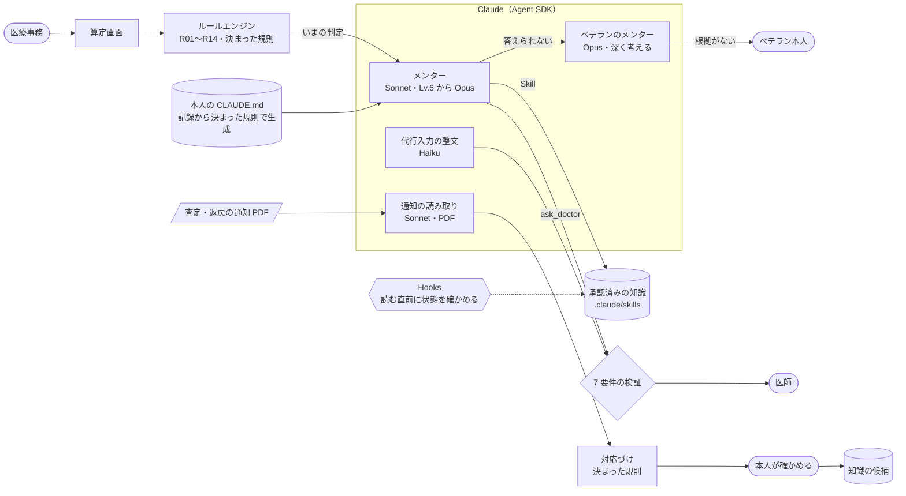
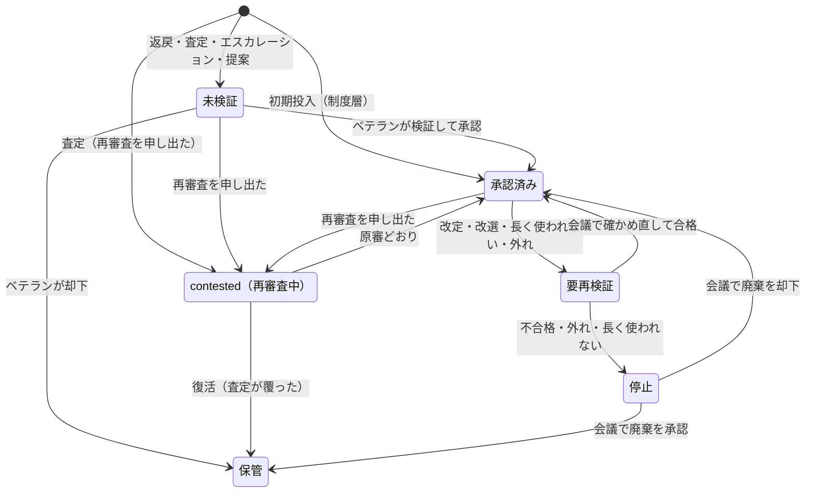

# レセメン（仮）

在宅医療のクリニックでレセプト請求を担う医療事務一人ひとりに、隣で働く同僚としての AI メンターをつけるアプリです。算定の正否は決まった規則（ルールエンジン）が判定し、メンター（Claude）は答えを出さずに理由と筋道を示します。医師への確認はメンターが引き受け、わからないことはメンター同士で解きます。

Built with Claude: Japan 2026 提出作品。

## 背景

医療機関は、医師・看護師を人材紹介会社経由で採用するたびに高い紹介手数料を払っています。厚生労働省の集計では、令和6年度の 1 件あたり平均手数料は医師 107.8 万円、看護師 72.5 万円です（[厚生労働省](https://www.mhlw.go.jp/content/11600000/001754261.pdf)）。国会では、医療・介護全体の紹介手数料が 2024 年度に 1,139 億円にのぼると指摘されました（[2026-05-15 衆議院厚生労働委員会](https://kokkai.ndl.go.jp/txt/122104260X00920260515/55)）。職業安定局長は手数料率を賃金の 20〜30% と答弁しています（[2025-06-04 衆議院厚生労働委員会](https://kokkai.ndl.go.jp/txt/121704260X02420250604/117)）。保険料と税で賄われる医療費の一部が、採用と離職の繰り返しに流れています。

医療事務は、辞められると困るのに、紹介料を払ってまでは採らない職種です（上記の厚労省の手数料公表対象職種に含まれていません）。経営を支える請求の仕事なのに声が届きにくく、医療事務に固有の離職統計もありません。レセメンは、医療事務が一人で抱え込まず、働くことが楽しくなる同僚を隣に置くことから始めます。

公式に測られている指標は、査定率 約 0.40%（請求 1 万点あたり 40.4 点）、返戻率 0.460%、再審査の復活率 35.6% です（[支払基金 審査状況 令和7年度](https://www.hpdx.or.jp/tokeijoho/shinsatokei/shinsajokyo_r07.html)）。算定漏れの規模を示す公開統計はありません。

## 何をするか

| 機能 | 内容 |
|---|---|
| 算定の伴走（1 件＝1 問） | メンターのヒント → 本人が確定 → ルールエンジンの判定 → メンターの解説。スコアは件数と連続正解だけ |
| 医師確認 | カルテの記載が足りないとき、選択式で中立に医師へ聞く（AHIMA/ACDIS 2026 年版の 7 要件）。医師の回答と承認で傷病名が確定する |
| カルテとの照合 | UKE の傷病名と処方を突き合わせ、合っていない点を確認してほしい点として出す |
| 代行入力 | 下書きを整え、足りない項目は推定せずに聞く。必ず医師の確認・承認を挟む |
| メンター同士 | 新人のメンターが答えられない問いはベテランのメンターへ、解けなければベテラン本人へ。解決した問いは知識の候補になる |
| 知識の賞味期限 | 知識は 4 層（制度・地域・ベテランの判断・院内）。改定・改選・長く使われていないことで見直しになり、査定・返戻は毎週のレセメン会議で責任者が判断する |
| 防いだ額 | 提出前に指摘して本人が直したものだけを数える（推定）。本人向けは既定で非表示、事務長向けは集計だけ |

## 守っていること

- 点数は **2024年度改定後（2025年4月のDX加算改定前）** のもの。合成レセプトの診療年月は 2025 年 3 月
- レセ電コードはすべて **架空コード**。実在のマスターとは無関係
- 医療事務（請求・記載）の支援であり、**診断・治療に関与しない**
- **代行入力は医師の確認・承認を前提とする**（医政発第1228001号）
- **数字は EM（evidence-master）の採用値のみ**を使う（`design/iji-context/sources/evidence-master-iji-context.md`）
- データは合成データだけ。実在の患者データ・個人情報は使わない。AI は病名・施行事実を作り足さない
- 知識の状態（承認・降格など）は決まった規則だけで動き、AI（LLM）には決めさせない

## 動かし方

```bash
npm install
```

`.env.local` に `ANTHROPIC_API_KEY` を置いてから起動します（キーはコードに書きません）。

```bash
npm run dev
```

制度層の知識（R01〜R14）は `knowledge/` に入っています。作り直すときは次を実行します。

```bash
npx tsx scripts/seed-knowledge.ts
```

合成の査定通知（K6・2 月分の BNP。点数欄なし）は次で作り直せます（PDF 化に手元の Google Chrome を使います）。

```bash
npx tsx scripts/gen-notice.ts
```

合成 UKE（国保連あて K1〜K5、支払基金あて K6）は次で作り直せます。

```bash
npx tsx scripts/gen-uke.ts
```

## Claude の使い方

判定はルールエンジン、判断は人が持ち、Claude は「読む・話す・整える」を受け持ちます。役割ごとにモデルと考える深さを変えています（`config/models.json`）。



| 役割 | モデル | していること |
|---|---|---|
| 新人の隣のメンター | Sonnet（考える深さ：低）。Lv.6 からは Opus | レセプトを開くと先に声をかけ、確定すると解説を始める。速さを優先 |
| ベテランのメンター | Opus（考える深さ：高） | 新人のメンターが答えられない問いに、承認済みの知識を根拠に答える。根拠がなければベテラン本人に回す |
| 代行入力の整文 | Haiku | 下書きを整える。足りない項目は推定せずに聞く |
| 査定・返戻の通知の読み取り | Sonnet | PDF から書かれていることを取り出す。区分・請求・審査支払機関への対応づけは決まった規則で行う |

- **知識は Skill として読む**：承認済みの知識だけを `.claude/skills/` に同期し、メンターは Skill のツールで必要なものだけを読みます。読む直前に Hooks で知識の状態を確かめ、承認済みでなければ読ませません。読んだ知識は Hooks で記録し、引用されたもののうち実際に読んだものだけを「使われた」と数えます。
- **医師に聞く前に決まりを読む**：医師確認を作る直前に Hooks で、このレセプトに当てはまる決まり（エンジンが当てはめたルールと、カルテとの照合の規則）のどれかを読んだかを確かめます。当てはまる決まりがない話題は、ベテランのメンターに回します。カルテとの照合で見つかった不一致（例：DOAC と「心房細動」だけの病名）があるときは、メンターは質問を書かず、どれのことかを本人が画面で選び、聞く軸の決まった質問で送ります（話題の見分けを AI にさせない）。
- **一人ひとりの CLAUDE.md**：医療事務ごとに作業場所を作り、レベルや直近で確認が入ったルールを書いた CLAUDE.md を、記録から決まった規則で書き換えます（AI には書かせません）。作業場所は、上の階層に CLAUDE.md がない場所に置きます（既定は OS の一時フォルダ。`RESEMEN_WORKSPACES` で変えられます）。
- **答えを言わない仕組み**：確定する前のメンターには、判定のうちルールと行だけを渡し、指摘の中身と点数は渡しません。返事が答え（足すべき項目の名前・指摘の種類・点数）に触れていたら、決まった規則で見つけて一度だけ書き直させます。
- **所要時間の記録**：呼び出しごとにモデル・所要時間・トークン数をサーバーのログに残します（プロンプトと本文は残しません）。

### 知識が育って廃れる流れ



状態を動かすのは決まった規則と人の判断だけで、AI は状態を決めません。査定・返戻の結果は記録するだけで、知識を直すのは毎週のレセメン会議です。

## 構成とテスト

- TypeScript のみ。Next.js（App Router・API Route）、Claude Agent SDK（メンター 1 人 1 セッション）、SQLite（better-sqlite3・Drizzle）
- `src/engine/`：ルールエンジン（R01〜R14、決定的）
- `src/lifecycle/`：知識の状態遷移・見直し・レセメン会議
- `src/uke/`：合成 UKE の読み書き（記録条件仕様 令和6年6月版の主要列）とカルテとの照合
- `src/query/`：医師確認（7 要件の検証・記録・承認・リマインド）
- `src/mentor/`：メンター・ベテランのメンター・代行入力の整文・作業場所（CLAUDE.md と Skill の Hooks）・役割ごとのモデル
- `src/notice/`：査定・返戻の通知（PDF）の読み取りと対応づけ
- `eval/`：prompt-eval（本番と同じ関数・モデルで 10 件を回し、決まった規則で判定する。開発サーバーの `/api/eval` から実行）
- `src/practice/`・`src/prevented/`：1 件＝1 問の流れ、レベル、防いだ額

```bash
npx vitest run
```

```bash
npx tsc --noEmit
```

## これから

- **やる気のある人向けの経営分析**：既定の表示は余白を大事にし、金額は出しません。一方で、もっと深く見たい人はオプトインで分析に進めるようにしたいと考えています。たとえば次のような分析です。
  - 防いだ額の推移
  - 医師記載起因の傾向（事務長から医師へのフィードバック）
  - 査定・返戻の区分別の傾向
  - 知識の育ち方

  いずれも「正しく取る・取りこぼさない」ための分析で、取れない算定を取りにいかせる方向には使いません。
- **知識のつながりを図で見る（知識グラフ）**：知識はすでに「どの知識から生まれたか」でつながっています。知識が増えたら、改定の影響がどこまで届くかや、関連する知識をまとめて見られるようにします。新しいつながりを AI が提案しても、確定するのは責任者です
- **改定情報を拾って知らせる**：厚労省の改定情報を Web 検索で拾い、見直しが必要かもしれない知識を責任者に知らせます。拾った情報は知らせるまでにとどめ、数字は採用値だけを使います
- 医療事務以外の医療従事者への展開

## 資料

- 仕様：`design/iji-context/spec.md`
- 設計（ルールエンジンと知識ライフサイクル）：`design/iji-context/design.md`
- 反論台帳と反証の記録：`design/iji-context/ledger.md`、`design/iji-context/reviews/`
- 採用値と出典：`design/iji-context/sources/evidence-master-iji-context.md`
