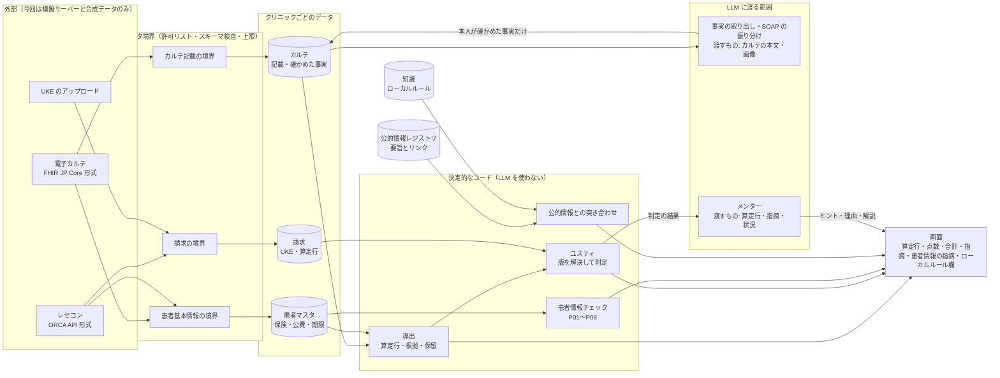
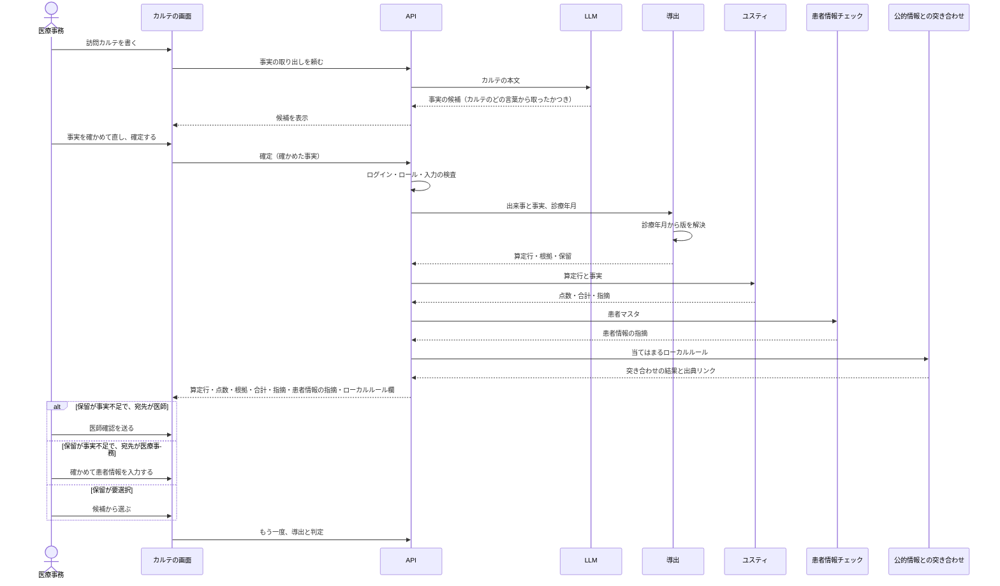
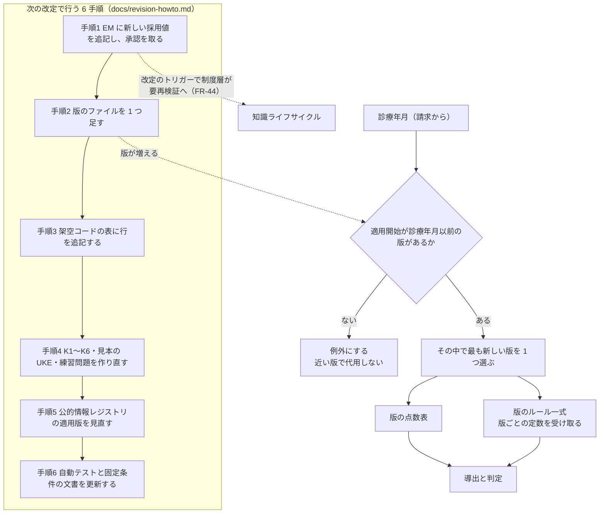

# iji-context 仕様書 追記案（v22 向け）— カルテ→算定／連携／患者情報チェック／令和8年度移行／公的情報との整合／品質・セキュリティ

状態: **案（未承認）**。承認されるまで spec.md・CLAUDE.md・evidence-master・コードは変更しない。
起草日: 2026-11-17
追記の内容の正: 承認済みの改修計画（snazzy-jingling-wave）。本書はその計画を spec.md の形式（FR・Mermaid・完了条件）に落としたもの。
番号: spec.md の最後の FR は FR-86。本書の新規 FR は **FR-87〜FR-146**。
数字: 点数・金額・施行日・記録条件仕様の版は本書に書かない。すべて evidence-master（EM）の採用値による。EM への追記（令和8年度の採用値・採用した公的文書・患者情報チェックの根拠）は別の承認事項。
括弧内の「計画n」は改修計画の「何を作るか」の節番号。

---

## 1. 変更の要約

### 何を作るか

| 領域 | 内容 |
|---|---|
| 改定の版 | 診療年月から改定の版を解決する仕組み。版 1 つ＝ファイル 1 つ。診療年月を 2026年10月・令和8年度改定後に移す |
| カルテ→算定 | 確かめた事実と出来事から、算定行をコードで導出する層。根拠と保留を添えて、カルテの画面に算定行・点数・合計・指摘を出す |
| 連携 | 患者基本情報／請求／カルテ記載の 3 つの境界。UKE のアップロード、ORCA API 形式・FHIR JP Core 形式の読み取りコネクタ（模擬サーバー相手） |
| 患者情報チェック | 保険・公費・期限などの指摘 P01〜P08。ユスティとは別欄で、宛先は医療事務。患者マスタを新設する |
| 公的情報レジストリ | 疑義解釈・審査情報提供事例等を 1 文書 1 件で持ち、ローカルルールと決まった規則で突き合わせて表示する。矛盾の恐れがある承認済みローカルルールは要再検証にしてレセメン会議に出す |
| 品質・セキュリティ | ロールと権限表、医師の回答・承認の本人記録、全 API の入力検証、招待制登録、Origin 検証、回数制限、監査ログ、マイグレーション、CI、CSP |

### 何を捨てるか

- 診療年月 2025年3月・2024年度改定後の固定と、その点数表（版の併存はしない）
- 点数表の並び順から架空コードを作る方式
- 「UKE はデモ用の 2 本を選ぶだけ」「登録は誰でもできる」「承認者名を画面から受け取る」「クリニック内の本人は固定の 1 人」
- 患者を保険者番号と被保険者番号で見分ける方式
- 公開版にいま入っているデータ（作り直しになる。破棄は実行前に別途承認を取る）

### どこが危ないか

1. **令和8年度で区分体系が変わっていた場合**、K1〜K6 の合計・練習問題・R01〜R14 が連鎖で変わる。調査結果を EM 追記案として確定するまで、移行の規模が決まらない。
2. **アップロードと外部接続は、いままで無かった入口**。請求 id をファイルパスに使っている箇所、日別回数に上限がない箇所を直してから開ける。順序を逆にすると任意ファイルの読み取りになる。
3. **導出と検証が食い違うと、画面の算定行とユスティの指摘が矛盾する**。判定の述語を 1 か所に置き、両方から使う。
4. **ロールの導入は「1 人 1 クリニック」（FR-73）と衝突する**。クリニックに複数の利用者が入る形に変わる（§8 の 8）。
5. **公的情報による要再検証は、FR-66 の「変えない」とした対応表に列を足す変更**。F5 の設計（design.md v21）の原則に触れるため /design-loop を通す。
6. **49 ルートの載せ替えは範囲が広い**。権限表に載っていないルートをテストで落とす形にして、漏れを機械で止める。

---

## 2. 固定条件の改訂案（CLAUDE.md）

CLAUDE.md は本書の承認後、実装の最終段（計画 P7）で書き換える。ここでは書き換え案だけを示す。

### 正とする文書

| 旧 | 新 |
|---|---|
| 仕様の正は design/iji-context/spec-input-iji-context.md（11/3 チャットUIの決定を正とした改訂版） | 仕様の正は design/iji-context/spec.md。spec-input-iji-context.md は 2026-11-04 時点の決定の記録として残し、食い違う場合は spec.md を採る |
| 別チャット（11/4午前）の D24・D26 は無効 | 変更なし |

### 唯一の採用値

| 旧 | 新 |
|---|---|
| 数字・制度・点数は EM の採用値のみ | 変更なし。対象に「改定の施行日」「記録条件仕様の版」「採用した公的文書（疑義解釈・審査情報提供事例等）」「患者情報チェックの根拠」を加える |
| 設計パラメータ（N=180日、営業日数、K3の訪問回数など）は対象外 | 変更なし。アップロードの上限、回数制限の値、接続のタイムアウトも設計パラメータに含める |

### 固定条件

| 旧 | 新 |
|---|---|
| 合成レセプトの診療年月は 2025年3月、点数は 2024年度改定後 | 合成レセプトの診療年月は 2026年10月、点数は令和8年度改定後。点数・施行日は EM の採用値による。診療年月は config/demo.json の 1 か所で持ち、コードに直書きしない |
| （なし） | 改定の版は診療年月で決まる。該当する版がない診療年月は判定しない。同梱する版は令和8年度改定後の 1 つで、2024年度版は持たない |
| 医療機関は在宅療養支援診療所（機能強化型以外・病床なし・東京都） | 変更なし |
| 症例は K1〜K6（EM 5-1）。追加するときは同表に行を足してから | 変更なし（EM 5-1 自体を令和8年度の採用値で書き直す） |
| レセ電コードは架空。README に「架空コード」と明記する | 変更なし。加えて、架空コードは区分→コードの追記専用の表で持つ。実在コードのマスターには対応しない |
| 個人情報・実在の患者データは使わない。合成データのみ | 変更なし。加えて、アップロードと連携で受け入れるのは架空コードだけで作られた合成データに限る。実機の電子カルテ・レセコンには接続しない |
| メンターは 4 キャラから本人が選ぶ。一人一セッション | 変更なし |
| 知識の検証は状態ラベルで表す。可視性にゲートを置かない | 変更なし。ロールを導入しても、知識の閲覧はどのロールにも開く |
| 実装は TypeScript 固定（Agent SDK + Next.js API Route + SQLite/Drizzle）。Python は使わない | 変更なし。スキーマの変更は連番のマイグレーションで行う |
| 使用禁止の 4 語（CLAUDE.md の現行の列挙どおり） | 変更なし。CI の禁止語検査で確かめる |
| 現場例はインタビューと EM の具体例に限定し、創作しない | 変更なし |
| （なし） | 患者情報の指摘（P 系）はユスティ（R 系）と別系統にする。宛先は医療事務 |
| （なし） | 公的情報は要旨とリンクで持ち、原文を転載しない。ローカルルールとの突き合わせは決まった規則で行い、LLM に判定させない |

### 医師確認

| 旧 | 新 |
|---|---|
| 7 要件を UI 要件とする。点数・金額への言及は禁止。「その他」「判定不能」を含める | 変更なし。加えて、回答と承認はログインした医師ロールの本人として記録する |

### 開発プロトコル

| 旧 | 新 |
|---|---|
| /design-loop は F5 とルールエンジンだけに使う。F1〜F4・F6〜F11 は spec.md から直接実装計画に落とす | 変更なし。本書の項目の振り分けは §7 |

---

## 3. 既存 FR の改訂

「旧」は現行 spec.md の要旨。数値は引用しない。

| # | 対象 | 旧 | 新 |
|---|---|---|---|
| 1 | 非スコープ 2 行目 | 2026年度点数、または 2025年3月以外の診療年月での合成 | 削除。代わりに §5 の非スコープ（2024年度版の併存など）を置く |
| 2 | FR-02 | 13 項目を自動テストのケースとして持つ | 13 項目は版ごとに見直し、令和8年度改定後の条件でテストのケースとして持つ。見直しの結果は EM に残す |
| 3 | FR-03 | K1・K2 の合計を数値で直書き | K1・K2 の合計は EM 5-1 の採用値（令和8年度改定後）と一致する。spec には数値を書かない |
| 4 | FR-04 | K1 に付けない加算・指導管理料を点数つきで直書き | K1 に付けない項目とその理由は EM 5 の採用値による。点数は書かない |
| 5 | FR-05 | 合成 UKE は 2 本 | 同梱する見本の UKE は 2 本（構成は変更なし）。診療年月は config/demo.json による。取り込める UKE は見本に限らない（FR-106） |
| 6 | FR-06 | 記録条件仕様の版を直書き | 記録条件仕様の版は EM 12-1 の採用値による。形式とレコード順は変更なし |
| 7 | FR-33 | 承認は確認ボタン。承認者名と日時をログに残す | 承認は確認ボタン。承認者はセッションの本人（医師ロール）とし、画面から送られた名前は使わない。本人の id・表示名・日時を残す（FR-134） |
| 8 | FR-41 | ベテランの検証で未検証→承認済み | 変更なし。検証の操作はベテランのロールに限る（FR-133） |
| 9 | FR-44 | 再検証のトリガーは ①改定 ②改選 ③N日。改定日・改選日を直書き | トリガーに ④公的文書（FR-130）を加える。改定日・改選日は EM の採用値と config/calendar.json による。/design-loop で確定する |
| 10 | FR-45 | 承認済み→要再検証は ①②③ のうち層に効くもの | ①②③④ のうち層に効くもの。④ は停止に進めず、レセメン会議の回答を待つ |
| 11 | FR-66 | 層×トリガーの対応表（「この対応は変えない」） | 表に ④ の列を足す（制度＝効かない／地域・ベテランの判断・院内＝効く、が既定案）。/design-loop で確定する |
| 12 | FR-61 | README に「2024年度改定後…」ほか 5 項目 | 「令和8年度改定後（診療年月 2026年10月）」に置き換える。他の 4 項目は変更なし。加えて「実機には接続しない」「公的情報は要旨とリンク」を明記する |
| 13 | FR-67 | 患者は UKE の保険者番号と被保険者番号で見分ける | 患者は患者マスタの id で見分ける（FR-121）。確かめた患者情報の記録は患者マスタに付け替える |
| 14 | FR-68 | 訪問の記録。月末までに変わり得るルールは指摘にせず見込みだけ出す | 変更なし。導出した算定行にも同じ扱いを適用する（FR-102） |
| 15 | FR-69 | 確かめた事実を、その月の請求（出来事と行）と照合用のカルテに重ねる | 確かめた事実を出来事に重ね、算定行は導出（FR-94）で作る。カルテ→出来事の変換は 1 か所に置き、訪問の記録と導出で共有する |
| 16 | FR-71 | デモ用の 2 本を選んで取り込むだけ。ファイルを選んで読み込む機能は持たない | 見本の 2 本を選ぶほか、ファイルを選んでアップロードできる（FR-106〜109）。取り込んだ UKE のレセプトだけが月末の点検に並ぶ点は変更なし |
| 17 | FR-72 | 登録は誰でもできる（招待コードなし） | 登録は招待制（FR-137）。開放は環境変数で明示したときだけ。パスワード・セッション・失敗時の扱いは変更なし |
| 18 | FR-73 | ログインした人ごとに専用のクリニック（1 人 1 クリニック） | クリニック（tenant）に複数の利用者が属し、利用者はロールを 1 つ持つ（FR-132）。クリニックどうしの操作は混ざらない点は変更なし。§8 の 8 で確定する |
| 19 | FR-75・FR-76 | 練習問題の題材（13 項目から 12 問、医師確認 3 題） | 題材の出どころは変更なし。条件と点数は版から取り、問題文に改定依存の値を直書きしない。問数は FR-02 の見直しの結果に合わせる |
| 20 | FR-78 | ローカルルール欄に状態・出どころ・助言に使うかを添える | 加えて、公的情報との突き合わせの結果と出典リンクを添える（FR-128） |
| 21 | FR-79 | K6 の地域ルール（改選で要再検証になる筋書き） | 筋書きの日付を新しい診療年月に合わせて見直す。/design-loop で案を出す（§8 の 6） |
| 22 | FR-80 | 院内ルール 12 件の遷移を固定の年の範囲で作る | 遷移の日付は config/demo.json の基準月からの相対で作る |
| 23 | FR-82 | デモの時計は日付で進める | 変更なし。初期値は config/demo.json で持ち、祝日でない営業日にする |
| 24 | 制約「開発の進め方」 | F5 とルールエンジンは /design-loop | 変更なし。振り分けは §7 |
| 25 | 完了条件 2 | K1・K2 の合計を数値で直書き | 「K1・K2 の合計が EM 5-1 の採用値と一致する」 |
| 26 | 完了条件 6 | 承認者名と日時が残る | 「承認者はセッションの本人の id で残り、事務ロールでの承認は拒否される」 |

変更しない主なもの：FR-01（判定は決定的ロジックだけ）、FR-09（架空コード）、FR-10〜FR-32、FR-34〜FR-40、FR-42・FR-43、FR-46〜FR-60、FR-62〜FR-65、FR-74、FR-77、FR-81、FR-83〜FR-86。

---

## 4. 新規 FR

### 4-1. 改定の版（Revision）（計画1）

- FR-87 改定の版は「id・名前・適用開始の診療年月・点数表・ルール一式」を 1 つのファイルで持つ。版を足すときに既存の版のファイルを書き換えない。
- FR-88 ルールエンジンは、渡された診療年月から「適用開始がその年月以前で最も新しい版」を 1 つ決めて判定する。該当する版がなければ例外にし、近い版で代用しない。
- FR-89 版によって変わる条件（対象疾患の一覧など）は、版のファイルがルールに定数として渡す。ルール本体に年月や改定に依存する値を直書きしない。
- FR-90 架空コードは区分→コードの明示の表で持ち、追記だけを許す。既存の行の変更・削除・並べ替えは自動テストで落とす。
- FR-91 診療年月・請求年月・時計の初期値は config/demo.json の 1 か所で持つ。`src`・`app`・`scripts` に年月の直書きがあれば CI を落とす。
- FR-92 同梱する版は令和8年度改定後の 1 つとする。版の切り替えの検証は、テストの中だけに置く作り物の版 2 つで行い、EM の採用値を二重に持たない。
- FR-93 次の改定で行う作業を docs/revision-howto.md に 6 手順で書く。手順の案：① EM に新しい採用値を追記して承認を取る ② 版のファイルを 1 つ足す ③ 架空コードの表に行を追記する ④ K1〜K6・見本の UKE・練習問題を作り直す ⑤ 公的情報レジストリの適用版を見直す ⑥ 自動テストと README・CLAUDE.md の固定条件を更新する。

**受け入れ条件**
- 作り物の版 2 つのテストで、境目の前後の診療年月がそれぞれの版に解決される。どの版にも当たらない年月は例外になる。
- 架空コードの表の既存行を 1 つ変えるとテストが落ちる。区分を 1 つ足しても既存のコードが変わらない。
- `src app scripts` を検査して、旧年月・新年月の直書きが 0 件。
- ルールエンジンが出す K1・K2 の合計が EM 5-1 の採用値と一致する。

### 4-2. カルテ→算定（計画2）

- FR-94 算定行は、出来事（訪問・往診・検査・処方など）と事実から、決定的なコードで導出する。導出に LLM を使わない。
- FR-95 LLM が担うのは、カルテの文から事実を取り出すところまでとする（FR-69・FR-83・FR-86）。導出に入るのは、本人が確かめて直した事実と出来事だけとする。
- FR-96 導出は「算定行」「根拠」「保留」の 3 つを返す。根拠は行ごとに、どの出来事・どの事実・どの条件で立てたかを示す。
- FR-97 保留は 2 種類とする。「事実不足」は足りない事実と、誰に確かめるか（医師なら医師確認、医療事務なら患者情報の入力）を示す。「要選択」は候補を並べ、本人が選ぶまで行にしない。
- FR-98 看取り加算と死亡診断加算は自動で立てず、「要選択」として出す。
- FR-99 導出と検証（ユスティ）は、同じ判定の述語を使う。導出した算定行をそのまま検証に通したとき、区分誤り・取り忘れの指摘が出ない。
- FR-100 単一建物の人数別の点数と、機能強化型の点数は扱わない。当たるときは合計を出さず、扱っていない理由を表示する。
- FR-101 カルテを確定すると、同じ画面に、算定行・点数・根拠・合計・ユスティの指摘・患者情報の指摘・ローカルルール欄を出す。画面を移らずに読める。
- FR-102 月の途中の確定では、月末までに変わり得る行（在医総管の区分など）を「見込み」と表示する。確定は提出ではなく、適用記録・件数・レベル・防いだ額に数えない（FR-68 と同じ）。
- FR-103 導出は、記録された出来事と確かめた事実にないものを行にしない。算定を増やす方向の提案を出さない（FR-56）。

**受け入れ条件**
- K1〜K5 で「導出した算定行を検証に通すと区分誤り・取り忘れが 0 件」の性質テストが通る。
- 看取りのある症例で、看取り加算・死亡診断加算がどちらも行に入らず、要選択として返る。
- 事実を 1 つ「分からない」にすると、その事実に依存する行が保留（事実不足）になり、宛先が付く。
- 画面で、カルテを書く→確かめる→確定、のあと同じ画面に FR-101 の 7 つが出る。
- 導出のコードから LLM の呼び出しに到達しない（依存の検査）。

### 4-3. 連携（計画3）

- FR-104 外部とのやり取りは 3 つの境界に分ける：患者基本情報（PatientSource）／請求（ClaimSource）／カルテ記載（ChartSource）。画面と判定は境界の型だけに依存し、個別の接続先を知らない。
- FR-105 最初のコネクタは、同梱の合成データを読む「フィクスチャ コネクタ」とする。既存の自動テストが、境界を通した状態で変更なしに通る。
- FR-106 UKE のファイルをアップロードして取り込める。受け入れるのは次をすべて満たすものだけとする：形式（FR-06）に合う／サイズと行数が上限以内／各レコードの列数と数値が範囲内／日別の回数が上限以内／請求 id が決められた文字種だけ／すべてのコードが架空コードの表にある／診療年月に当たる版がある。上限の値は設計で決める。
- FR-107 条件を 1 つでも満たさない UKE は、ファイルごと拒否する。一部だけの取り込みはしない。拒否の理由は行番号つきで返す。表にないコードを含むファイルは拒否する（実在のデータを通さない）。
- FR-108 取り込んだ UKE は、クリニックごとの場所に、内容のハッシュを名前にして保存する。請求 id やファイル名をファイルパスの組み立てに使わない。
- FR-109 見本の UKE をダウンロードでき、それをアップロードすると月末の点検に並ぶ。
- FR-110 ORCA API 形式（日レセ API の JSON 応答）と、HL7 FHIR JP Core 形式の読み取りコネクタを持つ。どちらも読み取り専用で、書き込みはしない。応答はスキーマで検査し、合わない応答は取り込まない。
- FR-111 コネクタで読んだデータに、架空コードの表に対応のないコードがあれば、その行を判定から外し、「判定の対象外 n 件」と表示する。このとき合計は出さない。
- FR-112 コネクタの相手は、同梱の模擬サーバー（合成データを返す）とする。模擬サーバーは自動テストと手元の確認で同じものを使う。
- FR-113 接続先はリクエストから受け取らない。環境変数の許可リストに完全一致する接続先だけに接続する。https に限り、リダイレクトに従わず、タイムアウトと応答サイズの上限を持ち、プライベートアドレス宛てを拒否する。認証情報は環境変数だけで渡し、ログ・応答・監査ログに出さない。値は設計で決める。
- FR-114 公開版では、アップロード以外の連携（コネクタ）を既定で無効にする。有効にするのは環境変数で明示したときだけとする。
- FR-115 連携のために新しい依存を足さない。足す必要が出た場合は、用途・代替・ライセンス・更新状況を示して個別に承認を取る。

**受け入れ条件**
- 模擬サーバーとの結合テストで、許可リスト外の接続先・リダイレクト・上限を超える応答・タイムアウトがそれぞれ拒否される。
- 壊した UKE（列数の不足、範囲外の数値、表にないコード、上限を超える日別回数、文字種の外の請求 id）が、行番号つきで拒否される。拒否のあとに何も保存されていない。
- 見本の UKE をダウンロード→アップロード→月末の点検に並ぶ。
- 対応のないコードを 1 行混ぜた模擬応答で、「判定の対象外 1 件」が出て合計が出ない。
- 公開版の設定でコネクタの API を呼ぶと拒否される。

### 4-4. 患者情報チェック P01〜P08（計画4）

- FR-116 患者基本情報の指摘は、ユスティ（R 系）とは別系統の「患者情報チェック」（P 系）として持つ。画面ではユスティとは別の欄に出す。防いだ額・練習問題・知識との対応・件数・レベルには数えない。
- FR-117 患者情報チェックの宛先は常に医療事務とする。医師確認には送らない。
- FR-118 指摘の種類は「期限／不整合／形式／情報不足」の 4 つで閉じる。
- FR-119 チェックは次の 8 つとする（番号の割り当ては案）。判定は決定的なコードで行い、LLM を使わない。

| # | 見るもの | 主な種類 |
|---|---|---|
| P01 | 保険者番号・公費負担者番号などの桁と検証番号 | 形式 |
| P02 | 生年月日と保険種別の組み合わせ | 不整合 |
| P03 | 負担割合 | 不整合 |
| P04 | レセプト種別コード | 不整合 |
| P05 | 公費の順位 | 不整合 |
| P06 | 資格・受給者証の期限 | 期限／情報不足 |
| P07 | 要介護認定の期限 | 期限／情報不足 |
| P08 | 氏名・性別・日付などの記録の形式 | 形式 |

- FR-120 各チェックの制度上の根拠は、EM に採用値として追記してから実装する。根拠を EM に置けないチェックは作らない。
- FR-121 患者マスタ（患者と、その保険・公費の加入情報）を持つ。患者の id は保険者番号に依存せず、保険が変わっても同じ人として続く。加入情報は期限を持てる。
- FR-122 期限が入っていない加入情報は「情報不足」として出す。医療事務が確かめて、根拠と日付つきで入力すると（FR-67 と同じ流れ）、指摘が消える。期限を過ぎていれば「期限」として出す。
- FR-123 患者情報チェックは、連携の境界（FR-104 の患者基本情報）から来たデータにも、UKE から来たデータにも同じ規則でかかる。

**受け入れ条件**
- 期限のない患者で「情報不足」が出る→入力すると消える。時計を期限の先に進めると「期限」が出る。
- P01〜P08 のそれぞれに、指摘が出る合成データと出ない合成データのテストがある。
- 患者情報チェックの指摘が、ユスティの指摘の一覧・防いだ額・適用記録に入っていない。
- 保険を切り替えた合成の患者で、確かめた患者情報の記録が同じ患者に付いたままになる。
- P 系のすべての id に、EM の行への対応がある（テストで確かめる）。

### 4-5. 公的情報レジストリ（計画5）

- FR-124 公的情報は 1 文書 1 件で持つ。項目は、種類・発出者・文書番号・発出日・URL・対象区分・立場・自前の要旨・確認日・適用する改定の版。
- FR-125 原文は転載しない。持つのは自前の要旨とリンクだけとする。
- FR-126 対象は疑義解釈と審査情報提供事例等とする。薬局の疑義照会は対象にしない。初期の件数は、K1〜K6 とローカルルールに関係するものを手で確かめた範囲（10〜20 件）に限る。
- FR-127 EM に「採用した公的文書」の表を持つ。レジストリのすべての id が EM の表にあることを自動テストで確かめる。EM にない文書はレジストリに置けない。
- FR-128 ローカルルール欄（FR-78）の各ルールに、公的情報との突き合わせの結果を「整合／矛盾の恐れ／公的根拠なし／関連あり・未照合」のどれか 1 つで出し、当たった文書への出典リンクを添える。
- FR-129 突き合わせは決まった規則（対象区分・審査支払機関・都道府県・立場と、知識の適用条件・向きの対応）で行い、同じ入力なら同じ結果になる。LLM に判定させない。規則で決められない組み合わせは「関連あり・未照合」とし、推し量らない。
- FR-130 レジストリに新しい文書が入り、承認済みのローカルルール（地域・ベテランの判断・院内）が「矛盾の恐れ」になったとき、そのルールを要再検証にして、次のレセメン会議の議題に出す。停止にはせず、どうするかは会議で人が決める。
- FR-131 文書は適用する改定の版を持つ。診療年月の版に当たらない文書は突き合わせに使わない。

**受け入れ条件**
- レジストリと EM の突合テストが通る。EM にない id を 1 件足すとテストが落ちる。
- K6 の地域ルールに、突き合わせの結果と出典リンクが出る。
- 4 つの表示それぞれに、そうなる合成の組み合わせのテストがある。同じ入力で結果が変わらない。
- 矛盾の恐れになる文書を足して時計を進めると、該当の承認済みルールが要再検証になり、レセメン会議の議題に出る。停止にはなっていない。
- レジストリのどの件にも、原文の長い引用がない（要旨の長さの上限を検査する。値は設計で決める）。

### 4-6. 品質・セキュリティ（計画6）

- FR-132 利用者はクリニック（tenant）に属し、ロールを 1 つ持つ：事務／ベテラン／事務長／医師。クリニック内の本人を固定の 1 人として扱う処理をなくす。
- FR-133 どのロールが何をできるかは、1 つの権限表で持つ。すべての API ルートが表に載っていることを自動テストで確かめ、載っていないルートは拒否する。権限表の案は下の表。
- FR-134 医師確認の回答と承認は、医師ロールでログインした本人だけができる。回答者・承認者はセッションから決め、画面から送られた名前は使わない。
- FR-135 すべての API は、共通の入口で、ログイン・ロール・入力のスキーマ・回数制限を確かめてから処理に入る。スキーマに合わない入力は処理に渡さない。
- FR-136 利用者に原因がある誤りだけ、理由の文を返す。それ以外は定型の文と 500 を返し、内部のメッセージを返さない。
- FR-137 登録は招待制とする。招待はクリニックとロールを決めて発行し、1 回だけ使える。誰でも登録できる状態は、環境変数で明示したときだけにする。
- FR-138 GET 以外のリクエストは Origin を確かめ、合わなければ 403 にする。
- FR-139 LLM と音声の API は、利用者ごとの回数制限と 1 日の上限を持つ。接続元の IP は、前段のリバースプロキシ（Caddy）が付けた値だけを信用する。値は設計で決める。
- FR-140 監査ログを持つ。残すのは、誰が・どの操作を・どの対象 id に・結果・時刻。カルテの本文や回答の本文は入れない。
- FR-141 DB のスキーマは、版番号つきの連番のマイグレーションで変える。起動時に未適用の分だけを順に当てる。散らばっているテーブル作成の文は 1 か所にまとめる。
- FR-142 CI で、型検査・自動テスト・ビルド・依存の脆弱性検査・禁止語の検査・年月の直書きの検査を走らせる。どれかが落ちたらマージしない。
- FR-143 セキュリティヘッダと CSP を付ける。CSP は報告だけのモードで始め、違反がなくなってから強制に切り替える。
- FR-144 デモ用と印を付けたクリニックに限り、1 人の利用者がロールを切り替えられる。切り替えは監査ログに残す。それ以外のクリニックでは切り替えられない。
- FR-145 docs/security.md に、脅威モデル・外部へ出るデータの表（LLM と音声の API に何が渡るか）・残っているリスクを書く。
- FR-146 （推奨。必須の項目が終わってから）型検査の strict 化をルールエンジン・UKE・サーバーから順に広げる／LLM に送る前に患者の識別子を伏せる／開発用の GET ルートを消す／lint を入れる（依存の追加は個別に承認を取る）。

権限表（案。確定は実装計画で行い、表そのものをコードに置く）

| 操作 | 事務 | ベテラン | 事務長 | 医師 |
|---|---|---|---|---|
| 算定・訪問の記録・カルテ・練習問題 | ○ | ○ | － | － |
| 患者情報の確認と入力 | ○ | ○ | － | － |
| UKE の取り込み・アップロード | ○ | ○ | － | － |
| 知識の閲覧 | ○ | ○ | ○ | ○ |
| ルール改善の投稿・共感（FR-51） | ○ | ○ | ○ | ○ |
| 知識の検証・廃棄提案の可否・レセメン会議の回答 | － | ○ | － | － |
| 医師確認の回答・承認 | － | － | － | ○ |
| 事務長レポート | － | － | ○ | － |
| 招待の発行 | － | － | ○ | － |
| コネクタでの読み取り（有効な環境だけ） | － | ○ | ○ | － |
| 監査ログの閲覧 | － | － | ○ | － |

**受け入れ条件**
- 権限表の網羅テストが通る。表にないルートを 1 つ足すとテストが落ちる。
- Origin の違う POST が 403 になる。事務ロールでの医師確認の承認が 403 になる。どちらも監査ログに行が残る。
- 承認の記録に、画面から送った名前ではなくセッションの本人の id が入っている。
- スキーマに合わない入力が、どのルートでも処理に入る前に拒否される。内部の例外で返る文が定型の文になっている。
- 招待なしの登録が拒否される。使い終わった招待がもう一度使えない。
- 回数制限を超えた LLM・音声の呼び出しが拒否される。
- 空の DB と、旧スキーマの DB のどちらからでも、マイグレーションで同じスキーマになる。
- デモ用でないクリニックでロールの切り替えが拒否される。デモ用のクリニックでの切り替えが監査ログに残る。
- `npm run typecheck && npm test && npm run build` と CI の全項目が通る。

---

## 5. 非スコープの追記

spec.md の非スコープに次を加える（2 行目の「2026年度点数、または 2025年3月以外の診療年月での合成」は削除する）。

- 実機の ORCA・電子カルテ・レセコンへの接続（相手は同梱の模擬サーバーだけ）
- 外部への書き込み（コネクタは読み取り専用）
- 実在コードのマスターへの対応
- 実在の UKE の受け入れ（架空コードの表にないコードを含むファイルは拒否する）
- 公的情報の全件の取り込みと、自動の巡回・更新の検知
- 公的情報の原文の転載
- LLM による、公的情報とローカルルールの矛盾の判定
- 公的情報を理由にした、ローカルルールの自動の停止
- 薬局の疑義照会
- 2024年度版の併存（同梱する版は令和8年度改定後の 1 つ）
- 単一建物の人数別の点数、機能強化型の点数
- 看取り加算・死亡診断加算の自動の選択
- SSO・多要素認証、保存時の暗号化、WAF、複数台構成、ブラウザを使った E2E テスト

---

## 6. 構造図

### 図4 データの流れと、LLM に渡る範囲

LLM に渡さないもの：接続先・認証情報、導出・判定・患者情報チェック・突き合わせの処理そのもの。患者の識別子を伏せてから送る処理は推奨項目（FR-146）で、外部へ出るデータの一覧は docs/security.md に置く（FR-145）。

### 図5 カルテの確定から、算定の数字と指摘が出るまで

### 図6 改定の版の解決と、2 年ごとの追加手順

---

## 7. /design-loop に回す項目と、spec から直接実装計画に落とす項目

CLAUDE.md の開発プロトコルどおり、/design-loop は F5（知識ライフサイクル）とルールエンジンだけに使う。どちらも承認なしで実装に進まない。

| 項目 | FR | 進め方 | 理由 |
|---|---|---|---|
| 改定の版の解決、版ごとの定数、作り物の版でのテスト | FR-87〜89、FR-92 | /design-loop（v22） | ルールエンジンの入力と構造が変わる |
| 架空コードの追記専用の表 | FR-90 | /design-loop（v22） | ルールエンジンと UKE の両方が使う表で、点数表（design.md 2-4）と対になる |
| R01〜R14 と 13 項目の令和8年度での見直し、K1〜K6 の再計算 | FR-02〜04 の改訂 | /design-loop（v22） | ルールエンジンの中身。EM の追記が先 |
| 算定行の導出、根拠と保留、述語の共有、看取り・死亡診断の扱い | FR-94〜100、FR-102・103 | /design-loop（v22） | 設計 v21 の「エンジンは算定行を作らない」に層を足す変更で、検証と述語を共有する |
| 公的文書による要再検証（トリガー④）、FR-44・45・66 の改訂 | FR-130 | /design-loop（v22） | F5 の遷移と層×トリガーの表が変わる |
| 突き合わせで「矛盾の恐れ」とする規則の定義 | FR-129 のうち矛盾の恐れ | /design-loop（v22） | トリガー④ の発火条件になる |
| K6 の筋書きの見直し | FR-79 の改訂 | /design-loop（v22） | F5 の遷移の日付に依存する |
| 日付の一元化、年月の直書きの検査、改定の手順書 | FR-91、FR-93 | 直接 | 設定と文書。エンジンの判定は変えない |
| カルテの画面への表示 | FR-101 | 直接 | UI |
| 連携の境界、UKE のアップロード、コネクタ、模擬サーバー | FR-104〜115 | 直接 | F4 の入力側。判定は変えない |
| 患者情報チェック、患者マスタ | FR-116〜123 | 直接 | ユスティと別系統で、知識との対応を持たない |
| 公的情報レジストリ、EM との対応、ローカルルール欄への表示 | FR-124〜128、FR-131、FR-129 の残り | 直接 | 表示だけで、知識の状態を変えない |
| 品質・セキュリティ | FR-132〜146 | 直接 | サーバーの共通処理 |

進める順（計画の関門）：(a) 本書の承認と spec.md への反映 → (b) EM の追記の承認 → (c) /design-loop v22。直接に落とす項目は (a) のあと実装計画を出して承認を取る。

/design-loop（v22）は複数ファイルにまたがる構造の判断を含むため、その間は上位モデル（Opus 系）への切り替えを推奨する。

---

## 8. 承認時に決めていただく点

既定案で進める。異論があれば承認時に指示を。1〜7 は計画の「リスクと、承認時に決めていただく点」と同じ番号。

| # | 論点 | 既定案 | 代替案 |
|---|---|---|---|
| 1 | 令和8年度で区分体系が再編されていた場合の規模 | 一次資料の調査を最初に行い、結果を EM 追記案として出してから、版の移行の規模を確定する。それまで K1〜K6 の数値には触れない | 再編が大きい場合は、症例を K1・K2・K6 に絞って先に移行し、K3〜K5 は後段に回す |
| 2 | 公開版の既存データ | 作り直す（旧い請求 id と旧年月の種が入っているため）。破棄は実行の前に改めて承認を取る | 旧データを別のボリュームに退避してから作り直す（戻せるが、旧データは新しい版では開けない） |
| 3 | 登録の方式（FR-72 の変更） | 招待制。開放は環境変数で明示したときだけ | 公開版だけ開放のままにし、回数制限と 1 日の上限で守る |
| 4 | ロール導入後に 1 人で全役を操作する手段 | デモ用と印を付けたクリニックに限り、ロールの切り替えを許す。切り替えは監査ログに残す | 切り替えを持たず、ロールごとの利用者を種として用意し、ログインし直す |
| 5 | 患者情報の指摘の置き場所 | 別系統（P01〜P08）。ユスティには混ぜない | R15 以降としてユスティに入れる（欄は 1 つで済むが、防いだ額・練習問題・知識との対応に区分のない指摘が混ざる） |
| 6 | K6 の「改選で要再検証になる」筋書き | 新しい診療年月では次の改選が 2027年6月になるため、/design-loop で案を出す | 筋書きを公的文書のトリガー（FR-130）に置き換える／時計を次の改選まで進める操作にする |
| 7 | 仕様の正 | spec.md を正とし、CLAUDE.md を書き直す。spec-input は決定の記録として残す | spec-input を正のまま保ち、本書の内容を決定 79 以降として spec-input に足してから spec.md を生成し直す |

起草の途中で見つかった、あわせて決めていただきたい点：

| # | 論点 | 既定案 | 代替案 |
|---|---|---|---|
| 8 | FR-73「1 人 1 クリニック」とロールの関係 | クリニックに複数の利用者が属する形に変える。招待はクリニックとロールを決めて発行する。招待なしで開放しているときは、いままでどおり 1 人 1 クリニックで、デモ用の印を付ける | 1 人 1 クリニックを保ち、ロールは常に切り替えで表す（権限表は形だけになる） |
| 9 | 対応のないコードの扱いが入口で違う | UKE のアップロードはファイルごと拒否（計画どおり）。コネクタで読んだ分は行を外して「判定の対象外 n 件」と表示し、合計を出さない | どちらも拒否にそろえる／どちらも対象外の表示にそろえる（後者は実在の UKE が通り得るので勧めない） |
| 10 | 模擬サーバーと「https 限定・プライベート宛て拒否」の両立 | 自動テストと手元の確認に限り、環境変数で明示したループバックの接続先を例外にする。公開版では例外を持てない | 模擬サーバーにも自己署名の https を付け、例外を作らない |
| 11 | 月の途中の合計の出し方 | 月末まで変わり得る行は「見込み」と表示し、合計にも「見込み」を付ける（FR-68 に合わせる） | 月の途中は合計を出さず、行と点数だけ出す |
| 12 | 患者情報チェックの「情報不足」と ask_missing（FR-36）の関係 | 患者情報チェックの欄は固定の表示で、メンターを通さない。メンターが不足を聞く場合は、いままでどおり ask_missing を通す | 患者情報チェックの情報不足も ask_missing（宛先＝医療事務）を通して記録を残す |
| 13 | 公的文書で要再検証にしたときの、メンターの扱い | ほかのトリガーと同じ（要再検証の間は同期の対象外で、メンターは助言に使わない）。設計 v21 の「結果では知識を更新しない」は、公的文書を暦のトリガーと同じ扱いにして保つ | 状態は承認済みのまま、会議の議題にだけ出す（メンターは会議の回答まで使い続ける） |
| 14 | トリガー④ が効く層 | 地域・ベテランの判断・院内に効く。制度には効かない（制度は改定のトリガーだけ） | 制度にも効かせる（疑義解釈で制度層の要約が古くなる場合に拾える） |
| 15 | 権限表の細部（UKE の取り込み、コネクタの実行、招待の発行を誰に許すか） | §4-6 の表の案 | 事務長にも算定の操作を許す／招待の発行をベテランにも許す |
| 16 | P01〜P08 の番号の割り当て | §4-4 の表の案（計画の列挙順） | EM に根拠を置けたものから番号を振り直す |

やらないこと（計画どおり）：実機の ORCA・電子カルテへの接続、実在コードのマスターへの対応、実在の UKE の受け入れ、公的情報の全件の取り込み・自動の巡回、LLM による矛盾の判定、2024年度版の併存。
