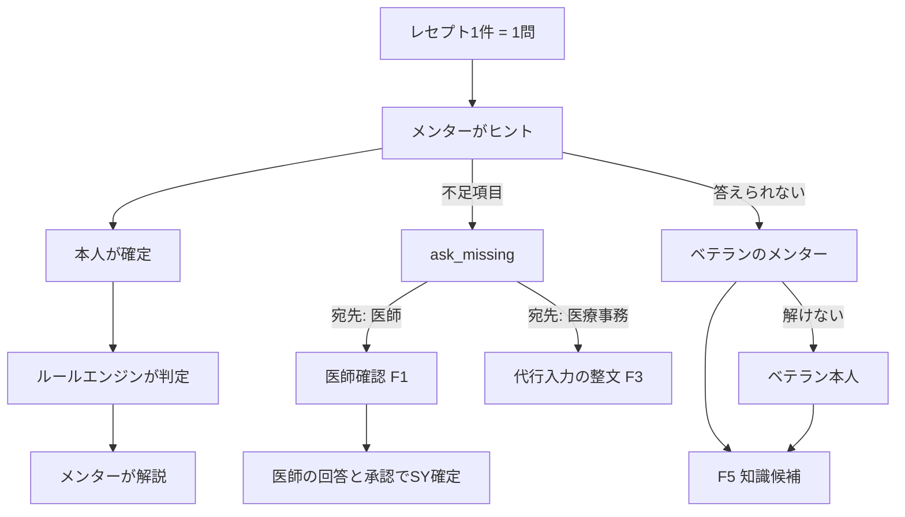
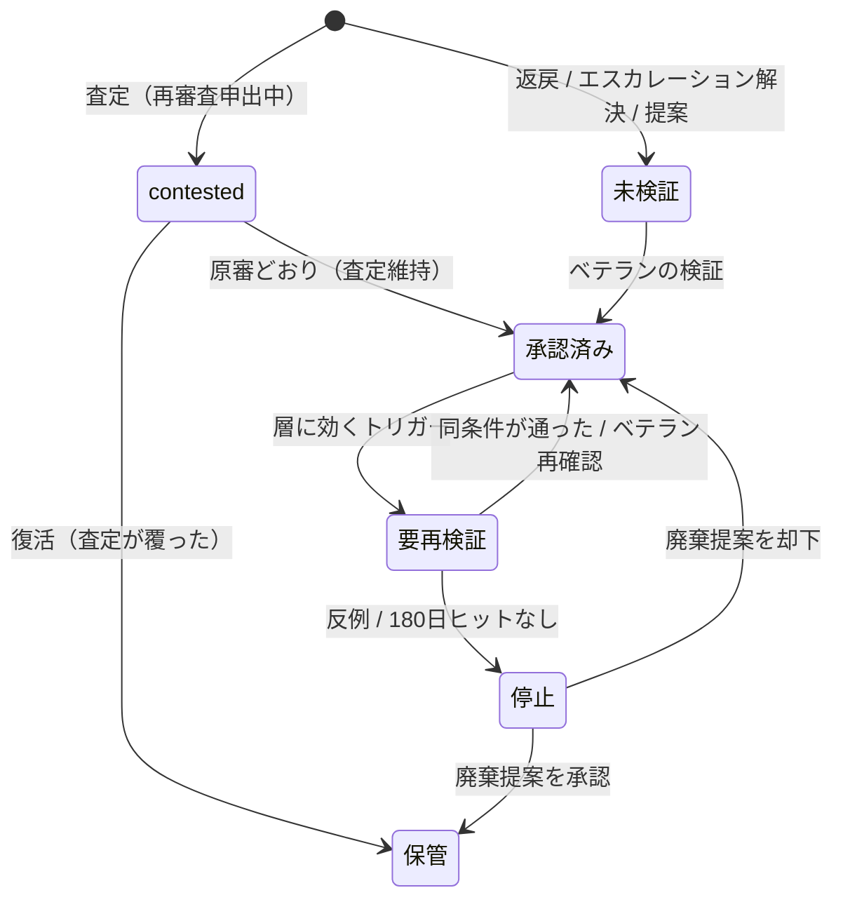
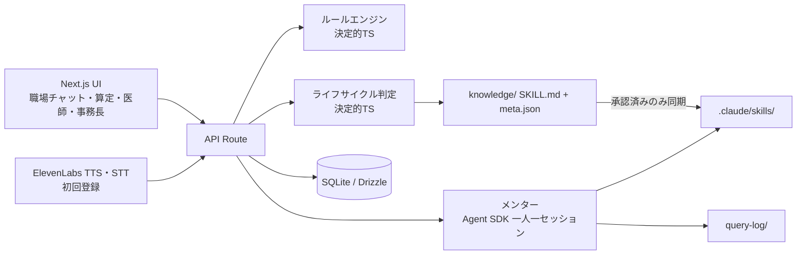
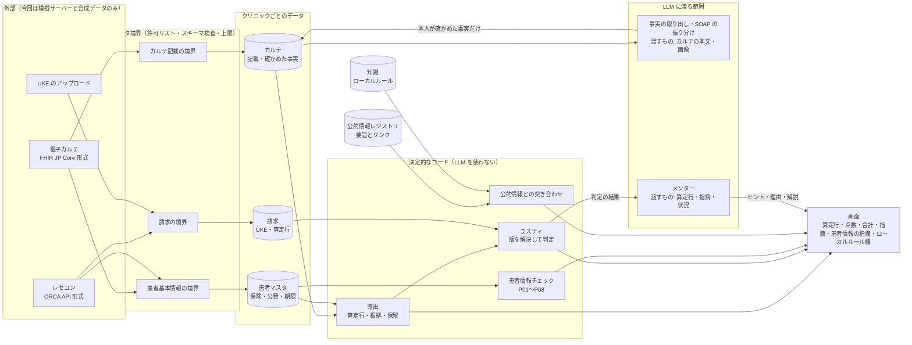
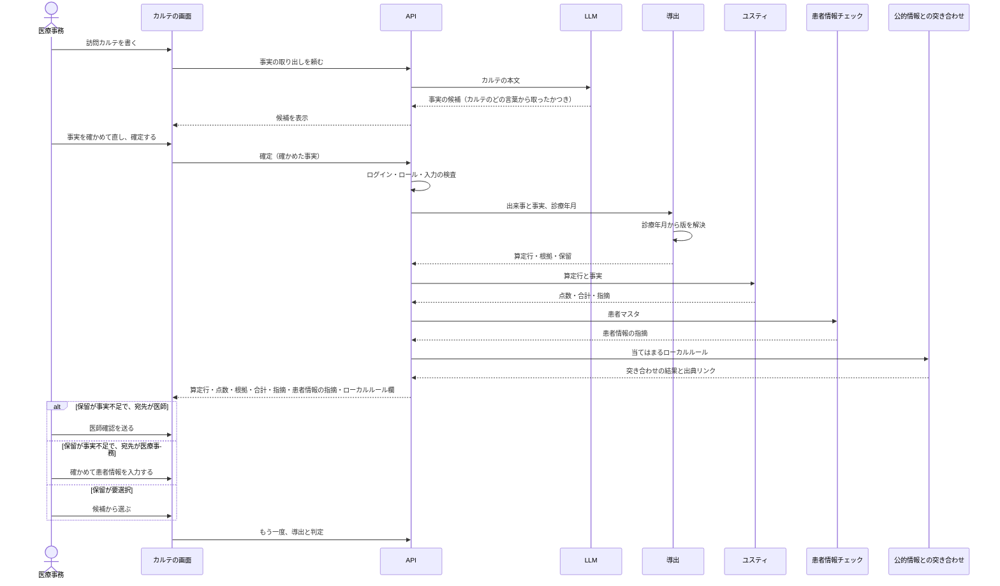

# iji-context 仕様書 — レセメン（仮）

生成元: design/iji-context/spec-input-iji-context.md（改訂版 2026-11-04、写し source-input.md sha256 先頭 af2d8a7d64de）／生成日 2026-11-04
数字の出典: design/iji-context/sources/evidence-master-iji-context.md（EM）。括弧内の「決定n」「Fn」「U-x」は spec-input の番号。
改訂 2026-11-17: 仕様の正は本書とする（spec-input は 2026-11-04 時点の決定の記録として残し、食い違う場合は本書を採る）。FR-87〜FR-152 と図4〜6 を加え、既存の FR を改訂した。改訂した箇所には「2026-11-17 改訂」と付け、決定の結論は末尾の「2026-11-17 の決定」に置く。FR-87 以降と 2026-11-17 に改訂した FR では、点数・金額・施行日・記録条件仕様の版を本書に書かず、EM の採用値による。
改訂 2026-11-21: 設計 v22〜v24（design.md §2〜§12）と台帳（ledger.md）2026-11-17〜11-21 の決定のうち、本書に入っていなかったものを反映した。FR-153 以降を加え、既存の FR を改訂した。改訂した箇所には「2026-11-21 改訂」と出典（設計書の節・台帳の日付・L 番号）を付ける。決まっていないことは「未決事項」に置く。

## 目的

クリニックでレセプト請求を担う医療事務は、経営を支えているのに声が届かない。医師への確認には制度名すらなく（EM #13-2）、返戻のたびに積み上がるルールは誰も捨てられない（EM #9-1）。医療事務固有の離職統計は存在しない（EM #2-1）。レセメンは、医療事務一人ひとりに AI メンターをつける。カルテから算定までを診察直後に一緒に進め（EM §6-5）、医師への確認はメンターが引き受け、わからないことはメンター同士で解く。正否は決定的なルールエンジンが出し、AI は答えを出さず、理由と筋道を示す。価値の中心は新人の独力化で、採用・離職への効果は主張しない仮説として扱う（決定5）。提出先は Built with Claude: Japan 2026。

2026-11-17 改訂：合成データの診療年月は 2026年10月、点数は令和8年度改定後とする（値は EM の採用値）。使う人は、クリニックに属する医療事務（事務・ベテラン）・事務長・医師で、それぞれロールを 1 つ持つ（FR-132）。カルテを確かめて確定すると、同じ画面に算定行・点数・合計・指摘が出る（FR-94〜103）。算定行を作るのも正否を出すのも決定的なコードで、AI が担うのはカルテの文から事実を取り出すところまでと、理由と筋道を示すところである。

## スコープ / 非スコープ

### スコープ（F1〜F11）

| # | 機能 | 一言 |
|---|---|---|
| F1 | 医師確認 | 記載不足をメンターが医師に、Non-Leading な選択式で聞く |
| F2 | AIメンター（算定伴走） | 算定の筋道と理由を出す。正否はルールエンジンが出す |
| F3 | 代行入力の整文 | 代行入力の文章を整え、足りない項目は推定せずに聞く |
| F4 | レセプト照合 | 合成 UKE とカルテ・受給者証を照合し、確認してほしい点を出す |
| F5 | 知識ライフサイクル | 知識（Skill）候補の生成と、状態遷移による管理 |
| F6 | メンター同士のやり取り | 新人のメンター→ベテランのメンター→ベテラン本人の順に聞く |
| F7 | ゲーム的な処理体験 | レセプト 1 件＝1 問。スコアは非金額 |
| F8 | 初回登録の音声会話 | 4 キャラから選び、声で挨拶・名乗りをする |
| F9 | 防いだ額の可視化 | 2 系統で集計し、本人向けと事務長向けの 2 表示にする |
| F10 | レベルとキャラの成長 | 処理件数でレベルが上がり、メンターの振る舞いが変わる |
| F11 | ボトムアップ提案ループ | 誰でもルール改善を投稿でき、F5 の状態遷移に乗せる |

### スコープの追加（2026-11-17。F1〜F11 の外）

| 領域 | 内容 | FR |
|---|---|---|
| 改定の版 | 診療年月から改定の版を解決する仕組み。版 1 つ＝ファイル 1 つ。診療年月を 2026年10月・令和8年度改定後に移す | FR-87〜93、FR-147 |
| 施設の設定と症例 | 架空クリニックの施設の設定を決め、症例ごとに上書きできるようにする。在医総管の注16 の基準を満たさない場合の症例を 1 つ足す | FR-148〜152 |
| カルテ→算定 | 確かめた事実と出来事から、算定行をコードで導出する層。根拠と保留を添えて、カルテの画面に算定行・点数・合計・指摘を出す | FR-94〜103 |
| 連携 | 患者基本情報／請求／カルテ記載の 3 つの境界。UKE のアップロード、ORCA API 形式・FHIR JP Core 形式の読み取りコネクタ（相手は同梱の模擬サーバー） | FR-104〜115 |
| 患者情報チェック | 保険・公費・期限などの指摘 P01〜P08。ユスティとは別欄で、宛先は医療事務。患者マスタを新設する | FR-116〜123 |
| 公的情報レジストリ | 疑義解釈・審査情報提供事例等を 1 文書 1 件で持ち、ローカルルールと決まった規則で突き合わせて表示する。矛盾の恐れがある承認済みローカルルールは要再検証にしてレセメン会議に出す | FR-124〜131 |
| 品質・セキュリティ | ロールと権限表、医師の回答・承認の本人記録、全 API の入力検証、招待制登録、Origin 検証、回数制限、監査ログ、マイグレーション、CI、CSP | FR-132〜146 |

### 非スコープ

- 実在の患者データ・個人情報・実在のレセ電コード（すべて架空・合成）
- 算定漏れの金額規模の主張／「学習する」を差別化として打ち出すこと／審査委員交代と査定傾向の因果を事実として主張すること
- 令和8年度改定の生成AI評価（保医発0305第7号）を根拠に使うこと
- 実際の請求・審査支払機関への提出、電子署名
- Slack 等の実チャットツール連携、電話での登録・会話
- 医師側の F3、キャラの育成分岐・ガチャ、同僚の機嫌・チームの空気メーター
- 事務長 KPI を評価制度へ接続すること
- 診断・治療に関わる判断

2026-11-17 に加えたもの（「2026年度点数、または 2025年3月以外の診療年月での合成」は非スコープから外した）：

- 実機の ORCA・電子カルテ・レセコンへの接続（相手は同梱の模擬サーバーだけ）
- 外部への書き込み（コネクタは読み取り専用）
- 実在コードのマスターへの対応
- 実在の UKE の受け入れ（架空コードの表にないコードを含むファイルは拒否する）
- 公的情報の全件の取り込みと、自動の巡回・更新の検知
- 公的情報の原文の転載
- LLM による、公的情報とローカルルールの矛盾の判定
- 公的情報を理由にした、ローカルルールの自動の停止
- 薬局の疑義照会
- 2024年度版の併存（同梱する版は令和8年度改定後のものだけ）
- 単一建物の人数別の点数、機能強化型の点数
- 看取り加算・死亡診断加算の自動の選択
- SSO・多要素認証、保存時の暗号化、WAF、複数台構成、ブラウザを使った E2E テスト

## 機能要件

### ルールエンジン（判定）

- FR-01 算定の正否・点数・背反・算定条件は、TypeScript の決定的ロジックだけで判定する。LLM には判定させない（決定1, 67）
- FR-02 ルールエンジンは、レポートA項目21 の 13 項目を自動テストのケースとして持つ。13 項目と R01〜R14 は改定の版ごとに見直し、令和8年度改定後の条件でケースにする。見直しの結果は EM に残す（決定58。2026-11-17 改訂）。令和8年度で新設したルールは R15（物価対応料）と R16（管理料の種別：居宅か施設入居等か）で、番号は振り直さず、廃止した番号は使い回さない（2026-11-21 改訂。出典：design.md §2-3）
- FR-03 ルールエンジンが算出する K1・K2 の合計は、EM 5-1 の採用値（令和8年度改定後）と一致する。数値は本書に書かない（決定55, 56。2026-11-17 改訂）
- FR-04 K1 には包括的支援加算を付けず、C101 も付けない。付けない項目とその理由は EM 5 の採用値による。点数は本書に書かない（決定55。2026-11-17 改訂）

### 入力・UKE（F4）

- FR-05 同梱する見本の合成 UKE は審査支払機関ごとに 1 ファイル、計 2 本とする（国保連用 K1〜K5・K7 は IR=2、支払基金用 K6 は IR=1。症例は EM 5-1 の 7 症例）。診療年月は config/demo.json による（FR-91）。取り込める UKE は見本に限らない（FR-106）（決定54, 57。2026-11-17 改訂。2026-11-21 改訂：FR-150 の症例は K7 で、国保連用に入れる。出典：design.md §1（K7 の説明）、L-50、EM 5-1）
- FR-06 UKE は記録条件仕様に準拠する。版は EM 12-1 の採用値による。形式は Shift_JIS・CSV・CRLF・EOF(0x1A)、レコード順は IR→(RE→HO/KO→SY→SI/IY/TO/CO)×n→GO（決定61。2026-11-17 改訂）
- FR-07 入力は UKE、合成カルテ（SOAP）、受給者証情報とする。施設届出と過去月は設定ファイルの固定値とする。施設の設定は症例ごとに上書きできる（FR-149）（決定62。2026-11-17 改訂）
- FR-08 F4 は「病名と処方の不一致」「背反」「加算の取り忘れ」を「確認してほしい点」として出す（F4）
- FR-09 レセ電コードはすべて架空とする（決定60）
- FR-67 医療事務が確かめた患者情報（要介護度・別表第七・別表第八の二・在宅酸素療法）を、確かめた根拠と日付つきで患者ごとに残す。判定はカルテ側の値に最新の記録を重ね、要介護度は有効期間の終わりを過ぎたら「分からない」に戻す。患者は患者マスタの id で見分け（FR-121）、確かめた患者情報の記録は患者マスタに付ける（2026-11-07 決定。2026-11-17 改訂）。医療事務が確かめる患者情報に、居住の場所（居宅か施設入居等か）・文書の提供・緊急往診加算の対象の患者か・管理料を算定する患者か（計画的な医学管理を行っているか）・同じ日の訪問診療料と往診料が別々の診療か（診療日ごと）を足す。どれも「分からない」を持ち、入るまでは検証では情報不足、導出では保留（事実不足）になる。聞くのは答えで結果が変わるときだけとする（2026-11-21 改訂。出典：design.md §6-1、L-17・L-45 (1)（v22 の承認で推奨どおり。台帳 2026-11-17）、台帳 2026-11-20 fix/round-28 で患者ごとの事実に移した）
- FR-68 訪問のあった日に、レセコンに入れる前の確認を算定画面で行う（訪問の記録）。その日のカルテとその日までの実施で、今と同じ流れ（ヒント → メンター → 確定 → 判定 → 解説）と照合・医師確認ができる。月末までに結論が変わり得るルール（R01 在医総管の区分・R09 ターミナルケア）は指摘にせず、在医総管は見込み（今月ここまでの訪問回数）だけ出す。確定は提出ではないので、適用記録を書かず、件数・レベル・防いだ額にも数えない。月末の UKE の点検は提出前の最終確認として残す（2026-11-07 ユーザー判断。UKE は提出用のファイルで、そこで初めて気づくと医師の記載を直すには遅いため）。訪問の記録は合成データの練習用として、デモの時計に関係なく全部の訪問日で開ける。カルテから導出した算定行にも、見込みの扱いと「確定は提出ではない」扱いを同じく適用する（FR-102）（2026-11-07 ユーザー判断。2026-11-17 改訂）
- FR-69 本人が患者（合成カルテのある症例 K1〜K5・K7。K6 は外来の症例で訪問カルテを持たない。2026-11-21 改訂。出典：L-50、EM 5-1）を選び、今日訪問したていで訪問カルテ（S・O・A・P・処方を自由記述。訪問診療か往診かは選ぶ）を書ける。AI が算定に要る事実（処方の分類・病名の記載・急性増悪）を取り出し、事実ごとにカルテのどの言葉から取ったかを付ける。カルテにない言葉から取った事実は決まった規則で捨てる。本人が確かめて直した事実だけを、出来事と照合用のカルテに重ね、算定行は導出（FR-94）で作る。カルテ→出来事の変換は 1 か所に置き、訪問の記録（FR-68）と導出で共有する。そのまま訪問の記録としてユスティとメンターにつなぐ。判定は AI ではなくユスティが行う。画面は一般的なスマホのカルテの見た目にし、特定の製品に似せない（2026-11-07 ユーザー判断。2026-11-17 改訂）
- FR-70 （FR-72・FR-73 で置き換え。名前を入れるだけの入口はログインになった）使う人は、はじめに名前（呼ばれたい名前）を入れて自分の利用者を作る。キャラ・伝え方・メンターとの会話・処理件数・書いた訪問カルテ・取り込んだ UKE は利用者ごとに分ける。患者情報の記録・医師確認・知識・デモの時計は全員で共有する（2026-11-07 ユーザー判断。審査員がそれぞれ別のキャラで試せるように）
- FR-71 月末に UKE を取り込む画面を持つ。取り込んだ UKE のレセプトだけが「月末の点検（UKE・提出前）」に並ぶ。同梱の見本の 2 本（国保連・支払基金）を選ぶほか、ファイルを選んでアップロードできる（FR-106〜109）（2026-11-07 ユーザー判断。2026-11-17 改訂）
- FR-72 ログイン ID とパスワードで登録・ログインする。登録は招待制とする（FR-137）。誰でも登録できる状態は、環境変数で明示したときだけにする（2026-11-07 ユーザー判断の「招待コードなし」を 2026-11-17 に改訂）。パスワードは scrypt のハッシュだけを保存し、セッションは httpOnly の cookie（本番は https だけ）で渡して、DB にはトークンのハッシュだけを置く。ログインの失敗が続いたら 10 分受け付けない。サーバーは画面から送られた利用者 id を使わず、セッションで本人を決める
- FR-73 クリニック（tenant）ごとに、専用の DB・知識・同期した Skill・医師確認の記録・デモの時計・メンターの作業場所を持つ。クリニックには複数の利用者が属し、利用者はロールを 1 つ持つ（FR-132）。はじめて開いたときに制度層の知識を入れて用意する。クリニックどうしの操作は混ざらない。招待なしの登録を開放しているとき（FR-137）は、登録した人ごとにクリニックを 1 つ作り、デモ用の印を付ける（FR-144）。FR-70 の「利用者ごと」は、クリニックの中の利用者ごとの区別として残る（2026-11-07 ユーザー判断の「1 人 1 クリニック」を 2026-11-17 に改訂）
- FR-74 公開は GCP の VM（Compute Engine）に Docker Compose で置き、Caddy で https にする。データはボリュームに残す。API キーはサーバーの設定ファイル（git・イメージに入れない）で渡す。手順は docs/deploy-gcp.md（2026-11-07 ユーザー判断）
- FR-75 練習問題：よくある間違いを 1 つ入れた明細から始め、本人が直して確定し、ユスティが判定する。間違いは report-A 項目 21 の 13 項目（ルールエンジンのテストの「違反あり」）から取り、作り足さない。R13（週 4 回の訪問）は、直すのに医師への確認が要り明細だけでは正解にできないので外し、12 問とする。問題を解くのに要る事実（例：内服 7 種類、その日は往診だけ）は「状況」として画面とメンターに渡し、答え（どのルールか）は一覧に出さない。件数・レベルには数え、提出・防いだ額には数えない。条件と点数は改定の版から取り、問題文に改定に依存する値を直書きしない。問数は FR-02 の見直しの結果に合わせる（2026-11-07 ユーザー判断。2026-11-17 改訂）
- FR-76 医師確認の練習問題：カルテに書かれていない事実を推測で埋めず、医師確認を送ってから確定する。題材は根拠のある 3 つ（K3 の別表第八の二＝EM 5-1「重症区分（別表八の二: 難病）」「カルテに PD のみ記載」。2026-11-07 に K1 から入れ替え：K1 は在宅酸素療法中で、カルテだけで答えが決まるため、週 4 回の訪問と急性増悪＝report-A 項目 21 の 13、K4 の DOAC と病型＝EM 5-1）。質問は決まった形で 7 要件の検査を通す。承認された回答だけを問題の中の事実に戻し、本物の患者情報は変えない（「その他」「判定不能」は戻さない）。情報不足や照合の不一致が残ったまま確定したら不正解。題材の条件は改定の版と EM 5-1 の採用値から取り、問題文に改定に依存する値を直書きしない（2026-11-07 ユーザー判断。2026-11-17 改訂）
- FR-77 練習問題の手引き：医療事務や医師でない人向けに、練習の流れ・用語・ユスティが見ているルール（制度層の要約をそのまま）を 1 ページにまとめる（2026-11-07 ユーザー判断）
- FR-78 算定画面に、ユスティ（全国共通の決まり）とは別の欄で、明細に当てはまるローカルルール（地域・ベテランの判断・院内。保管・停止を除く）を出す。当てはめは知識の match による決まった規則で、明細を直すたびに当てはめ直す。状態・出どころ・メンターが助言に使うか（承認済みの地域・ベテランだけ。院内は使わない）を添える。加えて、公的情報との突き合わせの結果と出典リンクを添える（FR-128）（2026-11-07 ユーザー判断。2026-11-17 改訂）
- FR-79 クリニックには、根拠のある地域ルールを最初から 1 つ入れておく（K6 の合成の増減点連絡書：東京都・支払基金で、傷病名が「心不全の疑い」のまま連月で BNP を算定して査定）。状態は通常の規則どおり候補（未検証）から始まる。すでにあれば入れ直さない。このルールが改選で要再検証になる筋書きは、日付を新しい診療年月に合わせて見直し、/design-loop で案を出す（2026-11-07 ユーザー判断。2026-11-17 改訂）。筋書きは案 A とする：承認したあと、時計を次の改選日（支払基金は奇数年 6/1）より後の日へ 1 回で進めると、会議の整理で改選のトリガー（②）が出る。週ごとに進めて先に 180 日ヒットなし（③）が出るのは仕様どおりの動きとして直さない（2026-11-21 改訂。出典：design.md §4-7、L-24（v22 の承認で推奨どおり。台帳 2026-11-17））
- FR-80 クリニックには、何年分も積み上がった院内ルールを 12 件入れておく。中身は作らず（決定64）、名前は「〇〇に関する院内ローカル」として何の区分に関するものかだけを出し（「中身は伏せています」は画面に出さない。2026-11-07 ユーザー判断）、その区分で当てはめる。状態は本物の遷移を古い日付（config/demo.json の基準月からの相対で決め、固定の年を書かない）で通して作り、承認済みのまま何年も使われていないもの・使われ続けているもの・しまわれたもの・未検証の提案が混ざる。算定画面では最後に使われた日と「長く使われていない」を示し、レセメン会議で要再検証に回る（2026-11-07 ユーザー判断。2026-11-17 改訂）
- FR-81 メンターのキャラと話し方（好み・16 タイプ）は、はじめての算定画面と「設定」の画面で選ぶ。算定画面からは変えない（2026-11-07 ユーザー判断）
- FR-82 デモの時計は日付だけを出し、日付で進める（時刻はその日の 9 時にそろえる）。日付はカルテの訪問日・医師確認の期限・レセメン会議の日に使う。初期値は config/demo.json で持ち、祝日でない営業日にする（2026-11-07 ユーザー判断。2026-11-17 改訂）
- FR-83 訪問カルテは自由に書いてよく、AI（Haiku）が SOAP の欄に振り分ける。AI は書かれた言葉を並べ替えるだけで、原文にない言い回しは決まった規則で見つけて知らせ、本人が欄を直してから保存する。カルテを書いたことがない人向けに、5 人それぞれに「足りないカルテ」「ちゃんとしたカルテ」の見本を入れられる（合成。EM 5-1 の症例の事実だけから作る。K3 の「PD」・K4 の「AF」は EM の例）（2026-11-07 ユーザー判断）
- FR-84 見た目は案 C+（クエストボード）とする：色は Blue Jay のテーマ（ミスト・コバルト・空色・黒に近い紺。指摘はどんぐり色で、赤は使わない）、左の縦メニューに本人のステータス（Lv・連続・次のレベルまでのゲージ）とデモの日付、算定の一覧は訪問を月のタイムライン（点の色＝患者、丸＝訪問診療・四角＝往診）、練習問題は患者の色のカード（本人が正解で終えたものは「クリア」、次の 1 問は「NEXT」）。メンター欄は立ち絵が吹き出しにはみ出す形。ユスティは「RULE ENGINE」の黒いパネルでメンターと分ける。カードは角を丸め、影を薄く付ける（2026-11-08 ユーザー判断）
- FR-85 どの画面にも、上にレセメン（案内役）が立ち、その画面でできることを 1〜2 文で説明する。文は固定で AI は呼ばない。案内役は 医師確認・事務長＝ハル、UKE 取り込み＝ユスティ、知識＝ユキ、手引き＝マッキー、カルテ＝ナツ、設定＝本人が選んだメンター、レセメン会議＝全員（ハルがホログラムのパネルで説明する絵。Codex で生成）。訪問カルテは PC・タブレットでも書けるので、スマホの枠に入れず、左に患者・右にカルテの 2 列にする（2026-11-08 ユーザー判断）
- FR-86 カルテの画面で、電子カルテの画面を撮った画像（PNG・JPEG・WebP、5MB まで）を渡すと、AI（Sonnet。config/models.json の chartImage）が病名・診療記録・処方の文字だけを書いてあるまま書き写し、自由記述の欄に入れる。そのあとは FR-83 と同じく本人が確かめてから SOAP に整える。画像はどこにも保存しない。読み取りを見せるため、架空の電子カルテの画面（/demo/emr。K4 の合成データ。メニューに出さない。特定の製品に似せない）を置く（2026-11-08 ユーザー判断）

### メンター（F2・F6・F10）

- FR-10 メンターは医療事務 1 人につき 1 セッション（Agent SDK）とする（決定21）
- FR-11 メンターが出すのはヒント・理由・解説だけで、ルールエンジンの判定結果を上書きしない（決定2, F2）
- FR-12 院内ローカルルールは新人への助言に使わない（決定8）
- FR-13 メンターが持つツールは `query_skills / query_history / ask_peer_mentor / ask_human / ask_doctor / ask_missing` の 6 つとする（決定68）。`query_skills` は Agent SDK の Skill（同期先の承認済み知識だけを有効にする）で実現し、読む直前に Hooks で知識の状態を確かめる（2026-11-06 ユーザー判断）
- FR-14 新人のメンターが答えられない問いは、ベテランのメンター（別セッション）に渡す。それでも解けないときだけ、ベテランのメンター経由でベテラン本人に届ける（決定22, F6）
- FR-15 エスカレーションで解けた案件は「ベテランの判断」層の知識候補になる（決定23）
- FR-16 本人のレベルは処理件数の累計で Lv.1〜10 とし、本人画面の端に小さく出す。他人のレベルは見せない（決定32）
- FR-17 レベルが上がると、メンターの振る舞い（ヒント量・ヒントを出す時機・呼び方と口調）が変わる。一定レベル以上では、他の医療事務のメンターから質問が届く（決定33）
  - 高いレベルでもヒントは聞かれたときに一言だけ出すが、声かけは積極的にする（「あなたなら余裕ですね」のような信頼を伝える一言）。コンセプトは「働くを楽しくするメンターで同僚」（2026-11-06 ユーザー判断）
  - レベルのしきい値は、月に数百件を扱う前提で Lv.10＝1,000 件（2026-11-06 ユーザー判断。途中の値は config/levels.json）
- FR-18 レベル名には、職位や評価を連想させる語を使わない（決定34）

### キャラ・音声（F8）

- FR-19 キャラは男女を含む 4 名で、本人が自分で選ぶ。質問による振り分けはしない（決定24。2026-11-06 ユーザー判断で「男性 3 名」から「男女を含む 3 名」へ、2026-11-07 に 4 名へ変更）
- FR-20 伝え方のタイプは本人の自己申告を任意で受け付ける。診断はしない（決定25）。話し方の好み（結論から短く／順を追って丁寧に／励まし多めで／一緒に考える問いかけで）と 16 タイプを任意で選べ、メンターへの指示に本人の申告として入る（2026-11-07 実装）
- FR-21 各キャラは静止画の立ち絵で、3 表情（喜び／通常／落ち込み）を持つ。4 キャラとも同じ構図（ハルに合わせた腰から上・同じ向き）で、表情ごとに顔だけを変える。アニメーションはしない（決定26。2026-11-07 ユーザー判断で 6 表情から 3 表情へ変更。ユキは口角がわずかに上がる・下がる程度）
- FR-22 立ち絵の表情は場面で決める：正解したとき（確定して指摘なし）は喜び、愚痴を聞くときと間違えたとき（確定して指摘あり）は落ち込み、ほかは通常（2026-11-07 ユーザー判断。メンター出力の `expression` は記録として残すが、立ち絵には使わない。決定28 を置き換え）
- FR-23 （FR-22 の変更で立ち絵の「困り」はなくなった。メンター出力の `expression` には引き続き適用する。決定27）
- FR-24 キャラが喜ぶのは正方向の出来事（正解・知識が増えた／承認された／連続正解／月次完了）だけとする（決定36。2026-11-07 に正解を加えた）
- FR-25 立ち絵は表情ごとに 1 枚ずつ生成する（assets/characters/expressions/。画面用に縮小して public/characters/ に置く）（決定29 を 2026-11-07 に変更）
- FR-26 音声は初回登録と節目（月次提出完了など）だけで使い、算定作業中はテキストのみとする（決定30）
- FR-27 初回登録の音声は定型にする。キャラを選んだら、そのキャラの声で自己紹介と「何て呼べばいいか」を流す（前もって作った音声）。本人は名前を声か文字で答え、声で答えた場合も入力欄に入った名前を本人が確かめてから決める。名前はアプリ DB に書き、本人の CLAUDE.md の呼び方に反映する。最後に名前を入れた「これからよろしく」をその場で読み上げる。音声の生成と聞き取りは ElevenLabs（Text to Speech・Speech to Text）で、API キーはサーバー側だけで使う。台詞は config/voice-lines.json（2026-11-07 ユーザー判断で ElevenLabs Agents から変更。Agent が要るのは声で会話する場合だけで、定型の声なら不要なため。決定31 を置き換え）

### 処理体験（F7）

- FR-28 レセプト 1 件を 1 問とし、メンターのヒント→本人が確定→ルールエンジンの結果→メンターの解説、の順に進める（F7）
- FR-29 スコアは件数・連続正解などの非金額とし、ランキング・ノルマにしない（F7, 決定49）

### 医師確認・代行入力（F1・F3）

- FR-30 医師確認の質問は、AHIMA/ACDIS 2026年版の 7 要件を満たす：①臨床指標を引用 ②誘導しない ③選択肢に「その他」「判定不能」を必ず含める ④点数・金額に触れない ⑤AI が作った質問も同じ基準 ⑥記録を保存 ⑦未回答ならエスカレーション（決定37）
- FR-31 呼び名は UI 上「医師確認」で統一する（決定38）
- FR-32 SY が確定するのは、医師の回答と承認があったときだけとする（F1）
- FR-33 医師の承認は確認ボタンで行う。承認者はセッションの本人（医師ロール）とし、画面から送られた名前は使わない。本人の id・表示名・日時をログに残す（決定39。FR-134。2026-11-17 改訂）
- FR-34 未回答の質問は翌営業日にリマインドし、3 営業日で保留（算定しない）にする（決定40）
- FR-35 質問の記録は `query-log/` に 1 質問 1 ファイルで、Markdown と JSON を併記する（決定41）
- FR-36 不足項目を聞くときは `ask_missing(target, field, why)` を必ず通す。宛先が医師なら F1、医療事務なら F3 になる（決定42）
- FR-37 代行入力のあと、UI は必ず医師確認のステップを挟む（決定43）

### 知識ライフサイクル（F5・F11）

- FR-38 知識は 4 層（制度／地域／ベテランの判断／院内）で管理し、層ごとに生成・減衰ルールを分ける（決定7）
- FR-39 知識の実体は `knowledge/<layer>/<slug>/SKILL.md` とサイドカー `meta.json`（layer / status / source_event / valid_from / review_by / hits / misses / retired_reason）とする（決定18）
- FR-40 候補は生成した瞬間から全員に見え、「未検証」ラベルが付く。可視性に承認ゲートは置かない（決定10）
- FR-41 ベテランの検証で、状態が未検証から承認済みに変わる。検証の操作はベテランのロールに限る（決定11。FR-133。2026-11-17 改訂）
- FR-42 返戻を取り込むと、すぐにルール候補を生成する（決定12）。査定・返戻の通知から作る候補は、必ず近似（条件の注記つき）とし、通知の理由を条件の注記に入れる（2026-11-21 改訂。出典：design.md §3・C-73、L-45 (4)（v22 の承認で推奨どおり。台帳 2026-11-17））
- FR-43 査定は必ず知識化する。再審査申出中は contested 状態とする。結果が原審どおり（査定が維持された）なら承認済みにする。復活（査定が覆った）なら保管にし、あわせて「この項目は再審査で認められた」を地域層の知識として、承認済み・出所＝再審査結果で別に登録する（決定13、U-G）。再審査で復活した知識は近似にしない（外れを会議に出すため）（2026-11-21 改訂。出典：design.md §3・C-73、L-45 (4)・L-47（台帳 2026-11-17））
- FR-44 再検証のトリガーは ①診療報酬改定 ②審査委員の改選（国保連は都道府県ごと）③180 日ヒットなし（初期値）④公的文書（FR-130）とする。改定日・改選日は EM の採用値と config/calendar.json による。④ の細部は /design-loop で確定する（決定14。2026-11-17 改訂）。④ は、会議の整理のときに、承認済みの知識について「矛盾の恐れ」になった文書のうち会議で確認していないもの（承認より前からある文書も含む）で発火する。同じ整理で複数が条件を満たすときの優先は ①→②→④→③ とする（2026-11-21 改訂。出典：design.md §4-3・§4-7、L-25（台帳 2026-11-17））
- FR-45 トリガーだけでルールを無効にしない。適用期間・版・廃止理由を残す（決定15）。遷移は次のとおり（U-H）
  - 承認済み→要再検証：トリガー①②③④のうち、その層に効くもの（FR-66）。④ で要再検証になったルールは停止に進めず、レセメン会議の回答を待つ（FR-130）（2026-11-17 改訂）
  - 要再検証→承認済み：次の請求で同じ条件が通った、またはベテランが再確認した
  - 要再検証→停止：反例が出た（同じ条件で返戻・査定）、または 180 日ヒットなし
  - 停止→保管：廃棄提案をベテランが承認した
  - 停止→承認済み：廃棄提案をベテランが却下した
- FR-46 院内ローカルルールはヒットしなくなったら廃棄提案を出し、可否は人が決める（決定9）
- FR-47 状態判定と減衰は TypeScript の決定的ロジックで行い、LLM に任せない（決定67）
- FR-48 承認済みの Skill だけを、決定的スクリプトで `.claude/skills/` に同期する。それ以外の状態はロードさせない。同期先もコミットする（決定19）
- FR-49 知識ディレクトリは git で管理し、育った履歴を `git log` で見せられるようにする（決定20）。デモでは、院内ルールが生まれてから保管されるまでを git log 風に見せる仮の表示を知識画面に置く（中身は伏せた例。2026-11-07）
- FR-50 個人名はデフォルトで出さず、知識はチームの共有知として扱う。本人向けの名前表示はオプトインとする（決定17）
- FR-51 誰でもルール改善を投稿でき、投稿は F5 の状態遷移に乗る（F11）
- FR-64 状態は「候補（未検証）／承認済み／contested／要再検証／停止／保管」の 6 つで閉じる（U-H）
- FR-65 共感数は候補（未検証）に付く属性で、状態遷移は起こさない。効くのはベテランの検証キューの並び順だけ（共感が多い候補ほど先に検証される）。閾値による自動承認はしない（U-I）
- FR-66 層ごとの生成元と、効く再検証トリガーは次の表で固定する。条件の細部は design-loop の起草で詰めてよいが、この対応は変えない（U-J）。④公的文書の対応は 2026-11-17 に足した（制度には効かず、地域・ベテランの判断・院内に効く）。④ の条件は /design-loop で確定する（2026-11-17 改訂）。④ の条件は FR-44 のとおり（2026-11-21 改訂。出典：design.md §4-3）

| 層 | 生成元 | 効くトリガー | 備考 |
|---|---|---|---|
| 制度 | 初期投入（点数表・留意事項から手で起こす） | ①改定のみ（④は効かない） | 減衰は改定時だけ |
| 地域 | 返戻・査定・再審査結果 | ②改選、③N日、④公的文書 | |
| ベテランの判断 | エスカレーションの解決 | ③N日、④公的文書 | 改選では落とさない。ただし既存の知識の修正版（relates_to を持つもの）は、元の知識の層のトリガー（制度なら①、地域なら②）も効く（2026-11-06 ユーザー判断。design.md v21 X-57） |
| 院内 | 返戻起点、または手動登録 | ③N日、④公的文書 | 助言には使わない。停止→廃棄提案が出やすい |

### 防いだ額（F9）

- FR-52 「防いだ」は、提出前にルールエンジンまたは F4 が指摘し、提出までに本人が修正した項目に限る。自己申告は数えない（決定44）
- FR-53 金額は点数×10円で換算し（EM #7-5）、公費・自己負担の内訳は分けない。表示には常に「推定」を付ける（決定44, 45）
- FR-54 「取りこぼしを防いだ（算定漏れ）」と「差し戻しを防いだ（返戻・査定リスク）」の 2 系統で集計する（決定46）
- FR-55 医師の記載が原因で F1 経由で解決した項目は「医師記載起因」として別に集計する（決定47）。件数に加えて、医師の回答で算定できるようになった点数も金額（推定）で出し、医師側の取りこぼしを示す材料にする（2026-11-06 ユーザー判断）
- FR-56 「多く取る」方向の表示・誘導は一切入れない（決定48）。趣旨は、経営の目線を持たせすぎて取れない算定まで取りにいかせないこと。ルールエンジンが正しいと判定した算定との差（過少の区分を正しい区分に直した差額など）は「取りこぼしを防いだ」に数えてよい（2026-11-06 ユーザー判断）
- FR-57 本人向けの表示はオプトインで、既定は非表示とする。トグル 1 つで詳細（防いだ額、ルール貢献数）を開ける（決定35, 49）。2026-11-07 時点で開けるのは防いだ額だけ（ルール貢献数は、提案に投稿者を記録していないため未実装）
- FR-58 見逃した額（返戻になった額）は本人向けに出さず、事務長向けに集計だけを出す（決定50）

### UI・評価

- FR-59 UI は Next.js の自作とし、職場チャット風の画面（人同士の場）、算定画面、医師画面、事務長レポートを持つ（決定70）
- FR-60 評価は prompt-eval の超軽量版 10 ケースで行う（理由があるか／医療判断をしていないか／7 要件を満たすか）（決定71）

### 提出物

- FR-61 README に「令和8年度改定後（診療年月 2026年10月）」「架空コード」「医療事務（請求・記載）の支援であり、診断・治療に関与しない」「代行入力は医師の確認・承認を前提とする」「数字は EM の採用値のみ」「実機には接続しない」「公的情報は要旨とリンク」の 7 項目を明記する（決定52, 60, 77。2026-11-17 改訂）
- FR-62 README の背景節に、紹介手数料の問題への国会・業界の指摘を、出典付きで 1 段落置く（決定75）
- FR-63 `docs/` に、匿名化したインタビュー要約、spec-input、EM、design.md、ledger.md、意思決定の経緯を含める（決定76）

### 改定の版（2026-11-17 追加）

FR-87 以降は 2026-11-17 に加えた。各節の末尾に受け入れ条件を置く。

- FR-87 改定の版は「id・名前・適用開始の診療年月・点数表・ルール一式」を 1 つのファイルで持つ。版を足すときに既存の版のファイルを書き換えない。
- FR-88 ルールエンジンは、渡された診療年月から「適用開始と適用終了のあいだに診療年月がある版」を 1 つ決めて判定する。版は適用開始と適用終了の月を持ち、版どうしの期間に空白・重なりがあれば読み込みで例外にする。該当する版がなければ例外にし、近い版で代用しない（2026-11-21 改訂。出典：design.md §2-5、L-20（v22 の承認で推奨どおり。台帳 2026-11-17））。
- FR-89 版によって変わる条件（対象疾患の一覧など）は、版のファイルがルールに定数として渡す。ルール本体に年月や改定に依存する値を直書きしない。
- FR-90 架空コードは区分→コードの明示の表で持ち、追記だけを許す。既存の行の変更・削除・並べ替えは自動テストで落とす。
- FR-91 診療年月・請求年月・時計の初期値は config/demo.json の 1 か所で持つ。`src`・`app`・`scripts` の `.ts`・`.tsx` のうち、版のファイル（`src/engine/revisions/`）を除いたものに、文字列として書かれた年月（`YYYY-MM` と 6 桁の `YYYYMM`）があれば CI を落とす。コメントは見ない（2026-11-21 改訂。出典：design.md §7-1、L-36（v22 の承認で推奨どおり。台帳 2026-11-17））。
- FR-92 同梱する版は令和8年度改定後のものだけとし、2024年度版は持たない。同梱する版は 2 つで、2 つ目は同じ改定年度の中で値が変わる区分を差し替えた版とする（FR-147）。版の切り替えの仕組みの検証は、テストの中だけに置く作り物の版 2 つで行い、EM の採用値を二重に持たない。
- FR-93 次の改定で行う作業を docs/revision-howto.md に 6 手順で書く：① EM に新しい採用値を追記して承認を取る ② 版のファイルを 1 つ足す ③ 架空コードの表に行を追記する ④ EM 5-1 の症例・見本の UKE・練習問題を作り直す ⑤ 公的情報レジストリの適用版を見直す ⑥ 自動テストと README・CLAUDE.md の固定条件を更新する。
- FR-147 同じ改定年度の中で値が変わる区分（ベースアップ評価料・物価対応料。令和9年6月以降）は、2 つ目の版として持つ。版は適用開始の診療年月で解決する（FR-88）ので、改定年度をまたがない値の変更も版として表せる。2 つ目の版の値と適用開始の診療年月は EM の採用値による。2 つ目の版は、1 つ目との差分（変わる区分の点数）だけを持つ（2026-11-21 改訂。出典：design.md §2-5、L-21（台帳 2026-11-17））。

**受け入れ条件**
- 作り物の版 2 つのテストで、境目の前後の診療年月がそれぞれの版に解決される。どの版にも当たらない年月は例外になる。
- 同梱の 2 つの版の境目の前後の診療年月が、それぞれの版に解決される。
- 架空コードの表の既存行を 1 つ変えるとテストが落ちる。区分を 1 つ足しても既存のコードが変わらない。
- `src app scripts` を検査して、旧年月・新年月の直書きが 0 件。
- ルールエンジンが出す K1・K2 の合計が EM 5-1 の採用値と一致する。

### 施設の設定と症例（2026-11-17 追加）

- FR-148 架空クリニックの施設の設定は次のとおりとする：在宅医療DX情報活用加算は加算1／外来・在宅ベースアップ評価料(Ⅰ)は通常の区分／物価対応料を算定する／在医総管の新しい規定（注16）の基準を満たす。点数と基準の内容は EM の採用値による。物価対応料と注16 をユスティの判定にどう加えるか（ルールの番号と条件）は /design-loop で決める。注16 は R01（管理料の区分）の担当とし、物価対応料は新しいルール R15 とする。管理料の種別（在医総管か施設総管か）は患者の居住の場所で決め、R16 で見る（2026-11-21 改訂。出典：design.md §2-3・§2-7、L-16（台帳 2026-11-17））。施設の設定のうち「分からない」になり得るもの（在宅医療DX情報活用加算の区分、ベースアップ評価料、物価対応料、注16、訪問診療と往診を同じ日に算定した日の再診時等の重ね〔ベースアップ評価料用と物価対応料用の 2 つ〕）は、事務長・責任者が「分からない」を含めて入力・変更でき、変更の記録が残る画面を持つ（2026-11-21 改訂。出典：design.md §6-1、L-32・L-45 (2)（台帳 2026-11-17）。統合ブランチに画面はまだない）。
- FR-149 施設の設定は、既定値（FR-148）を設定ファイルに置き、症例ごとに上書きできる。判定と導出は、その症例に効く施設の設定を事実として受け取る（FR-07）。
- FR-150 在医総管の注16 の基準を満たさない場合の症例を 1 つ足す。EM 5-1 に行を足して承認を取ってから作る。症例の番号・患者・どちらの UKE に入れるかは EM 5-1 で決める。症例は K7（K2 と同じ患者像で、施設の設定だけを注16 非該当に変える）とし、国保連用の UKE に入れる（2026-11-21 改訂。出典：design.md §1、EM 5-1）。この症例では、注16 の規定どおりの区分になることと、その根拠を画面で確かめられる。
- FR-151 K4（有料老人ホームの入居者）の管理料は、施設入居時等医学総合管理料とする。EM 5-1 を直してから反映する。
- FR-152 R10（往診と訪問診療の同日・翌日）は、留意事項通知を読み直し、/design-loop で判定を見直す。見直しの結果は EM に残す。見直しは v22（算定した行で判定し、同じ日の 2 つの行が別々の診療かは医療事務が日ごとに確かめる）と v23（往診料を立てる条件を一次資料に合わせた）で行った（2026-11-21 改訂。出典：design.md §2-3-4・§11-5）。

**受け入れ条件**
- 施設の設定を上書きした症例と、していない症例で、同じ訪問回数でも在医総管の区分が設定どおりに分かれる。
- 算定画面で FR-150 の症例を開くと、注16 の規定どおりの区分と根拠が出る。
- K4 の管理料が施設入居時等医学総合管理料で、合計が EM 5-1 の採用値と一致する。
- 既定の施設の設定が 1 か所にあり、症例が上書きしていない項目は既定値になる。

### カルテ→算定（2026-11-17 追加）

- FR-94 算定行は、出来事（訪問・往診・検査・処方など）と事実から、決定的なコードで導出する。導出に LLM を使わない。
- FR-95 LLM が担うのは、カルテの文から事実を取り出すところまでとする（FR-69・FR-83・FR-86）。導出に入るのは、本人が確かめて直した事実と出来事だけとする。
- FR-96 導出は「算定行」「根拠」「保留」の 3 つを返す。根拠は行ごとに、どの出来事・どの事実・どの条件で立てたかを示す。
- FR-97 保留は 2 種類とする。「事実不足」は足りない事実と、誰に確かめるか（医師なら医師確認、医療事務なら患者情報の入力）を示す。施設の設定が分からないための保留は、施設の設定の画面で確かめるよう案内する（2026-11-21 改訂。出典：design.md §6-1、L-44・L-45 (3)（台帳 2026-11-17））。「要選択」は候補を並べ、本人が選ぶまで行にしない。
- FR-98 看取り加算と死亡診断加算は自動で立てず、「要選択」として出す。在宅ターミナルケア加算も自動で立てず、回数の要件を満たすときに「要選択」（算定する／しない）として出す（記録にない要件があり、FR-103 により事実だけでは立てられないため）（2026-11-21 改訂。出典：design.md §2-8 D12、L-18（v22 の承認で推奨どおり。台帳 2026-11-17））。
- FR-99 導出と検証（ユスティ）は、同じ判定の述語を使う。導出した算定行をそのまま検証に通したとき、区分誤り・取り忘れの指摘が出ない。
- FR-100 単一建物の人数別の点数と、機能強化型の点数は扱わない。当たるときは合計を出さず、扱っていない理由を表示する。
- FR-101 カルテを確定すると、同じ画面に、算定行・点数・根拠・合計・ユスティの指摘・患者情報の指摘・ローカルルール欄を出す。画面を移らずに読める。
- FR-102 月の途中の確定では、月末までに変わり得る行（在医総管の区分など）を「見込み」と表示し、合計にも「見込み」を付ける。確定は提出ではなく、適用記録・件数・レベル・防いだ額に数えない（FR-68 と同じ）。
- FR-103 導出は、記録された出来事と確かめた事実にないものを行にしない。算定を増やす方向の提案を出さない（FR-56）。

**受け入れ条件**
- K1〜K5 と FR-150 の症例で「導出した算定行を検証に通すと区分誤り・取り忘れが 0 件」の性質テストが通る。
- 看取りのある症例で、看取り加算・死亡診断加算がどちらも行に入らず、要選択として返る。
- 事実を 1 つ「分からない」にすると、その事実に依存する行が保留（事実不足）になり、宛先が付く。
- 画面で、カルテを書く→確かめる→確定、のあと同じ画面に FR-101 の 7 つが出る。
- 導出のコードから LLM の呼び出しに到達しない（依存の検査）。

### 連携（2026-11-17 追加）

- FR-104 外部とのやり取りは 3 つの境界に分ける：患者基本情報（PatientSource）／請求（ClaimSource）／カルテ記載（ChartSource）。画面と判定は境界の型だけに依存し、個別の接続先を知らない。
- FR-105 最初のコネクタは、同梱の合成データを読む「フィクスチャ コネクタ」とする。既存の自動テストが、境界を通した状態で変更なしに通る。
- FR-106 UKE のファイルをアップロードして取り込める。受け入れるのは次をすべて満たすものだけとする：形式（FR-06）に合う／サイズと行数が上限以内／各レコードの列数と数値が範囲内／日別の回数が上限以内／請求 id が決められた文字種だけ／すべてのコードが架空コードの表にある／診療年月に当たる版がある。上限の値は設計で決める。
- FR-107 条件を 1 つでも満たさない UKE は、ファイルごと拒否する。一部だけの取り込みはしない。拒否の理由は行番号つきで返す。表にないコードを含むファイルは拒否する（実在のデータを通さない）。
- FR-108 取り込んだ UKE は、クリニックごとの場所に、内容のハッシュを名前にして保存する。請求 id やファイル名をファイルパスの組み立てに使わない。
- FR-109 見本の UKE をダウンロードでき、それをアップロードすると月末の点検に並ぶ。
- FR-110 ORCA API 形式（日レセ API の JSON 応答）と、HL7 FHIR JP Core 形式の読み取りコネクタを持つ。どちらも読み取り専用で、書き込みはしない。応答はスキーマで検査し、合わない応答は取り込まない。
- FR-111 コネクタで読んだデータに、架空コードの表に対応のないコードがあれば、その行を判定から外し、「判定の対象外 n 件」と表示する。このとき合計は出さない。
- FR-112 コネクタの相手は、同梱の模擬サーバー（合成データを返す）とする。模擬サーバーは自動テストと手元の確認で同じものを使う。
- FR-113 接続先はリクエストから受け取らない。環境変数の許可リストに完全一致する接続先だけに接続する。https に限り、リダイレクトに従わず、タイムアウトと応答サイズの上限を持ち、プライベートアドレス宛てを拒否する。認証情報は環境変数だけで渡し、ログ・応答・監査ログに出さない。値は設計で決める。自動テストと手元の確認に限り、環境変数で明示したループバックの接続先（模擬サーバー）を、https 限定とプライベートアドレス宛ての拒否の例外にする。公開版ではこの例外を持てない。
- FR-114 公開版では、アップロード以外の連携（コネクタ）を既定で無効にする。有効にするのは環境変数で明示したときだけとする。
- FR-115 連携のために新しい依存を足さない。足す必要が出た場合は、用途・代替・ライセンス・更新状況を示して個別に承認を取る。

**受け入れ条件**
- 模擬サーバーとの結合テストで、許可リスト外の接続先・リダイレクト・上限を超える応答・タイムアウトがそれぞれ拒否される。
- 壊した UKE（列数の不足、範囲外の数値、表にないコード、上限を超える日別回数、文字種の外の請求 id）が、行番号つきで拒否される。拒否のあとに何も保存されていない。
- 見本の UKE をダウンロード→アップロード→月末の点検に並ぶ。
- 対応のないコードを 1 行混ぜた模擬応答で、「判定の対象外 1 件」が出て合計が出ない。
- 公開版の設定でコネクタの API を呼ぶと拒否される。

### 患者情報チェック P01〜P08（2026-11-17 追加）

- FR-116 患者基本情報の指摘は、ユスティ（R 系）とは別系統の「患者情報チェック」（P 系）として持つ。画面ではユスティとは別の欄に出す。防いだ額・練習問題・知識との対応・件数・レベルには数えない。欄は固定の表示で、メンターを通さない（メンターが不足を聞く場合は、いままでどおり ask_missing（FR-36）を通す）。
- FR-117 患者情報チェックの宛先は常に医療事務とする。医師確認には送らない。
- FR-118 指摘の種類は「期限／不整合／形式／情報不足」の 4 つで閉じる。
- FR-119 チェックは次の 8 つとする。判定は決定的なコードで行い、LLM を使わない。

| # | 見るもの | 主な種類 |
|---|---|---|
| P01 | 保険者番号・公費負担者番号などの桁と検証番号 | 形式 |
| P02 | 生年月日と保険種別の組み合わせ | 不整合 |
| P03 | 負担割合 | 不整合 |
| P04 | レセプト種別コード | 不整合 |
| P05 | 公費の順位 | 不整合 |
| P06 | 資格・受給者証の期限 | 期限／情報不足 |
| P07 | 要介護認定の期限 | 期限／情報不足 |
| P08 | 氏名・性別・日付などの記録の形式 | 形式 |

- FR-120 各チェックの制度上の根拠は、EM に採用値として追記してから実装する。根拠を EM に置けないチェックは作らない。
- FR-121 患者マスタ（患者と、その保険・公費の加入情報）を持つ。患者の id は保険者番号に依存せず、保険が変わっても同じ人として続く。加入情報は期限を持てる。
- FR-122 期限が入っていない加入情報は「情報不足」として出す。医療事務が確かめて、根拠と日付つきで入力すると（FR-67 と同じ流れ）、指摘が消える。期限を過ぎていれば「期限」として出す。
- FR-123 患者情報チェックは、連携の境界（FR-104 の患者基本情報）から来たデータにも、UKE から来たデータにも同じ規則でかかる。

**受け入れ条件**
- 期限のない患者で「情報不足」が出る→入力すると消える。時計を期限の先に進めると「期限」が出る。
- P01〜P08 のそれぞれに、指摘が出る合成データと出ない合成データのテストがある。
- 患者情報チェックの指摘が、ユスティの指摘の一覧・防いだ額・適用記録に入っていない。
- 保険を切り替えた合成の患者で、確かめた患者情報の記録が同じ患者に付いたままになる。
- P 系のすべての id に、EM の行への対応がある（テストで確かめる）。

### 公的情報レジストリ（2026-11-17 追加）

- FR-124 公的情報は 1 文書 1 件で持つ。項目は、種類・発出者・文書番号・発出日・URL・対象区分・立場・自前の要旨・確認日・適用する改定の版。
- FR-125 原文は転載しない。持つのは自前の要旨とリンクだけとする。
- FR-126 対象は疑義解釈と審査情報提供事例等とする。薬局の疑義照会は対象にしない。初期の件数は、EM 5-1 の症例とローカルルールに関係するものを手で確かめた範囲（10〜20 件）に限る。
- FR-127 EM に「採用した公的文書」の表を持つ。レジストリのすべての id が EM の表にあることを自動テストで確かめる。EM にない文書はレジストリに置けない。
- FR-128 ローカルルール欄（FR-78）の各ルールに、公的情報との突き合わせの結果を「整合／矛盾の恐れ／公的根拠なし／関連あり・未照合」のどれか 1 つで出し、当たった文書への出典リンクを添える。
- FR-129 突き合わせは決まった規則（対象区分・審査支払機関・都道府県・立場と、知識の適用条件・向きの対応）で行い、同じ入力なら同じ結果になる。LLM に判定させない。規則で決められない組み合わせは「関連あり・未照合」とし、推し量らない。知識の側の条件の注記（近似の知識）は判定に使わず、結果に「条件の注記あり」と注記を添えて表示する。注記に照らして本当に矛盾かは会議で責任者が決める（2026-11-21 改訂。出典：design.md §4-6・C-73、L-47（台帳 2026-11-17））。
- FR-130 レジストリに新しい文書が入り、承認済みのローカルルール（地域・ベテランの判断・院内）が「矛盾の恐れ」になったとき、そのルールを要再検証にして、次のレセメン会議の議題に出す。停止にはせず、どうするかは会議で人が決める。要再検証の間の扱いはほかのトリガーと同じにする（同期の対象外で、メンターは助言に使わない）。
- FR-131 文書は適用する改定の版を持つ。診療年月の版に当たらない文書は突き合わせに使わない。

**受け入れ条件**
- レジストリと EM の突合テストが通る。EM にない id を 1 件足すとテストが落ちる。
- K6 の地域ルールに、突き合わせの結果と出典リンクが出る。
- 4 つの表示それぞれに、そうなる合成の組み合わせのテストがある。同じ入力で結果が変わらない。
- 矛盾の恐れになる文書を足して時計を進めると、該当の承認済みルールが要再検証になり、レセメン会議の議題に出る。停止にはなっていない。
- レジストリのどの件にも、原文の長い引用がない（要旨の長さの上限を検査する。値は設計で決める）。

### 品質・セキュリティ（2026-11-17 追加）

- FR-132 利用者はクリニック（tenant）に属し、ロールを 1 つ持つ：事務／ベテラン／事務長／医師。クリニック内の本人を固定の 1 人として扱う処理をなくす。
- FR-133 どのロールが何をできるかは、1 つの権限表で持つ。すべての API ルートが表に載っていることを自動テストで確かめ、載っていないルートは拒否する。権限表の案は下の表。
- FR-134 医師確認の回答と承認は、医師ロールでログインした本人だけができる。回答者・承認者はセッションから決め、画面から送られた名前は使わない。
- FR-135 すべての API は、共通の入口で、ログイン・ロール・入力のスキーマ・回数制限を確かめてから処理に入る。スキーマに合わない入力は処理に渡さない。
- FR-136 利用者に原因がある誤りだけ、理由の文を返す。それ以外は定型の文と 500 を返し、内部のメッセージを返さない。
- FR-137 登録は招待制とする。招待はクリニックとロールを決めて発行し、1 回だけ使える。誰でも登録できる状態は、環境変数で明示したときだけにする。
- FR-138 GET 以外のリクエストは Origin を確かめ、合わなければ 403 にする。
- FR-139 LLM と音声の API は、利用者ごとの回数制限と 1 日の上限を持つ。接続元の IP は、前段のリバースプロキシ（Caddy）が付けた値だけを信用する。値は設計で決める。
- FR-140 監査ログを持つ。残すのは、誰が・どの操作を・どの対象 id に・結果・時刻。カルテの本文や回答の本文は入れない。
- FR-141 DB のスキーマは、版番号つきの連番のマイグレーションで変える。起動時に未適用の分だけを順に当てる。DB の版番号がコードの知っている版より新しいときは、起動を止める（何も書き換えない）。散らばっているテーブル作成の文は 1 か所にまとめる。
- FR-142 CI で、型検査・自動テスト・ビルド・依存の脆弱性検査・禁止語の検査・年月の直書きの検査を走らせる。どれかが落ちたらマージしない。
- FR-143 セキュリティヘッダと CSP を付ける。CSP は報告だけのモードで始め、違反がなくなってから強制に切り替える。
- FR-144 デモ用と印を付けたクリニックに限り、1 人の利用者がロールを切り替えられる。切り替えは監査ログに残す。それ以外のクリニックでは切り替えられない。
- FR-145 docs/security.md に、脅威モデル・外部へ出るデータの表（LLM と音声の API に何が渡るか）・残っているリスクを書く。
- FR-146 （推奨。必須の項目が終わってから）型検査の strict 化をルールエンジン・UKE・サーバーから順に広げる／LLM に送る前に患者の識別子を伏せる／開発用の GET ルートを消す／lint を入れる（依存の追加は個別に承認を取る）。

権限表（2026-11-17 決定。細部は実装計画で詰め、表そのものをコードに置く）

| 操作 | 事務 | ベテラン | 事務長 | 医師 |
|---|---|---|---|---|
| 算定・訪問の記録・カルテ・練習問題 | ○ | ○ | － | － |
| 患者情報の確認と入力 | ○ | ○ | － | － |
| UKE の取り込み・アップロード | ○ | ○ | － | － |
| 知識の閲覧 | ○ | ○ | ○ | ○ |
| ルール改善の投稿・共感（FR-51） | ○ | ○ | ○ | ○ |
| 知識の検証・廃棄提案の可否・レセメン会議の回答 | － | ○ | － | － |
| 医師確認の回答・承認 | － | － | － | ○ |
| 事務長レポート | － | － | ○ | － |
| 招待の発行 | － | － | ○ | － |
| コネクタでの読み取り（有効な環境だけ） | － | ○ | ○ | － |
| 監査ログの閲覧 | － | － | ○ | － |

**受け入れ条件**
- 権限表の網羅テストが通る。表にないルートを 1 つ足すとテストが落ちる。
- Origin の違う POST が 403 になる。事務ロールでの医師確認の承認が 403 になる。どちらも監査ログに行が残る。
- 承認の記録に、画面から送った名前ではなくセッションの本人の id が入っている。
- スキーマに合わない入力が、どのルートでも処理に入る前に拒否される。内部の例外で返る文が定型の文になっている。
- 招待なしの登録が拒否される。使い終わった招待がもう一度使えない。
- 回数制限を超えた LLM・音声の呼び出しが拒否される。
- 空の DB と、旧スキーマの DB のどちらからでも、マイグレーションで同じスキーマになる。
- DB の版番号をコードより新しくして起動すると、起動が止まり、DB は変わっていない。
- デモ用でないクリニックでロールの切り替えが拒否される。デモ用のクリニックでの切り替えが監査ログに残る。
- `npm run typecheck && npm test && npm run build` と CI の全項目が通る。

## 制約・非機能

- **技術**：TypeScript 固定。Claude Agent SDK を Next.js の API Route 内で動かし、DB は SQLite（Drizzle）。Python は使わない（決定65, 69）
- **外部サービス**：音声は ElevenLabs（Text to Speech・Speech to Text。2026-11-07 に Agents から変更）、立ち絵の生成は Gemini（生成物は自作素材として公開リポジトリに含める）（決定29, 31）
- **予算**：開発はハッカソン付与の Max 5x、ランタイムは $500 の API クレジット（`ANTHROPIC_API_KEY`）（決定66）
- **締切・体制**：開発者 1 名、2026-11-04〜11-08。締切は 2026-11-08 20:00 JST
- **提出物**：日本語の概要・3 分デモ動画・公開 GitHub リポジトリ。リポジトリは公開必須で、シークレットは環境変数だけで扱う
- **既存資産**：ハッカソン期間中の新規制作に限る。既存コード（MOEGI 等）は使わない
- **数字**：EM の採用値だけを使う（対象は制度・統計・点数・価格・海外比較）。EM §4 の不採用値は使わない
- **語**：「教育」「学習」「学ぶ」「教える」をレセメン自身の説明に使わない（README・概要文・動画・docs/・UI 文言。コード内コメントは除く）
- **データ**：合成データだけを使う。AI は病名・施行事実を作り足さない
- **ライセンス**：取り込むときに確認する（uke-pseudonymize は AGPL）
- **開発の進め方**：F5 とルールエンジンは /design-loop で進める。それ以外は spec.md から直接実装計画に落とす。どちらも承認なしで実装しない。FR-87 以降の振り分けは「/design-loop に回す項目と、直接実装計画に落とす項目」の表による（2026-11-17 改訂）

## 構造図

### 図1 算定 1 件の流れ（F7・F2・F1・F6・F5）

### 図2 知識の状態遷移（F5）

### 図3 構成（決定65〜70）

### 図4 データの流れと、LLM に渡る範囲（2026-11-17 追加）

LLM に渡さないもの：接続先・認証情報、導出・判定・患者情報チェック・突き合わせの処理そのもの。患者の識別子を伏せてから送る処理は推奨項目（FR-146）で、外部へ出るデータの一覧は docs/security.md に置く（FR-145）。

### 図5 カルテの確定から、算定の数字と指摘が出るまで（2026-11-17 追加）

### 図6 改定の版の解決と、版を足す手順（2026-11-17 追加）

```mermaid
flowchart TD
    YM["診療年月（請求から）"] --> RS{"適用開始が診療年月以前の版があるか"}
    RS -->|"ある"| PICK["その中で最も新しい版を 1 つ選ぶ"]
    RS -->|"ない"| ERR["例外にする<br>近い版で代用しない"]
    PICK --> PT["版の点数表<br>同じ改定年度の中の値の変更も版で表す"]
    PICK --> RL["版のルール一式<br>版ごとの定数を受け取る"]
    PT --> EV["導出と判定"]
    RL --> EV

    subgraph HOWTO["次の改定で行う 6 手順（docs/revision-howto.md）"]
        H1["手順1 EM に新しい採用値を追記し、承認を取る"]
        H2["手順2 版のファイルを 1 つ足す"]
        H3["手順3 架空コードの表に行を追記する"]
        H4["手順4 EM 5-1 の症例・見本の UKE・練習問題を作り直す"]
        H5["手順5 公的情報レジストリの適用版を見直す"]
        H6["手順6 自動テストと固定条件の文書を更新する"]
        H1 --> H2 --> H3 --> H4 --> H5 --> H6
    end

    H2 -.->|"版が増える"| RS
    H1 -.->|"改定のトリガーで制度層が要再検証へ（FR-44）"| KN["知識ライフサイクル"]
```

## /design-loop に回す項目と、直接実装計画に落とす項目

2026-11-17 追加。/design-loop は F5（知識ライフサイクル）とルールエンジンだけに使う。どちらも承認なしで実装に進まない。

| 項目 | FR | 進め方 | 理由 |
|---|---|---|---|
| 改定の版の解決、版ごとの定数、作り物の版でのテスト、2 つ目の版 | FR-87〜89、FR-92、FR-147 | /design-loop（v22） | ルールエンジンの入力と構造が変わる |
| 架空コードの追記専用の表 | FR-90 | /design-loop（v22） | ルールエンジンと UKE の両方が使う表で、点数表（design.md 2-4）と対になる |
| R01〜R14 と 13 項目の令和8年度での見直し、EM 5-1 の症例の再計算、K4 の管理料、R10 の見直し | FR-02〜04 の改訂、FR-151、FR-152 | /design-loop（v22） | ルールエンジンの中身。EM の追記が先 |
| 施設の設定、症例ごとの上書き、注16 と物価対応料の判定、注16 の基準を満たさない症例 | FR-148〜150 | /design-loop（v22） | ルールエンジンが受け取る事実と判定が増える。EM 5-1 への行の追加が先 |
| 算定行の導出、根拠と保留、述語の共有、看取り・死亡診断の扱い | FR-94〜100、FR-102・103 | /design-loop（v22） | 設計 v21 の「エンジンは算定行を作らない」に層を足す変更で、検証と述語を共有する |
| 公的文書による要再検証（トリガー④）、FR-44・45・66 の改訂 | FR-130 | /design-loop（v22） | F5 の遷移と層×トリガーの表が変わる |
| 突き合わせで「矛盾の恐れ」とする規則の定義 | FR-129 のうち矛盾の恐れ | /design-loop（v22） | トリガー④ の発火条件になる |
| K6 の地域ルールが改選で要再検証になる筋書きの見直し | FR-79 の改訂 | /design-loop（v22） | F5 の遷移の日付に依存する |
| 日付の一元化、年月の直書きの検査、改定の手順書 | FR-91、FR-93 | 直接 | 設定と文書。エンジンの判定は変えない |
| カルテの画面への表示 | FR-101 | 直接 | UI |
| 連携の境界、UKE のアップロード、コネクタ、模擬サーバー | FR-104〜115 | 直接 | F4 の入力側。判定は変えない |
| 患者情報チェック、患者マスタ | FR-116〜123 | 直接 | ユスティと別系統で、知識との対応を持たない |
| 公的情報レジストリ、EM との対応、ローカルルール欄への表示 | FR-124〜128、FR-131、FR-129 の残り | 直接 | 表示だけで、知識の状態を変えない |
| 品質・セキュリティ | FR-132〜146 | 直接 | サーバーの共通処理 |

進める順：(a) 本書への反映（2026-11-17）→ (b) EM の追記の承認 → (c) /design-loop v22。直接に落とす項目は (a) のあと実装計画を出して承認を取る。/design-loop（v22）は複数ファイルにまたがる構造の判断を含むため、その間は上位モデル（Opus 系）への切り替えを推奨する。

## 検証可能な完了条件

1. ルールエンジンの自動テストで、FR-02 のケース（令和8年度改定後の条件で見直した 13 項目）がすべて通る（2026-11-17 改訂）
2. ルールエンジンが算出する K1・K2 の合計が EM 5-1 の採用値と一致する（2026-11-17 改訂）
3. パーサが見本の 2 本の UKE（IR=2 と IR=1）を読み込み、EM 5-1 の症例の数だけのレセプトとして扱える（2026-11-17 改訂）
4. 状態遷移の自動テストで、FR-43・FR-45・FR-64 の遷移がすべて確認でき、FR-66 の表にない層×トリガーの組み合わせでは要再検証にならず、共感数では状態が変わらない
5. 同期スクリプトを実行すると、`.claude/skills/` には承認済みの Skill だけが入る
6. 医師確認を 1 件流すと、`query-log/` に Markdown と JSON が 1 組でき、承認者はセッションの本人の id で残る。事務ロールでの承認は拒否される（2026-11-17 改訂）
7. prompt-eval 10 ケースで、理由がある・医療判断をしていない・7 要件を満たす、をすべて満たす
8. 本人画面に見逃した額と他人のレベルが出ず、防いだ額は既定で非表示になっている
9. README・docs/・UI 文言を grep して、禁止語（教育／学習／学ぶ／教える）がレセメン自身の説明に出てこない
10. README に FR-61 の 7 項目が書かれている（2026-11-17 改訂）
11. 公開リポジトリに、シークレット・実在データ・report-C が含まれていない
12. FR-87〜FR-152 の各節の「受け入れ条件」がすべて通る（2026-11-17 追加）

## 未決事項

spec-input から引き継ぐもの：

| # | 論点 | 材料 |
|---|---|---|
| U-A | 3 分動画の最終構成 | 仮置きは K1（算定伴走。冒頭に声の挨拶、同じカルテへの Lv.1／Lv.8 の反応を 10 秒で）→K4（医師確認）→K6（賞味期限）。制作直前に再協議する |
| U-B | 事務長向け月次レポートの最小構成 | 案：防いだ額 2 系統／医師記載起因の割合／残存する漏れの推定／今月のルール増減 |
| U-C | 審査員交代を推定で検知する機能 | 手動登録だけで十分。余裕があれば |
| U-D | 正式名 | 候補：ヨコ、ヨコセン、レセ友、となり |
| U-E | 知識の成長をデモのどの画面で見せるか | `git log`／スキル数の増減／Lv.1 と Lv.8 の並び |
| U-F | K3 の頻回訪問加算の要否と訪問の日付配置、K5 の実日数 | 告示本文（別表第七）の再確認待ち。K3 は月 12 回の仮置きを維持する |

仕様化の途中で見つかった U-G〜U-J は、2026-11-04 にユーザーが決定した（FR-43, FR-45, FR-64〜66 に反映済み）。

2026-11-17 の時点で残るもの：

| # | 論点 | 材料 |
|---|---|---|
| U-K | EM への追記（令和8年度の採用値、採用した公的文書、患者情報チェックの根拠、EM 5-1 の書き直しと症例の追加） | sources/em-r8-draft.md。承認までは、本書が「EM の採用値による」とした値は決まらない |
| U-L | 審査支払機関の名称の表記 | em-r8-draft §9-2 の 7。本書は従来の「支払基金」のままにしてある |
| U-M | R10 の判定、K6 の地域ルールが改選で要再検証になる筋書き、トリガー④ の条件、「矛盾の恐れ」とする規則 | /design-loop（v22）で案を出す |
| U-N | 設計で決める値（アップロードの上限、回数制限、接続のタイムアウトと応答サイズ、要旨の長さの上限） | 設計パラメータ。実装計画で出す |

2026-11-21 の時点で決まったもの（表の行は経緯として残す）：

- U-K：EM は 2026-11-17 に令和8年度の値へ反映済み（design.md 冒頭の「点数の扱い」）。2026-11-20 に §2-8〜§2-11 を足した（台帳 2026-11-20）
- U-L：内部のキーは「支払基金」のまま、画面・文言の表示名だけを変える（L-26。v22 の承認で推奨どおり。台帳 2026-11-17）
- U-M：R10 は design.md §2-3-4（v23 で §11-5 に改めた）、K6 の筋書きは案 A（§4-7、FR-79）、トリガー④ の条件は §4-3（FR-44）、「矛盾の恐れ」とする規則は §4-6（FR-129）。v22 の承認（台帳 2026-11-17）
- U-N の要旨の長さの上限は 200 字（design.md §4-6 の `summary`）。ほかの値は実装の中にあり、本書には置かない

## 2026-11-17 の決定

ユーザー判断。結論だけを書く（経緯は spec-v22-draft.md §8 と em-r8-draft.md §9-2）。

| # | 論点 | 結論 | 反映先 |
|---|---|---|---|
| 1 | 診療年月と点数 | 診療年月は 2026年10月、点数は令和8年度改定後（医科点数表は令和8年6月1日適用）。具体的な点数は本書に書かず、EM の採用値による | 目的、FR-03・04・06・61、FR-91 |
| 2 | 同じ改定年度の中で値が変わる区分 | ベースアップ評価料・物価対応料（令和9年6月以降）は、改定の版の 2 つ目として持つ | FR-92、FR-147 |
| 3 | 架空クリニックの施設の設定 | 在宅医療DX情報活用加算1、ベースアップ評価料は通常の区分、物価対応料を算定、在医総管の注16 は基準を満たす。基準を満たさない場合の症例を 1 つ足し、施設の設定は症例ごとに持てるようにする | FR-07、FR-148〜150 |
| 4 | 症例とルールの見直し | K4 は施設入居時等医学総合管理料に直す。K6 は「傷病名が『心不全の疑い』のまま連月で BNP を算定して査定」に変える。R10 と、改選で要再検証になる筋書きは /design-loop で見直す | FR-79、FR-151、FR-152 |
| 5 | DB の版番号がコードより新しいとき | 起動を止める | FR-141 |
| 6 | 仕様の正 | spec.md を正とする。spec-input は経緯の記録として残す | 冒頭、CLAUDE.md |
| 7 | 令和8年度の区分の再編への対応 | 一次資料の調査を EM 追記案として出し、EM の承認のあとに移行の規模を確定する | U-K |
| 8 | 公開版の既存データ | 作り直す。破棄は実行の前に改めて承認を取る | — |
| 9 | 登録の方式 | 招待制。開放は環境変数で明示したときだけ | FR-72、FR-137 |
| 10 | ロール導入後に 1 人で全役を操作する手段 | デモ用と印を付けたクリニックに限り、ロールの切り替えを許す。切り替えは監査ログに残す | FR-144 |
| 11 | 患者情報の指摘の置き場所 | 別系統（P01〜P08）。ユスティには混ぜない。番号の割り当ては FR-119 の表のとおり | FR-116〜123 |
| 12 | 「1 人 1 クリニック」とロールの関係 | クリニックに複数の利用者が属する形に変える。招待なしで開放しているときは、登録した人ごとにクリニックを 1 つ作り、デモ用の印を付ける | FR-73、FR-132、FR-137 |
| 13 | 架空コードの表に対応のないコード | UKE のアップロードはファイルごと拒否する。コネクタで読んだ分は行を外して「判定の対象外 n 件」と表示し、合計を出さない | FR-107、FR-111 |
| 14 | 模擬サーバーと接続先の制限の両立 | 自動テストと手元の確認に限り、環境変数で明示したループバックの接続先を例外にする。公開版では例外を持てない | FR-113 |
| 15 | 月の途中の合計 | 月末まで変わり得る行は「見込み」と表示し、合計にも「見込み」を付ける | FR-102 |
| 16 | 患者情報チェックの「情報不足」と ask_missing | 患者情報チェックの欄は固定の表示で、メンターを通さない。メンターが不足を聞く場合は ask_missing を通す | FR-116 |
| 17 | 公的文書で要再検証にしたときのメンターの扱い | ほかのトリガーと同じ（要再検証の間は同期の対象外で、メンターは助言に使わない） | FR-130 |
| 18 | トリガー④ が効く層 | 地域・ベテランの判断・院内に効く。制度には効かない | FR-66 |
| 19 | 権限表 | 「品質・セキュリティ」の節の表のとおり | FR-133 |
