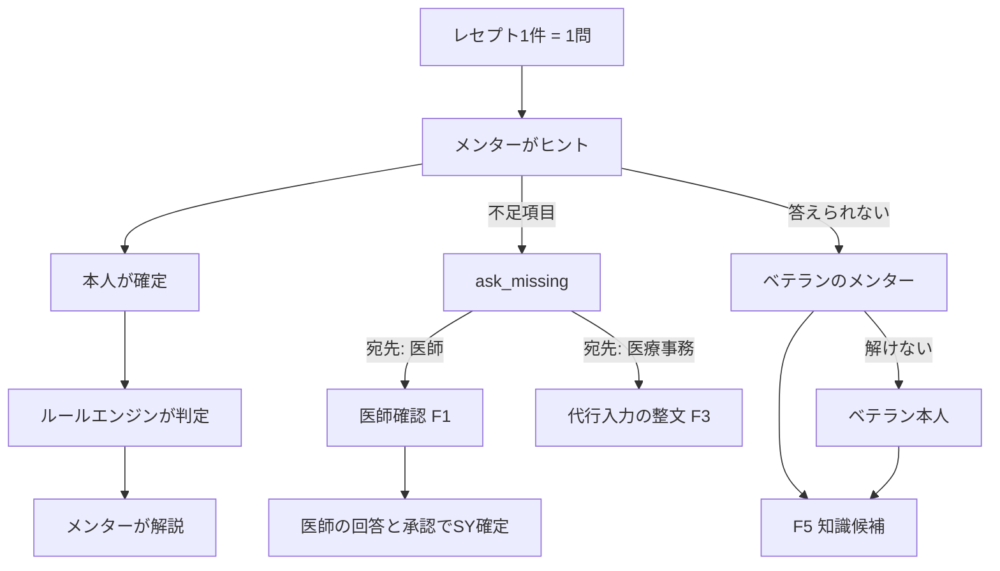
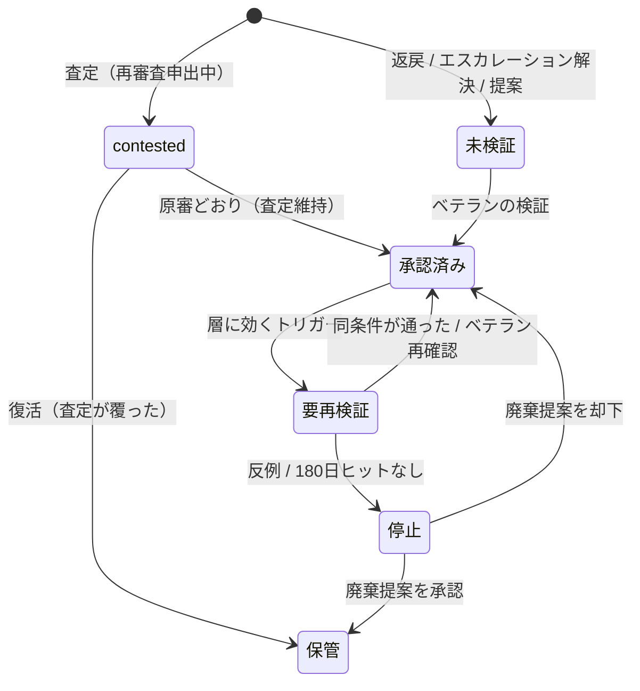
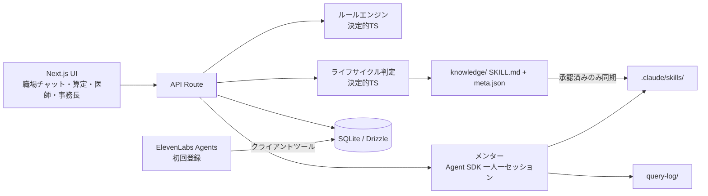

# iji-context 仕様書 — レセメン（仮）

生成元: design/iji-context/spec-input-iji-context.md（改訂版 2026-11-04、写し source-input.md sha256 先頭 af2d8a7d64de）／生成日 2026-11-04
数字の出典: design/iji-context/sources/evidence-master-iji-context.md（EM）。括弧内の「決定n」「Fn」「U-x」は spec-input の番号。

## 目的

クリニックでレセプト請求を担う医療事務は、経営を支えているのに声が届かない。医師への確認には制度名すらなく（EM #13-2）、返戻のたびに積み上がるルールは誰も捨てられない（EM #9-1）。医療事務固有の離職統計は存在しない（EM #2-1）。レセメンは、医療事務一人ひとりに AI メンターをつける。カルテから算定までを診察直後に一緒に進め（EM §6-5）、医師への確認はメンターが引き受け、わからないことはメンター同士で解く。正否は決定的なルールエンジンが出し、AI は答えを出さず、理由と筋道を示す。価値の中心は新人の独力化で、採用・離職への効果は主張しない仮説として扱う（決定5）。提出先は Built with Claude: Japan 2026。

## スコープ / 非スコープ

### スコープ（F1〜F11）

| # | 機能 | 一言 |
|---|---|---|
| F1 | 医師確認 | 記載不足をメンターが医師に、Non-Leading な選択式で聞く |
| F2 | AIメンター（算定伴走） | 算定の筋道と理由を出す。正否はルールエンジンが出す |
| F3 | 代行入力の整文 | 代行入力の文章を整え、足りない項目は推定せずに聞く |
| F4 | レセプト照合 | 合成 UKE とカルテ・受給者証を照合し、確認してほしい点を出す |
| F5 | 知識ライフサイクル | 知識（Skill）候補の生成と、状態遷移による管理 |
| F6 | メンター同士のやり取り | 新人のメンター→ベテランのメンター→ベテラン本人の順に聞く |
| F7 | ゲーム的な処理体験 | レセプト 1 件＝1 問。スコアは非金額 |
| F8 | 初回登録の音声会話 | 3 キャラから選び、声で挨拶・名乗りをする |
| F9 | 防いだ額の可視化 | 2 系統で集計し、本人向けと事務長向けの 2 表示にする |
| F10 | レベルとキャラの成長 | 処理件数でレベルが上がり、メンターの振る舞いが変わる |
| F11 | ボトムアップ提案ループ | 誰でもルール改善を投稿でき、F5 の状態遷移に乗せる |

### 非スコープ

- 実在の患者データ・個人情報・実在のレセ電コード（すべて架空・合成）
- 2026年度点数、または 2025年3月以外の診療年月での合成
- 算定漏れの金額規模の主張／「学習する」を差別化として打ち出すこと／審査委員交代と査定傾向の因果を事実として主張すること
- 令和8年度改定の生成AI評価（保医発0305第7号）を根拠に使うこと
- 実際の請求・審査支払機関への提出、電子署名
- Slack 等の実チャットツール連携、電話での登録・会話
- 医師側の F3、キャラの育成分岐・ガチャ、同僚の機嫌・チームの空気メーター
- 事務長 KPI を評価制度へ接続すること
- 診断・治療に関わる判断

## 機能要件

### ルールエンジン（判定）

- FR-01 算定の正否・点数・背反・算定条件は、TypeScript の決定的ロジックだけで判定する。LLM には判定させない（決定1, 67）
- FR-02 ルールエンジンは、レポートA項目21 の 13 項目を自動テストのケースとして持つ（決定58）
- FR-03 ルールエンジンは K1 を合計 14,693 点、K2 を合計 6,193 点と算出する（決定55, 56。EM #7-6 とその注）
- FR-04 K1 には包括的支援加算 150 点を付けず、C101 650 点も付けない（決定55）

### 入力・UKE（F4）

- FR-05 合成 UKE は審査支払機関ごとに 1 ファイル、計 2 本とする（国保連用 K1〜K5 は IR=2、支払基金用 K6 は IR=1）（決定54, 57）
- FR-06 UKE は記録条件仕様 令和6年6月版に準拠する。形式は Shift_JIS・CSV・CRLF・EOF(0x1A)、レコード順は IR→(RE→HO/KO→SY→SI/IY/TO/CO)×n→GO（決定61）
- FR-07 入力は UKE、合成カルテ（SOAP）、受給者証情報とする。施設届出と過去月は設定ファイルの固定値とする（決定62）
- FR-08 F4 は「病名と処方の不一致」「背反」「加算の取り忘れ」を「確認してほしい点」として出す（F4）
- FR-09 レセ電コードはすべて架空とする（決定60）

### メンター（F2・F6・F10）

- FR-10 メンターは医療事務 1 人につき 1 セッション（Agent SDK）とする（決定21）
- FR-11 メンターが出すのはヒント・理由・解説だけで、ルールエンジンの判定結果を上書きしない（決定2, F2）
- FR-12 院内ローカルルールは新人への助言に使わない（決定8）
- FR-13 メンターが持つツールは `query_skills / query_history / ask_peer_mentor / ask_human / ask_doctor / ask_missing` の 6 つとする（決定68）。`query_skills` は Agent SDK の Skill（同期先の承認済み知識だけを有効にする）で実現し、読む直前に Hooks で知識の状態を確かめる（2026-11-06 ユーザー判断）
- FR-14 新人のメンターが答えられない問いは、ベテランのメンター（別セッション）に渡す。それでも解けないときだけ、ベテランのメンター経由でベテラン本人に届ける（決定22, F6）
- FR-15 エスカレーションで解けた案件は「ベテランの判断」層の知識候補になる（決定23）
- FR-16 本人のレベルは処理件数の累計で Lv.1〜10 とし、本人画面の端に小さく出す。他人のレベルは見せない（決定32）
- FR-17 レベルが上がると、メンターの振る舞い（ヒント量・ヒントを出す時機・呼び方と口調）が変わる。一定レベル以上では、他の医療事務のメンターから質問が届く（決定33）
  - 高いレベルでもヒントは聞かれたときに一言だけ出すが、声かけは積極的にする（「あなたなら余裕ですね」のような信頼を伝える一言）。コンセプトは「働くを楽しくするメンターで同僚」（2026-11-06 ユーザー判断）
  - レベルのしきい値は、月に数百件を扱う前提で Lv.10＝1,000 件（2026-11-06 ユーザー判断。途中の値は config/levels.json）
- FR-18 レベル名には、職位や評価を連想させる語を使わない（決定34）

### キャラ・音声（F8）

- FR-19 キャラは男性 3 名で、本人が自分で選ぶ。質問による振り分けはしない（決定24）
- FR-20 伝え方のタイプは本人の自己申告を任意で受け付ける。診断はしない（決定25）
- FR-21 各キャラは静止画の立ち絵で、6 表情（通常／笑顔／考え中／驚き／困り／称賛）を持つ。アニメーションはしない（決定26）
- FR-22 表情はメンター出力の構造化フィールド `expression`（enum）で切り替える（決定28）
- FR-23 「困り」は新人の誤りには出さない。出すのはカルテ不足（医師側）と審査が難しい場面だけ（決定27）
- FR-24 キャラが喜ぶのは「知識が増えた／承認された／連続正解／月次完了」の正方向の出来事だけとする（決定36）
- FR-25 立ち絵は 1 キャラ 1 枚のキャラクターシート（6 表情のグリッド）として生成し、スクリプトで分割する（決定29）
- FR-26 音声は初回登録と節目（月次提出完了など）だけで使い、算定作業中はテキストのみとする（決定30）
- FR-27 初回登録の音声は ElevenLabs Agents（LLM は Claude）で行う。選んだキャラと呼び名は、クライアントツールでアプリ DB に書く（決定31）

### 処理体験（F7）

- FR-28 レセプト 1 件を 1 問とし、メンターのヒント→本人が確定→ルールエンジンの結果→メンターの解説、の順に進める（F7）
- FR-29 スコアは件数・連続正解などの非金額とし、ランキング・ノルマにしない（F7, 決定49）

### 医師確認・代行入力（F1・F3）

- FR-30 医師確認の質問は、AHIMA/ACDIS 2026年版の 7 要件を満たす：①臨床指標を引用 ②誘導しない ③選択肢に「その他」「判定不能」を必ず含める ④点数・金額に触れない ⑤AI が作った質問も同じ基準 ⑥記録を保存 ⑦未回答ならエスカレーション（決定37）
- FR-31 呼び名は UI 上「医師確認」で統一する（決定38）
- FR-32 SY が確定するのは、医師の回答と承認があったときだけとする（F1）
- FR-33 医師の承認は確認ボタンで行い、承認者名と日時をログに残す（決定39）
- FR-34 未回答の質問は翌営業日にリマインドし、3 営業日で保留（算定しない）にする（決定40）
- FR-35 質問の記録は `query-log/` に 1 質問 1 ファイルで、Markdown と JSON を併記する（決定41）
- FR-36 不足項目を聞くときは `ask_missing(target, field, why)` を必ず通す。宛先が医師なら F1、医療事務なら F3 になる（決定42）
- FR-37 代行入力のあと、UI は必ず医師確認のステップを挟む（決定43）

### 知識ライフサイクル（F5・F11）

- FR-38 知識は 4 層（制度／地域／ベテランの判断／院内）で管理し、層ごとに生成・減衰ルールを分ける（決定7）
- FR-39 知識の実体は `knowledge/<layer>/<slug>/SKILL.md` とサイドカー `meta.json`（layer / status / source_event / valid_from / review_by / hits / misses / retired_reason）とする（決定18）
- FR-40 候補は生成した瞬間から全員に見え、「未検証」ラベルが付く。可視性に承認ゲートは置かない（決定10）
- FR-41 ベテランの検証で、状態が未検証から承認済みに変わる（決定11）
- FR-42 返戻を取り込むと、すぐにルール候補を生成する（決定12）
- FR-43 査定は必ず知識化する。再審査申出中は contested 状態とする。結果が原審どおり（査定が維持された）なら承認済みにする。復活（査定が覆った）なら保管にし、あわせて「この項目は再審査で認められた」を地域層の知識として、承認済み・出所＝再審査結果で別に登録する（決定13、U-G）
- FR-44 再検証のトリガーは ①診療報酬改定（偶数年6月1日）②支払基金の改選（奇数年6月1日。国保連は都道府県ごと）③180 日ヒットなし（初期値）とする（決定14）
- FR-45 トリガーだけでルールを無効にしない。適用期間・版・廃止理由を残す（決定15）。遷移は次のとおり（U-H）
  - 承認済み→要再検証：トリガー①②③のうち、その層に効くもの（FR-66）
  - 要再検証→承認済み：次の請求で同じ条件が通った、またはベテランが再確認した
  - 要再検証→停止：反例が出た（同じ条件で返戻・査定）、または 180 日ヒットなし
  - 停止→保管：廃棄提案をベテランが承認した
  - 停止→承認済み：廃棄提案をベテランが却下した
- FR-46 院内ローカルルールはヒットしなくなったら廃棄提案を出し、可否は人が決める（決定9）
- FR-47 状態判定と減衰は TypeScript の決定的ロジックで行い、LLM に任せない（決定67）
- FR-48 承認済みの Skill だけを、決定的スクリプトで `.claude/skills/` に同期する。それ以外の状態はロードさせない。同期先もコミットする（決定19）
- FR-49 知識ディレクトリは git で管理し、育った履歴を `git log` で見せられるようにする（決定20）
- FR-50 個人名はデフォルトで出さず、知識はチームの共有知として扱う。本人向けの名前表示はオプトインとする（決定17）
- FR-51 誰でもルール改善を投稿でき、投稿は F5 の状態遷移に乗る（F11）
- FR-64 状態は「候補（未検証）／承認済み／contested／要再検証／停止／保管」の 6 つで閉じる（U-H）
- FR-65 共感数は候補（未検証）に付く属性で、状態遷移は起こさない。効くのはベテランの検証キューの並び順だけ（共感が多い候補ほど先に検証される）。閾値による自動承認はしない（U-I）
- FR-66 層ごとの生成元と、効く再検証トリガーは次の表で固定する。条件の細部は design-loop の起草で詰めてよいが、この対応は変えない（U-J）

| 層 | 生成元 | 効くトリガー | 備考 |
|---|---|---|---|
| 制度 | 初期投入（点数表・留意事項から手で起こす） | ①改定のみ | 減衰は改定時だけ |
| 地域 | 返戻・査定・再審査結果 | ②改選、③N日 | |
| ベテランの判断 | エスカレーションの解決 | ③N日のみ | 改選では落とさない。ただし既存の知識の修正版（relates_to を持つもの）は、元の知識の層のトリガー（制度なら①、地域なら②）も効く（2026-11-06 ユーザー判断。design.md v21 X-57） |
| 院内 | 返戻起点、または手動登録 | ③N日のみ | 助言には使わない。停止→廃棄提案が出やすい |

### 防いだ額（F9）

- FR-52 「防いだ」は、提出前にルールエンジンまたは F4 が指摘し、提出までに本人が修正した項目に限る。自己申告は数えない（決定44）
- FR-53 金額は点数×10円で換算し（EM #7-5）、公費・自己負担の内訳は分けない。表示には常に「推定」を付ける（決定44, 45）
- FR-54 「取りこぼしを防いだ（算定漏れ）」と「差し戻しを防いだ（返戻・査定リスク）」の 2 系統で集計する（決定46）
- FR-55 医師の記載が原因で F1 経由で解決した項目は「医師記載起因」として別に集計する（決定47）。件数に加えて、医師の回答で算定できるようになった点数も金額（推定）で出し、医師側の取りこぼしを示す材料にする（2026-11-06 ユーザー判断）
- FR-56 「多く取る」方向の表示・誘導は一切入れない（決定48）。趣旨は、経営の目線を持たせすぎて取れない算定まで取りにいかせないこと。ルールエンジンが正しいと判定した算定との差（過少の区分を正しい区分に直した差額など）は「取りこぼしを防いだ」に数えてよい（2026-11-06 ユーザー判断）
- FR-57 本人向けの表示はオプトインで、既定は非表示とする。トグル 1 つで詳細（防いだ額、ルール貢献数）を開ける（決定35, 49）
- FR-58 見逃した額（返戻になった額）は本人向けに出さず、事務長向けに集計だけを出す（決定50）

### UI・評価

- FR-59 UI は Next.js の自作とし、職場チャット風の画面（人同士の場）、算定画面、医師画面、事務長レポートを持つ（決定70）
- FR-60 評価は prompt-eval の超軽量版 10 ケースで行う（理由があるか／医療判断をしていないか／7 要件を満たすか）（決定71）

### 提出物

- FR-61 README に「2024年度改定後（2025年4月のDX加算改定前）」「架空コード」「医療事務（請求・記載）の支援であり、診断・治療に関与しない」「代行入力は医師の確認・承認を前提とする」「数字は EM の採用値のみ」を明記する（決定52, 60, 77）
- FR-62 README の背景節に、紹介手数料の問題への国会・業界の指摘を、出典付きで 1 段落置く（決定75）
- FR-63 `docs/` に、匿名化したインタビュー要約、spec-input、EM、design.md、ledger.md、意思決定の経緯を含める（決定76）

## 制約・非機能

- **技術**：TypeScript 固定。Claude Agent SDK を Next.js の API Route 内で動かし、DB は SQLite（Drizzle）。Python は使わない（決定65, 69）
- **外部サービス**：音声は ElevenLabs Agents、立ち絵の生成は Gemini（生成物は自作素材として公開リポジトリに含める）（決定29, 31）
- **予算**：開発はハッカソン付与の Max 5x、ランタイムは $500 の API クレジット（`ANTHROPIC_API_KEY`）（決定66）
- **締切・体制**：開発者 1 名、2026-11-04〜11-08。締切は 2026-11-08 20:00 JST
- **提出物**：日本語の概要・3 分デモ動画・公開 GitHub リポジトリ。リポジトリは公開必須で、シークレットは環境変数だけで扱う
- **既存資産**：ハッカソン期間中の新規制作に限る。既存コード（MOEGI 等）は使わない
- **数字**：EM の採用値だけを使う（対象は制度・統計・点数・価格・海外比較）。EM §4 の不採用値は使わない
- **語**：「教育」「学習」「学ぶ」「教える」をレセメン自身の説明に使わない（README・概要文・動画・docs/・UI 文言。コード内コメントは除く）
- **データ**：合成データだけを使う。AI は病名・施行事実を作り足さない
- **ライセンス**：取り込むときに確認する（uke-pseudonymize は AGPL）
- **開発の進め方**：F5 とルールエンジンは /design-loop で進める。それ以外は spec.md から直接実装計画に落とす。どちらも承認なしで実装しない

## 構造図

### 図1 算定 1 件の流れ（F7・F2・F1・F6・F5）

### 図2 知識の状態遷移（F5）

### 図3 構成（決定65〜70）

## 検証可能な完了条件

1. ルールエンジンの自動テストで、13 項目のケースがすべて通る
2. ルールエンジンが K1 を 14,693 点、K2 を 6,193 点と算出する
3. パーサが 2 本の UKE（IR=2 で K1〜K5、IR=1 で K6）を読み込み、6 件のレセプトとして扱える
4. 状態遷移の自動テストで、FR-43・FR-45・FR-64 の遷移がすべて確認でき、FR-66 の表にない層×トリガーの組み合わせでは要再検証にならず、共感数では状態が変わらない
5. 同期スクリプトを実行すると、`.claude/skills/` には承認済みの Skill だけが入る
6. 医師確認を 1 件流すと、`query-log/` に Markdown と JSON が 1 組でき、承認者名と日時が残る
7. prompt-eval 10 ケースで、理由がある・医療判断をしていない・7 要件を満たす、をすべて満たす
8. 本人画面に見逃した額と他人のレベルが出ず、防いだ額は既定で非表示になっている
9. README・docs/・UI 文言を grep して、禁止語（教育／学習／学ぶ／教える）がレセメン自身の説明に出てこない
10. README に FR-61 の 5 項目が書かれている
11. 公開リポジトリに、シークレット・実在データ・report-C が含まれていない

## 未決事項

spec-input から引き継ぐもの：

| # | 論点 | 材料 |
|---|---|---|
| U-A | 3 分動画の最終構成 | 仮置きは K1（算定伴走。冒頭に声の挨拶、同じカルテへの Lv.1／Lv.8 の反応を 10 秒で）→K4（医師確認）→K6（賞味期限）。制作直前に再協議する |
| U-B | 事務長向け月次レポートの最小構成 | 案：防いだ額 2 系統／医師記載起因の割合／残存する漏れの推定／今月のルール増減 |
| U-C | 審査員交代を推定で検知する機能 | 手動登録だけで十分。余裕があれば |
| U-D | 正式名 | 候補：ヨコ、ヨコセン、レセ友、となり |
| U-E | 知識の成長をデモのどの画面で見せるか | `git log`／スキル数の増減／Lv.1 と Lv.8 の並び |
| U-F | K3 の頻回訪問加算の要否と訪問の日付配置、K5 の実日数 | 告示本文（別表第七）の再確認待ち。K3 は月 12 回の仮置きを維持する |

仕様化の途中で見つかった U-G〜U-J は、2026-11-04 にユーザーが決定した（FR-43, FR-45, FR-64〜66 に反映済み）。
