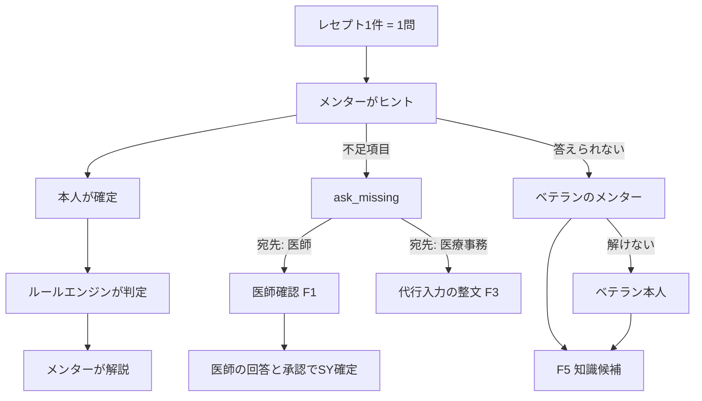
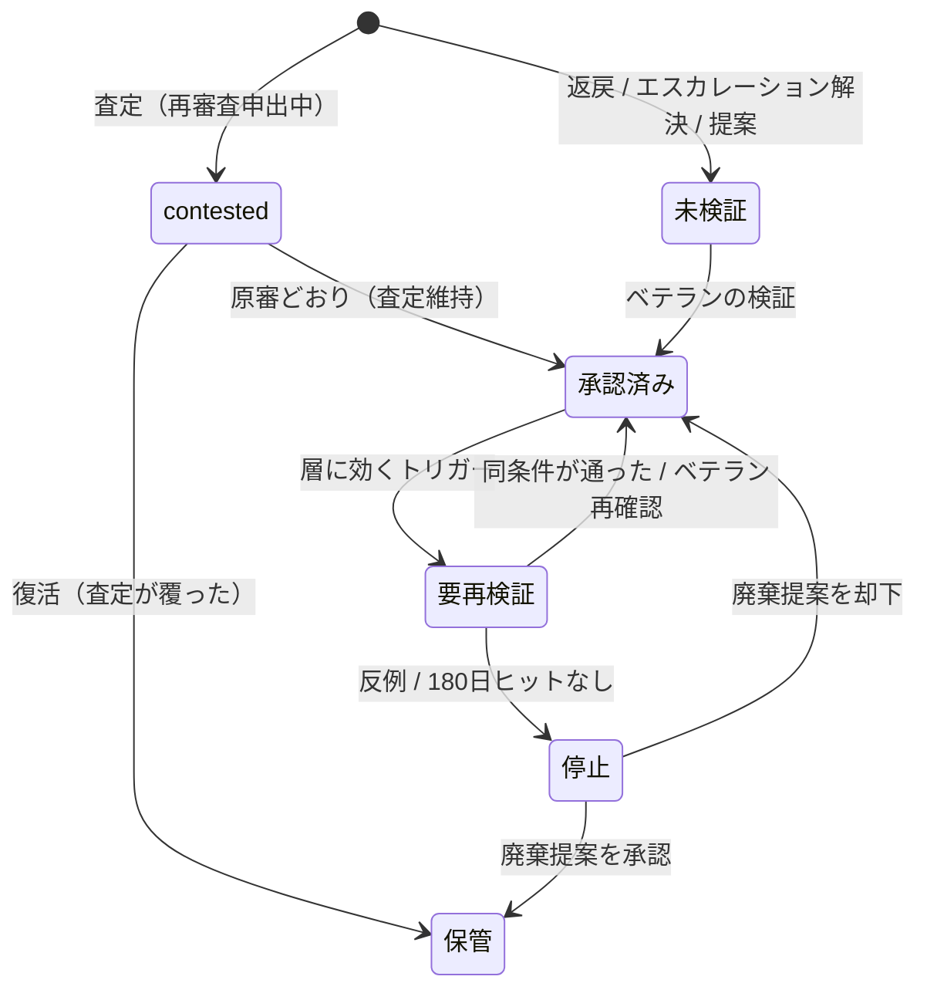
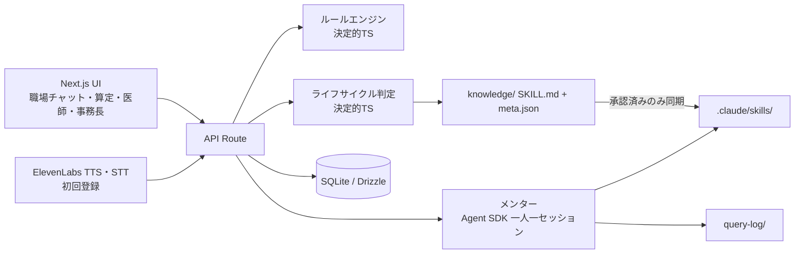
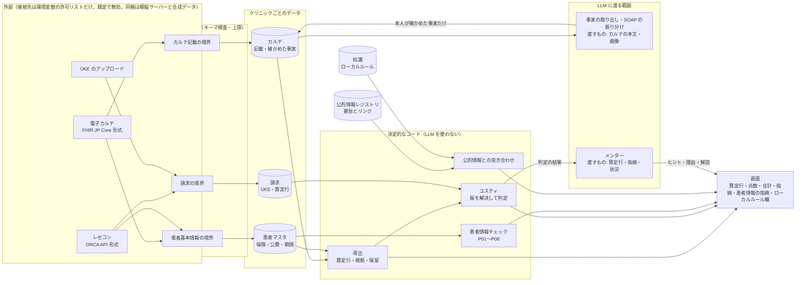
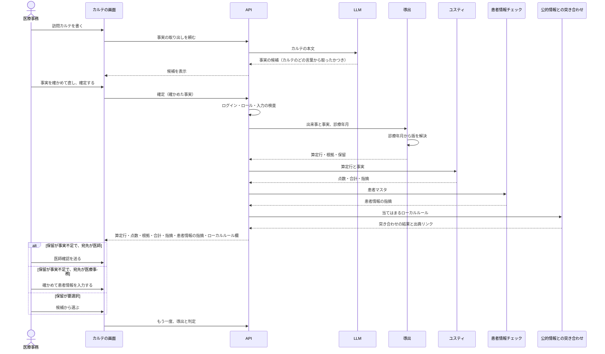
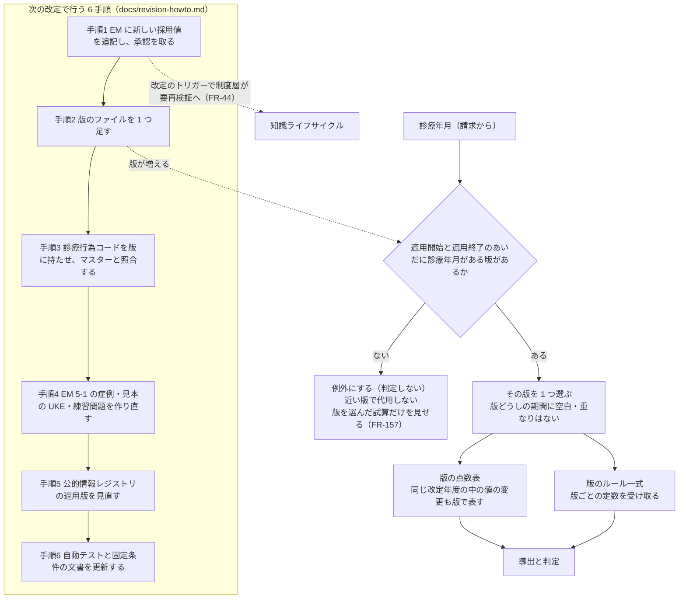
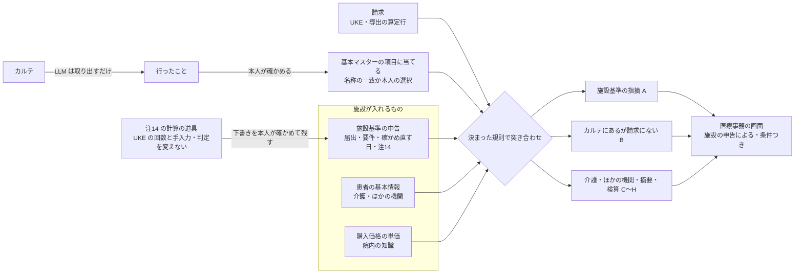
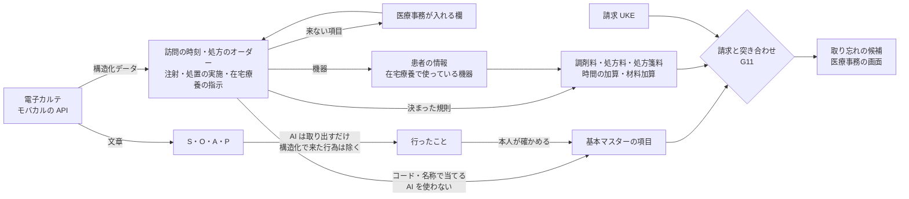

# iji-context 仕様書 — レセメン（仮）

生成元: design/iji-context/spec-input-iji-context.md（改訂版 2026-11-04、写し source-input.md sha256 先頭 af2d8a7d64de）／生成日 2026-11-04
数字の出典: design/iji-context/sources/evidence-master-iji-context.md（EM）。括弧内の「決定n」「Fn」「U-x」は spec-input の番号。
改訂 2026-11-17: 仕様の正は本書とする（spec-input は 2026-11-04 時点の決定の記録として残し、食い違う場合は本書を採る）。FR-87〜FR-152 と図4〜6 を加え、既存の FR を改訂した。改訂した箇所には「2026-11-17 改訂」と付け、決定の結論は末尾の「2026-11-17 の決定」に置く。FR-87 以降と 2026-11-17 に改訂した FR では、点数・金額・施行日・記録条件仕様の版を本書に書かず、EM の採用値による。
改訂 2026-11-21: 設計 v22〜v24（design.md §2〜§12）と台帳（ledger.md）2026-11-17〜11-21 の決定のうち、本書に入っていなかったものを反映した。FR-153 以降を加え、既存の FR を改訂した。改訂した箇所には「2026-11-21 改訂」と出典（設計書の節・台帳の日付・L 番号）を付ける。決まっていないことは「未決事項」に置く。

## 目的

クリニックでレセプト請求を担う医療事務は、経営を支えているのに声が届かない。医師への確認には制度名すらなく（EM #13-2）、返戻のたびに積み上がるルールは誰も捨てられない（EM #9-1）。医療事務固有の離職統計は存在しない（EM #2-1）。レセメンは、医療事務一人ひとりに AI メンターをつける。カルテから算定までを診察直後に一緒に進め（EM §6-5）、医師への確認はメンターが引き受け、わからないことはメンター同士で解く。正否は決定的なルールエンジンが出し、AI は答えを出さず、理由と筋道を示す。価値の中心は新人の独力化で、採用・離職への効果は主張しない仮説として扱う（決定5）。提出先は Built with Claude: Japan 2026。

2026-11-17 改訂：合成データの診療年月は 2026年10月、点数は令和8年度改定後とする（値は EM の採用値）。使う人は、クリニックに属する医療事務（事務・ベテラン）・事務長・医師で、それぞれロールを 1 つ持つ（FR-132）。カルテを確かめて確定すると、同じ画面に算定行・点数・合計・指摘が出る（FR-94〜103）。算定行を作るのも正否を出すのも決定的なコードで、AI が担うのはカルテの文から事実を取り出すところまでと、理由と筋道を示すところである。

2026-11-21 改訂：用途は公開ではなく社内のテストとする（台帳 2026-11-20 ユーザー判断 (3)）。利用者が入れる実在のデータも、注意書きへの同意を取って受け取る（FR-165〜169）。

## スコープ / 非スコープ

### スコープ（F1〜F11）

| # | 機能 | 一言 |
|---|---|---|
| F1 | 医師確認 | 記載不足をメンターが医師に、Non-Leading な選択式で聞く |
| F2 | AIメンター（算定伴走） | 算定の筋道と理由を出す。正否はルールエンジンが出す |
| F3 | 代行入力の整文 | 代行入力の文章を整え、足りない項目は推定せずに聞く |
| F4 | レセプト照合 | 合成 UKE とカルテ・受給者証を照合し、確認してほしい点を出す |
| F5 | 知識ライフサイクル | 知識（Skill）候補の生成と、状態遷移による管理 |
| F6 | メンター同士のやり取り | 新人のメンター→ベテランのメンター→ベテラン本人の順に聞く |
| F7 | ゲーム的な処理体験 | レセプト 1 件＝1 問。スコアは非金額 |
| F8 | 初回登録の音声会話 | 4 キャラから選び、声で挨拶・名乗りをする |
| F9 | 防いだ額の可視化 | 2 系統で集計し、本人向けと事務長向けの 2 表示にする |
| F10 | レベルとキャラの成長 | 処理件数でレベルが上がり、メンターの振る舞いが変わる |
| F11 | ボトムアップ提案ループ | 誰でもルール改善を投稿でき、F5 の状態遷移に乗せる |

### スコープの追加（2026-11-17。F1〜F11 の外）

| 領域 | 内容 | FR |
|---|---|---|
| 改定の版 | 診療年月から改定の版を解決する仕組み。版 1 つ＝ファイル 1 つ。診療年月を 2026年10月・令和8年度改定後に移す | FR-87〜93、FR-147 |
| 施設の設定と症例 | 架空クリニックの施設の設定を決め、症例ごとに上書きできるようにする。在医総管の注16 の基準を満たさない場合の症例を 1 つ足す | FR-148〜152 |
| カルテ→算定 | 確かめた事実と出来事から、算定行をコードで導出する層。根拠と保留を添えて、カルテの画面に算定行・点数・合計・指摘を出す | FR-94〜103 |
| 連携 | 患者基本情報／請求／カルテ記載の 3 つの境界。UKE のアップロード、ORCA API 形式・FHIR JP Core 形式の読み取りコネクタ（相手は同梱の模擬サーバー） | FR-104〜115 |
| 患者情報チェック | 保険・公費・期限などの指摘 P01〜P08。ユスティとは別欄で、宛先は医療事務。患者マスタを新設する | FR-116〜123 |
| 公的情報レジストリ | 疑義解釈・審査情報提供事例等を 1 文書 1 件で持ち、ローカルルールと決まった規則で突き合わせて表示する。矛盾の恐れがある承認済みローカルルールは要再検証にしてレセメン会議に出す | FR-124〜131 |
| 品質・セキュリティ | ロールと権限表、医師の回答・承認の本人記録、全 API の入力検証、招待制登録、Origin 検証、回数制限、監査ログ、マイグレーション、CI、CSP | FR-132〜146 |

### スコープの追加（2026-11-21。設計 v22〜v24 で決まり、実装したもの）

| 領域 | 内容 | FR |
|---|---|---|
| 実在の診療行為コード | 架空コードをやめ、EM §2-8 のコードを版に持つ | FR-09・FR-90 の改訂、FR-153〜155 |
| 改定の比較と試算 | 令和6年度→令和8年度の比較。版を選んで試しに算定する。版のない診療年月の UKE | FR-156〜158 |
| UKE の読み書きと点検の画面 | 記録条件仕様に合わせた単位の読み書き、対象外の単位、請求 id、記録のない請求、取り込んだレセプトの点検の画面 | FR-159〜164 |
| 実在のデータの受け入れ | 注意書きと同意、AI に送る文脈から識別子を外す、取り込んだファイル・カルテを消す | FR-165〜169 |
| 公的文書の確認 | 公的文書の条件に当たるかを人が確かめる | FR-170 |
| ルールの事実と入力 | R03・R07・R09・R10 の事実の追加、情報不足の項目の入力、医師の確認項目 | FR-171〜174 |
| 摘要欄の記載の点検 | R17 と、導出が作る摘要欄の記載 | FR-175・176 |
| 全部の行の点検 | 公開データ（基本マスター・電子点数表・コメント関連テーブル・チェックマスタ）で動く点検 G01〜G09 | FR-177〜187 |

### スコープの追加（2026-11-22。実務の算定）

| 領域 | 内容 | FR |
|---|---|---|
| A 施設基準 | 施設が施設基準を申告し、全項目で算定の可否と施設基準で分かれるコードを判定する（先に作る）。注14 の減算の申告と、基準に当たるかを数える計算の道具を含む（2026-11-23 追加） | FR-188〜191・FR-204 |
| B 取り忘れ | カルテから行ったことを取り出し、基本マスターに当てて請求と突き合わせる（全項目。先に作る） | FR-192〜195 |
| C〜I | 介護との調整、ほかの医療機関・訪問看護、摘要欄の残り、導入時の聞き取り、検算の形、購入価格、合格の基準 | FR-196〜202 |
| 取りこぼさない仕掛け | A〜I の進み具合を項目ごとに持ち、全部が通るまで完了としない | FR-203 |

### 非スコープ

- 実在の患者データ・個人情報を同梱すること（同梱するデータはすべて合成。利用者が入れる実在のデータは、注意書きへの同意を先に取って受け取る：FR-165〜169。2026-11-21 改訂。出典：design.md §11-11、台帳 2026-11-19 ユーザー判断 (1)、CLAUDE.md 固定条件（2026-11-20 変更））。レセ電コードは実在の診療行為コードを使う（FR-09。2026-11-21 改訂。出典：design.md §11-1、台帳 2026-11-19 ユーザー判断）
- 算定漏れの金額規模の主張／「学習する」を差別化として打ち出すこと／審査委員交代と査定傾向の因果を事実として主張すること
- 令和8年度改定の生成AI評価（保医発0305第7号）を根拠に使うこと
- 実際の請求・審査支払機関への提出、電子署名
- Slack 等の実チャットツール連携、電話での登録・会話
- 医師側の F3、キャラの育成分岐・ガチャ、同僚の機嫌・チームの空気メーター
- 事務長 KPI を評価制度へ接続すること
- 診断・治療に関わる判断

2026-11-17 に加えたもの（「2026年度点数、または 2025年3月以外の診療年月での合成」は非スコープから外した）：

- 実機の ORCA・電子カルテ・レセコンへの接続（相手は同梱の模擬サーバーだけ）→ 2026-11-21 改訂：接続先は環境変数の許可リストだけで、既定で無効とする（FR-113・FR-114）。許可リストにない接続先へはつながない（出典：design.md §11-11、CLAUDE.md 固定条件（2026-11-20 変更））
- 保存時の暗号化（注意書きと docs/security.md の残余リスクに書く。design.md §11-11）
- 外部への書き込み（コネクタは読み取り専用）
- 診療行為マスター・コメント関連テーブルなどの本体を同梱すること（コードは EM §2-8 の行だけを版に持つ。FR-153・FR-154。2026-11-21 改訂。出典：design.md §11-1・§12-1）
- 実在の UKE の受け入れ（架空コードの表にないコードを含むファイルは拒否する）→ 2026-11-21 改訂：非スコープから外した。対応していないコードの単位は点検の対象外として受け取る（FR-160）。出典：design.md §11-11、L-51、台帳 2026-11-19 ユーザー判断 (1)
- 入院のレセプトと、TI・TR・TS のレコードを含むレセプトの点検（レセプト単位で読めない請求として扱う。台帳 2026-11-20 実在の形の UKE の読み取り）
- 公的情報の全件の取り込みと、自動の巡回・更新の検知
- 公的情報の原文の転載
- LLM による、公的情報とローカルルールの矛盾の判定
- 公的情報を理由にした、ローカルルールの自動の停止
- 薬局の疑義照会
- 2024年度版の併存（同梱する版は令和8年度改定後のものだけ）→ 2026-11-21 改訂：請求の判定に 2024年度（令和6年度）版を使うこと。令和6年度の版は改定の比較と試算の表示にだけ持つ（FR-156・FR-157。出典：design.md §11-2・§11-12、CLAUDE.md 固定条件（2026-11-20 変更））
- 令和6年度のルールの指摘（改定の比較は算定行と点数だけを比べる。L-52）
- 予測で次の改定の版を作ること（台帳 2026-11-19 ユーザー判断、design.md §11-2）
- 単一建物の人数別の点数、機能強化型の点数
- 看取り加算・死亡診断加算の自動の選択
- 摘要欄の理由の文の下書きをメンターに頼むこと（人が書く。L-57）
- 本部点検条件（個別の事例の条件式。L-62）と、院外処方の薬の適応・量（医科のレセプトに薬が載らない。L-66）の点検
- SSO・多要素認証、保存時の暗号化、WAF、複数台構成、ブラウザを使った E2E テスト

## 機能要件

### ルールエンジン（判定）

- FR-01 算定の正否・点数・背反・算定条件は、TypeScript の決定的ロジックだけで判定する。LLM には判定させない（決定1, 67）
- FR-02 ルールエンジンは、レポートA項目21 の 13 項目を自動テストのケースとして持つ。13 項目と R01〜R14 は改定の版ごとに見直し、令和8年度改定後の条件でケースにする。見直しの結果は EM に残す（決定58。2026-11-17 改訂）。令和8年度で新設したルールは R15（物価対応料）と R16（管理料の種別：居宅か施設入居等か）、v23 で足したルールは R17（摘要欄の記載。FR-175）で、番号は振り直さず、廃止した番号は使い回さない（2026-11-21 改訂。出典：design.md §2-3）
- FR-03 ルールエンジンが算出する K1・K2 の合計は、EM 5-1 の採用値（令和8年度改定後）と一致する。数値は本書に書かない（決定55, 56。2026-11-17 改訂）
- FR-04 K1 には包括的支援加算を付けず、C101 も付けない。付けない項目とその理由は EM 5 の採用値による。点数は本書に書かない（決定55。2026-11-17 改訂）
- FR-171 R03（包括的支援加算）は、別表第八の三（EM R8-15a の 7 つの状態）で場合分けする。要介護度が下限以上／障害支援区分が 2 以上／ほかの状態に当たる、のどれかが分かっていれば対象、どれにも当たらないと分かっていれば対象外。決まらない間は、加算の行があっても要件不足と断定せず情報不足にし、答えで結果が変わる項目だけを聞く（要介護度・障害支援区分は医療事務、ほかの状態は医師）。導出（D04）と同じ述語を使う。障害支援区分は医師の確認にしない（2026-11-21 追加。出典：design.md §11-4、L-48、台帳 2026-11-18 ユーザー指示・2026-11-19 ユーザー判断「障害支援区分は医師の確認にしない」・2026-11-20 段 5）
- FR-172 R07・R09・R10 を一次資料（EM #7-8 改・#7-8a・#7-8b・#7-11〜#7-15）に合わせる。R10：同じ日に訪問診療料と往診料の両方を算定できるのは、訪問診療の後に急変などで往診したときの往診料だけとし、その事実は日付ごとに医療事務が確かめる（ある日の答えはほかの日に効かない）。R09：在宅ターミナルケア加算は、15 日間に 2 回以上の往診・訪問診療のほか、退院時共同指導料1 を算定し訪問診療を行った場合も要件を満たす（回数が足りないときだけ聞く。医療事務）。R07：判定の単位は処方 1 回ごと。内服の種類は F200 注3 の数え方で数えたものとし、読み取った数は医療事務が確かめる。区分 2 の理由は 7 種類以上と向精神薬の長期処方の 2 つで、長期処方かどうかは日付ごとに医師に確かめる（処方に不安・不眠の薬が含まれないと分かっている日は聞かない）。分からない日は区分 3 とみなさず、導出は処方箋料を保留にし、R07 は情報不足を返す。その日に処方の記録がない処方箋料の行は情報不足にする（2026-11-21 追加。出典：design.md §11-5（X-79・X-85・C-87・C-88）、L-49・L-54、台帳 2026-11-20 段 5）
- FR-175 R17「摘要欄の記載」：記載要領 別表Ⅰ のうち扱う区分の行（EM §2-10 の行だけ。コメント関連テーブルは同梱せず写さない）を版に持ち、算定した行に要るコメントがレセプトにあるかを、コメントの置き場所ではなくコメントコードで見る。指摘は 3 種類：記載もれ（要る数のコメントがない）／形式（文字データがコードの形式に合わない。全角は半角に寄せてから見る）／食い違い（訪問日・急性増悪の週の訪問日・死亡日・包括的支援加算の状態・在宅移行早期加算の算定開始日が、行や確かめた事実と違う）。指摘の種類「記載もれ」の宛先は医療事務。条件を決める事実が不明なら情報不足、比べる事実が不明なら比べない。理由の文の中身は読まず、LLM は使わない。点検している項目の数を画面の説明に出し、点検しない記載は EM §2-10 に理由つきで書く。コメントを持たない作り方の請求（練習問題・選択モード・問題の請求）では R17 は何も返さない。練習問題に R17 は足さない。知識の当てはめの「その区分にコメントがあるか」には、定められた記載のコードを数えない（2026-11-21 追加。出典：design.md §11-13（C-91・C-93・X-80・X-91）、L-56・L-59、台帳 2026-11-19 ユーザー判断 (3)「摘要欄の点検は肝なので入れる」・2026-11-20 段 6c）

### 入力・UKE（F4）

- FR-05 同梱する見本の合成 UKE は審査支払機関ごとに 1 ファイル、計 2 本とする（国保連用 K1〜K5・K7 は IR=2、支払基金用 K6 は IR=1。症例は EM 5-1 の 7 症例）。診療年月は config/demo.json による（FR-91）。取り込める UKE は見本に限らない（FR-106）（決定54, 57。2026-11-17 改訂。2026-11-21 改訂：FR-150 の症例は K7 で、国保連用に入れる。出典：design.md §1（K7 の説明）、L-50、EM 5-1）
- FR-06 UKE は記録条件仕様に準拠する。版は EM 12-1 の採用値による。形式は Shift_JIS・CSV・CRLF・EOF(0x1A)、レコード順は IR→(RE→HO/KO→SY→SI/IY/TO/CO)×n→GO（決定61。2026-11-17 改訂）。2026-11-21 改訂：読み書きは記録条件仕様（医科用）令和8年8月版に合わせ、FR-159 の単位で行う。読むレコードは仕様の 18 種（SN・JD・MF・GR・SJ も読む）とし、上の順は最小の形として残す（出典：design.md §11-14、台帳 2026-11-20 実在の形の UKE の読み取り）
- FR-07 入力は UKE、合成カルテ（SOAP）、受給者証情報とする。施設届出と過去月は設定ファイルの固定値とする。施設の設定は症例ごとに上書きできる（FR-149）（決定62。2026-11-17 改訂）
- FR-08 F4 は「病名と処方の不一致」「背反」「加算の取り忘れ」を「確認してほしい点」として出す（F4）
- FR-09 レセ電コードはすべて架空とする（決定60）。→ 2026-11-21 改訂：レセ電コードは実在の診療行為コードとする。架空にしていたのは誤りだった。採用するコードは EM §2-8 の行だけで、版ごとに持つ（FR-153）（出典：design.md §11-1、台帳 2026-11-19 ユーザー判断、CLAUDE.md 固定条件（2026-11-20 変更））
- FR-67 医療事務が確かめた患者情報（要介護度・別表第七・別表第八の二・在宅酸素療法）を、確かめた根拠と日付つきで患者ごとに残す。判定はカルテ側の値に最新の記録を重ね、要介護度は有効期間の終わりを過ぎたら「分からない」に戻す。患者は患者マスタの id で見分け（FR-121）、確かめた患者情報の記録は患者マスタに付ける（2026-11-07 決定。2026-11-17 改訂）。医療事務が確かめる患者情報に、居住の場所（居宅か施設入居等か）・文書の提供・緊急往診加算の対象の患者か・管理料を算定する患者か（計画的な医学管理を行っているか）・同じ日の訪問診療料と往診料が別々の診療か（診療日ごと）を足す。どれも「分からない」を持ち、入るまでは検証では情報不足、導出では保留（事実不足）になる。聞くのは答えで結果が変わるときだけとする（2026-11-21 改訂。出典：design.md §6-1、L-17・L-45 (1)（v22 の承認で推奨どおり。台帳 2026-11-17）、台帳 2026-11-20 fix/round-28 で患者ごとの事実に移した）
- FR-173 情報不足の項目に、画面から答えを残せる。答えは請求ごとの事実（患者ごとの事実は FR-67）として残し、次の判定から重ねる。宛先を守る：医師あての事実は医師の役割だけが、医療事務あての事実は事務・ベテランだけが残せる。障害支援区分（0＝認定なし、1〜6。有効期間は持たない）を患者ごとの事実に足す。同じ文の情報不足は画面で 1 件にまとめる（2026-11-21 追加。出典：design.md §6-1・§11-4・§11-5、L-48、台帳 2026-11-20「情報不足の項目の入力」・fix/round-28）
- FR-68 訪問のあった日に、レセコンに入れる前の確認を算定画面で行う（訪問の記録）。その日のカルテとその日までの実施で、今と同じ流れ（ヒント → メンター → 確定 → 判定 → 解説）と照合・医師確認ができる。月末までに結論が変わり得るルール（R01 在医総管の区分・R09 ターミナルケア）は指摘にせず、在医総管は見込み（今月ここまでの訪問回数）だけ出す。確定は提出ではないので、適用記録を書かず、件数・レベル・防いだ額にも数えない。月末の UKE の点検は提出前の最終確認として残す（2026-11-07 ユーザー判断。UKE は提出用のファイルで、そこで初めて気づくと医師の記載を直すには遅いため）。訪問の記録は合成データの練習用として、デモの時計に関係なく全部の訪問日で開ける。カルテから導出した算定行にも、見込みの扱いと「確定は提出ではない」扱いを同じく適用する（FR-102）（2026-11-07 ユーザー判断。2026-11-17 改訂）
- FR-69 本人が患者（合成カルテのある症例 K1〜K5・K7。K6 は外来の症例で訪問カルテを持たない。2026-11-21 改訂。出典：L-50、EM 5-1）を選び、今日訪問したていで訪問カルテ（S・O・A・P・処方を自由記述。訪問診療か往診かは選ぶ）を書ける。AI が算定に要る事実（処方の分類・病名の記載・急性増悪。2026-11-21 改訂：処方に不安・不眠の薬が含まれるかも取り出す。出典：design.md §11-5、台帳 2026-11-20「情報不足の項目の入力」）を取り出し、事実ごとにカルテのどの言葉から取ったかを付ける。カルテにない言葉から取った事実は決まった規則で捨てる。本人が確かめて直した事実だけを、出来事と照合用のカルテに重ね、算定行は導出（FR-94）で作る。カルテ→出来事の変換は 1 か所に置き、訪問の記録（FR-68）と導出で共有する。そのまま訪問の記録としてユスティとメンターにつなぐ。判定は AI ではなくユスティが行う。画面は一般的なスマホのカルテの見た目にし、特定の製品に似せない（2026-11-07 ユーザー判断。2026-11-17 改訂）
- FR-70 （FR-72・FR-73 で置き換え。名前を入れるだけの入口はログインになった）使う人は、はじめに名前（呼ばれたい名前）を入れて自分の利用者を作る。キャラ・伝え方・メンターとの会話・処理件数・書いた訪問カルテ・取り込んだ UKE は利用者ごとに分ける。患者情報の記録・医師確認・知識・デモの時計は全員で共有する（2026-11-07 ユーザー判断。審査員がそれぞれ別のキャラで試せるように）。時計を動かす操作（日付の入力と「日付を進める」）は開発時だけに置き、本番（公開版）では出さない（API は本番で 404）。進めると会議の整理と医師確認の期限がクリニック全体で動くため、利用者の操作にしない。公開版では、日付に依存する見せ方（改選・長く使われていない）は見せず、改定は改定の比較（design.md §11-2）、公的文書は条件に当たるかの人の確認（design.md §11-3）で見せる。会議の整理はベテランがその場で回せる（2026-11-21 改訂。出典：design.md §11-7、L-50、台帳 2026-11-19 ユーザー判断「時計を進めて見せる代わりに、改定の比較を見せる」）
- FR-71 月末に UKE を取り込む画面を持つ。取り込んだ UKE のレセプトだけが「月末の点検（UKE・提出前）」に並ぶ。同梱の見本の 2 本（国保連・支払基金）を選ぶほか、ファイルを選んでアップロードできる（FR-106〜109）（2026-11-07 ユーザー判断。2026-11-17 改訂）。取り込んだレセプトは、UKE に書いてあるとおりのまま点検する画面でも開ける（FR-163。2026-11-21 改訂）
- FR-72 ログイン ID とパスワードで登録・ログインする。登録は招待制とする（FR-137）。誰でも登録できる状態は、環境変数で明示したときだけにする（2026-11-07 ユーザー判断の「招待コードなし」を 2026-11-17 に改訂）。パスワードは scrypt のハッシュだけを保存し、セッションは httpOnly の cookie（本番は https だけ）で渡して、DB にはトークンのハッシュだけを置く。ログインの失敗が続いたら 10 分受け付けない。サーバーは画面から送られた利用者 id を使わず、セッションで本人を決める
- FR-73 クリニック（tenant）ごとに、専用の DB・知識・同期した Skill・医師確認の記録・デモの時計・メンターの作業場所を持つ。クリニックには複数の利用者が属し、利用者はロールを 1 つ持つ（FR-132）。はじめて開いたときに制度層の知識を入れて用意する。クリニックどうしの操作は混ざらない。招待なしの登録を開放しているとき（FR-137）は、登録した人ごとにクリニックを 1 つ作り、デモ用の印を付ける（FR-144）。FR-70 の「利用者ごと」は、クリニックの中の利用者ごとの区別として残る（2026-11-07 ユーザー判断の「1 人 1 クリニック」を 2026-11-17 に改訂）
- FR-74 公開は GCP の VM（Compute Engine）に Docker Compose で置き、Caddy で https にする。データはボリュームに残す。API キーはサーバーの設定ファイル（git・イメージに入れない）で渡す。手順は docs/deploy-gcp.md（2026-11-07 ユーザー判断）
- FR-75 練習問題：よくある間違いを 1 つ入れた明細から始め、本人が直して確定し、ユスティが判定する。間違いは report-A 項目 21 の 13 項目（ルールエンジンのテストの「違反あり」）から取り、作り足さない。R13（週 4 回の訪問）は、直すのに医師への確認が要り明細だけでは正解にできないので外し、12 問とする。問題を解くのに要る事実（例：内服 7 種類、その日は往診だけ）は「状況」として画面とメンターに渡し、答え（どのルールか）は一覧に出さない。件数・レベルには数え、提出・防いだ額には数えない。条件と点数は改定の版から取り、問題文に改定に依存する値を直書きしない。問数は FR-02 の見直しの結果に合わせる（2026-11-07 ユーザー判断。2026-11-17 改訂）
- FR-76 医師確認の練習問題：カルテに書かれていない事実を推測で埋めず、医師確認を送ってから確定する。題材は根拠のある 3 つ（K3 の別表第八の二＝EM 5-1「重症区分（別表八の二: 難病）」「カルテに PD のみ記載」。2026-11-07 に K1 から入れ替え：K1 は在宅酸素療法中で、カルテだけで答えが決まるため、週 4 回の訪問と急性増悪＝report-A 項目 21 の 13、K4 の DOAC と病型＝EM 5-1）。質問は決まった形で 7 要件の検査を通す。承認された回答だけを問題の中の事実に戻し、本物の患者情報は変えない（「その他」「判定不能」は戻さない）。情報不足や照合の不一致が残ったまま確定したら不正解。題材の条件は改定の版と EM 5-1 の採用値から取り、問題文に改定に依存する値を直書きしない（2026-11-07 ユーザー判断。2026-11-17 改訂）
- FR-77 練習問題の手引き：医療事務や医師でない人向けに、練習の流れ・用語・ユスティが見ているルール（制度層の要約をそのまま）を 1 ページにまとめる（2026-11-07 ユーザー判断）
- FR-78 算定画面に、ユスティ（全国共通の決まり）とは別の欄で、明細に当てはまるローカルルール（地域・ベテランの判断・院内。保管・停止を除く）を出す。→ 2026-11-21 改訂：除くのは保管だけとし、停止・要再検証のルールも状態ラベルつきで出す（隠さない。メンターは使わない）（出典：design.md §11-3 の K6 の流れ 6、台帳 2026-11-19 ユーザー判断「ローカルルールは隠さない」）。当てはめは知識の match による決まった規則で、明細を直すたびに当てはめ直す。状態・出どころ・メンターが助言に使うか（承認済みの地域・ベテランだけ。院内は使わない）を添える。加えて、公的情報との突き合わせの結果と出典リンクを添える（FR-128）（2026-11-07 ユーザー判断。2026-11-17 改訂）
- FR-79 クリニックには、根拠のある地域ルールを最初から 1 つ入れておく（K6 の合成の増減点連絡書：東京都・支払基金で、傷病名が「心不全の疑い」のまま連月で BNP を算定して査定）。状態は通常の規則どおり候補（未検証）から始まる。すでにあれば入れ直さない。このルールが改選で要再検証になる筋書きは、日付を新しい診療年月に合わせて見直し、/design-loop で案を出す（2026-11-07 ユーザー判断。2026-11-17 改訂）。筋書きは案 A とする：承認したあと、時計を次の改選日（支払基金は奇数年 6/1）より後の日へ 1 回で進めると、会議の整理で改選のトリガー（②）が出る。週ごとに進めて先に 180 日ヒットなし（③）が出るのは仕様どおりの動きとして直さない（2026-11-21 改訂。出典：design.md §4-7、L-24（v22 の承認で推奨どおり。台帳 2026-11-17））
- FR-80 クリニックには、何年分も積み上がった院内ルールを 12 件入れておく。中身は作らず（決定64）、名前は「〇〇に関する院内ローカル」として何の区分に関するものかだけを出し（「中身は伏せています」は画面に出さない。2026-11-07 ユーザー判断）、その区分で当てはめる。状態は本物の遷移を古い日付（config/demo.json の基準月からの相対で決め、固定の年を書かない）で通して作り、承認済みのまま何年も使われていないもの・使われ続けているもの・しまわれたもの・未検証の提案が混ざる。算定画面では最後に使われた日と「長く使われていない」を示し、レセメン会議で要再検証に回る（2026-11-07 ユーザー判断。2026-11-17 改訂）
- FR-81 メンターのキャラと話し方（好み・16 タイプ）は、はじめての算定画面と「設定」の画面で選ぶ。算定画面からは変えない（2026-11-07 ユーザー判断）
- FR-82 デモの時計は日付だけを出し、日付で進める（時刻はその日の 9 時にそろえる）。進める操作は開発時だけ（FR-70。2026-11-21 改訂。出典：design.md §11-7）。日付はカルテの訪問日・医師確認の期限・レセメン会議の日に使う。初期値は config/demo.json で持ち、祝日でない営業日にする（2026-11-07 ユーザー判断。2026-11-17 改訂）
- FR-83 訪問カルテは自由に書いてよく、AI（Haiku）が SOAP の欄に振り分ける。AI は書かれた言葉を並べ替えるだけで、原文にない言い回しは決まった規則で見つけて知らせ、本人が欄を直してから保存する。カルテを書いたことがない人向けに、5 人それぞれに（2026-11-21 改訂：合成カルテのある症例 K1〜K5・K7 のそれぞれに。出典：L-50 の症例数、EM 5-1）「足りないカルテ」「ちゃんとしたカルテ」の見本を入れられる（合成。EM 5-1 の症例の事実だけから作る。K3 の「PD」・K4 の「AF」は EM の例）（2026-11-07 ユーザー判断）
- FR-84 見た目は案 C+（クエストボード）とする：色は Blue Jay のテーマ（ミスト・コバルト・空色・黒に近い紺。指摘はどんぐり色で、赤は使わない）、左の縦メニューに本人のステータス（Lv・連続・次のレベルまでのゲージ）とデモの日付、算定の一覧は訪問を月のタイムライン（点の色＝患者、丸＝訪問診療・四角＝往診）、練習問題は患者の色のカード（本人が正解で終えたものは「クリア」、次の 1 問は「NEXT」）。メンター欄は立ち絵が吹き出しにはみ出す形。ユスティは「RULE ENGINE」の黒いパネルでメンターと分ける。カードは角を丸め、影を薄く付ける（2026-11-08 ユーザー判断）
- FR-85 どの画面にも、上にレセメン（案内役）が立ち、その画面でできることを 1〜2 文で説明する。文は固定で AI は呼ばない。案内役は 医師確認・事務長＝ハル、UKE 取り込み＝ユスティ、知識＝ユキ、手引き＝マッキー、カルテ＝ナツ、設定＝本人が選んだメンター、レセメン会議＝全員（ハルがホログラムのパネルで説明する絵。Codex で生成）。訪問カルテは PC・タブレットでも書けるので、スマホの枠に入れず、左に患者・右にカルテの 2 列にする（2026-11-08 ユーザー判断）
- FR-86 カルテの画面で、電子カルテの画面を撮った画像（PNG・JPEG・WebP、5MB まで）を渡すと、AI（Sonnet。config/models.json の chartImage）が病名・診療記録・処方の文字だけを書いてあるまま書き写し、自由記述の欄に入れる。そのあとは FR-83 と同じく本人が確かめてから SOAP に整える。画像はどこにも保存しない。読み取りを見せるため、架空の電子カルテの画面（/demo/emr。K4 の合成データ。メニューに出さない。特定の製品に似せない）を置く（2026-11-08 ユーザー判断）

### メンター（F2・F6・F10）

- FR-10 メンターは医療事務 1 人につき 1 セッション（Agent SDK）とする（決定21）
- FR-11 メンターが出すのはヒント・理由・解説だけで、ルールエンジンの判定結果を上書きしない（決定2, F2）
- FR-12 院内ローカルルールは新人への助言に使わない（決定8）
- FR-13 メンターが持つツールは `query_skills / query_history / ask_peer_mentor / ask_human / ask_doctor / ask_missing` の 6 つとする（決定68）。`query_skills` は Agent SDK の Skill（同期先の承認済み知識だけを有効にする）で実現し、読む直前に Hooks で知識の状態を確かめる（2026-11-06 ユーザー判断）
- FR-14 新人のメンターが答えられない問いは、ベテランのメンター（別セッション）に渡す。それでも解けないときだけ、ベテランのメンター経由でベテラン本人に届ける（決定22, F6）
- FR-15 エスカレーションで解けた案件は「ベテランの判断」層の知識候補になる（決定23）
- FR-16 本人のレベルは処理件数の累計で Lv.1〜10 とし、本人画面の端に小さく出す。他人のレベルは見せない（決定32）。実在用のクリニックでは、取り込んだレセプトの点検で本人が「この請求の点検を確かめた」を押した請求も処理件数に数える（同じ請求・同じ本人は 1 件。2026-11-22 利用者の判断 L-123。設計 §15-10 段 17g）
- FR-17 レベルが上がると、メンターの振る舞い（ヒント量・ヒントを出す時機・呼び方と口調）が変わる。一定レベル以上では、他の医療事務のメンターから質問が届く（決定33）
  - 高いレベルでもヒントは聞かれたときに一言だけ出すが、声かけは積極的にする（「あなたなら余裕ですね」のような信頼を伝える一言）。コンセプトは「働くを楽しくするメンターで同僚」（2026-11-06 ユーザー判断）
  - レベルのしきい値は、月に数百件を扱う前提で Lv.10＝1,000 件（2026-11-06 ユーザー判断。途中の値は config/levels.json）
- FR-18 レベル名には、職位や評価を連想させる語を使わない（決定34）

### キャラ・音声（F8）

- FR-19 キャラは男女を含む 4 名で、本人が自分で選ぶ。質問による振り分けはしない（決定24。2026-11-06 ユーザー判断で「男性 3 名」から「男女を含む 3 名」へ、2026-11-07 に 4 名へ変更）
- FR-20 伝え方のタイプは本人の自己申告を任意で受け付ける。診断はしない（決定25）。話し方の好み（結論から短く／順を追って丁寧に／励まし多めで／一緒に考える問いかけで）と 16 タイプを任意で選べ、メンターへの指示に本人の申告として入る（2026-11-07 実装）
- FR-21 各キャラは静止画の立ち絵で、3 表情（喜び／通常／落ち込み）を持つ。4 キャラとも同じ構図（ハルに合わせた腰から上・同じ向き）で、表情ごとに顔だけを変える。アニメーションはしない（決定26。2026-11-07 ユーザー判断で 6 表情から 3 表情へ変更。ユキは口角がわずかに上がる・下がる程度）
- FR-22 立ち絵の表情は場面で決める：正解したとき（確定して指摘なし）は喜び、愚痴を聞くときと間違えたとき（確定して指摘あり）は落ち込み、ほかは通常（2026-11-07 ユーザー判断。メンター出力の `expression` は記録として残すが、立ち絵には使わない。決定28 を置き換え）
- FR-23 （FR-22 の変更で立ち絵の「困り」はなくなった。メンター出力の `expression` には引き続き適用する。決定27）
- FR-24 キャラが喜ぶのは正方向の出来事（正解・知識が増えた／承認された／連続正解／月次完了）だけとする（決定36。2026-11-07 に正解を加えた）
- FR-25 立ち絵は表情ごとに 1 枚ずつ生成する（assets/characters/expressions/。画面用に縮小して public/characters/ に置く）（決定29 を 2026-11-07 に変更）
- FR-26 音声は初回登録と節目（月次提出完了など）だけで使い、算定作業中はテキストのみとする（決定30）
- FR-27 初回登録の音声は定型にする。キャラを選んだら、そのキャラの声で自己紹介と「何て呼べばいいか」を流す（前もって作った音声）。本人は名前を声か文字で答え、声で答えた場合も入力欄に入った名前を本人が確かめてから決める。名前はアプリ DB に書き、本人の CLAUDE.md の呼び方に反映する。最後に名前を入れた「これからよろしく」をその場で読み上げる。音声の生成と聞き取りは ElevenLabs（Text to Speech・Speech to Text）で、API キーはサーバー側だけで使う。台詞は config/voice-lines.json（2026-11-07 ユーザー判断で ElevenLabs Agents から変更。Agent が要るのは声で会話する場合だけで、定型の声なら不要なため。決定31 を置き換え）

### 処理体験（F7）

- FR-28 レセプト 1 件を 1 問とし、メンターのヒント→本人が確定→ルールエンジンの結果→メンターの解説、の順に進める（F7）
- FR-29 スコアは件数・連続正解などの非金額とし、ランキング・ノルマにしない（F7, 決定49）

### 医師確認・代行入力（F1・F3）

- FR-30 医師確認の質問は、AHIMA/ACDIS 2026年版の 7 要件を満たす：①臨床指標を引用 ②誘導しない ③選択肢に「その他」「判定不能」を必ず含める ④点数・金額に触れない ⑤AI が作った質問も同じ基準 ⑥記録を保存 ⑦未回答ならエスカレーション（決定37）
- FR-31 呼び名は UI 上「医師確認」で統一する（決定38）
- FR-32 SY が確定するのは、医師の回答と承認があったときだけとする（F1）
- FR-33 医師の承認は確認ボタンで行う。承認者はセッションの本人（医師ロール）とし、画面から送られた名前は使わない。本人の id・表示名・日時をログに残す（決定39。FR-134。2026-11-17 改訂）
- FR-34 未回答の質問は翌営業日にリマインドし、3 営業日で保留（算定しない）にする（決定40）
- FR-35 質問の記録は `query-log/` に 1 質問 1 ファイルで、Markdown と JSON を併記する（決定41）
- FR-36 不足項目を聞くときは `ask_missing(target, field, why)` を必ず通す。宛先が医師なら F1、医療事務なら F3 になる（決定42）
- FR-37 代行入力のあと、UI は必ず医師確認のステップを挟む（決定43）
- FR-174 医師の画面に「確かめてほしい項目」（医師あての情報不足：主病・看取りの場所・急性増悪・向精神薬の長期処方・別表第七など）を並べ、医師が答えを残せる。選択肢には必ず「その他」「判定不能」を含め、点数・金額に触れない（FR-30）。「その他」「判定不能」は事実に戻さず、決められなかった答えとして記録する（2026-11-21 追加。出典：台帳 2026-11-20「情報不足の項目の入力」の「残る穴」・fix/round-28、CLAUDE.md「医師確認」）

### 知識ライフサイクル（F5・F11）

- FR-38 知識は 4 層（制度／地域／ベテランの判断／院内）で管理し、層ごとに生成・減衰ルールを分ける（決定7）
- FR-39 知識の実体は `knowledge/<layer>/<slug>/SKILL.md` とサイドカー `meta.json`（layer / status / source_event / valid_from / review_by / hits / misses / retired_reason）とする（決定18）
- FR-40 候補は生成した瞬間から全員に見え、「未検証」ラベルが付く。可視性に承認ゲートは置かない（決定10）
- FR-41 ベテランの検証で、状態が未検証から承認済みに変わる。検証の操作はベテランのロールに限る（決定11。FR-133。2026-11-17 改訂）
- FR-42 返戻を取り込むと、すぐにルール候補を生成する（決定12）。査定・返戻の通知から作る候補は、必ず近似（条件の注記つき）とし、通知の理由を条件の注記に入れる（2026-11-21 改訂。出典：design.md §3・C-73、L-45 (4)（v22 の承認で推奨どおり。台帳 2026-11-17））
- FR-43 査定は必ず知識化する。再審査申出中は contested 状態とする。結果が原審どおり（査定が維持された）なら承認済みにする。復活（査定が覆った）なら保管にし、あわせて「この項目は再審査で認められた」を地域層の知識として、承認済み・出所＝再審査結果で別に登録する（決定13、U-G）。再審査で復活した知識は近似にしない（外れを会議に出すため）（2026-11-21 改訂。出典：design.md §3・C-73、L-45 (4)・L-47（台帳 2026-11-17））
- FR-44 再検証のトリガーは ①診療報酬改定 ②審査委員の改選（国保連は都道府県ごと）③180 日ヒットなし（初期値）④公的文書（FR-130）とする。改定日・改選日は EM の採用値と config/calendar.json による。④ の細部は /design-loop で確定する（決定14。2026-11-17 改訂）。④ は、会議の整理のときに、承認済みの知識について「矛盾の恐れ」になった文書のうち会議で確認していないもの（承認より前からある文書も含む）で発火する。同じ整理で複数が条件を満たすときの優先は ①→②→④→③ とする（2026-11-21 改訂。出典：design.md §4-3・§4-7、L-25（台帳 2026-11-17））
- FR-45 トリガーだけでルールを無効にしない。適用期間・版・廃止理由を残す（決定15）。遷移は次のとおり（U-H）
  - 承認済み→要再検証：トリガー①②③④のうち、その層に効くもの（FR-66）。④ で要再検証になったルールは停止に進めず、レセメン会議の回答を待つ（FR-130）（2026-11-17 改訂）
  - 要再検証→承認済み：次の請求で同じ条件が通った、またはベテランが再確認した
  - 要再検証→停止：反例が出た（同じ条件で返戻・査定）、または 180 日ヒットなし
  - 停止→保管：廃棄提案をベテランが承認した
  - 停止→承認済み：廃棄提案をベテランが却下した
- FR-46 院内ローカルルールはヒットしなくなったら廃棄提案を出し、可否は人が決める（決定9）
- FR-47 状態判定と減衰は TypeScript の決定的ロジックで行い、LLM に任せない（決定67）
- FR-48 承認済みの Skill だけを、決定的スクリプトで `.claude/skills/` に同期する。それ以外の状態はロードさせない。同期先もコミットする（決定19）
- FR-49 知識ディレクトリは git で管理し、育った履歴を `git log` で見せられるようにする（決定20）。デモでは、院内ルールが生まれてから保管されるまでを git log 風に見せる仮の表示を知識画面に置く（中身は伏せた例。2026-11-07）
- FR-50 個人名はデフォルトで出さず、知識はチームの共有知として扱う。本人向けの名前表示はオプトインとする（決定17）
- FR-51 誰でもルール改善を投稿でき、投稿は F5 の状態遷移に乗る（F11）
- FR-64 状態は「候補（未検証）／承認済み／contested／要再検証／停止／保管」の 6 つで閉じる（U-H）
- FR-65 共感数は候補（未検証）に付く属性で、状態遷移は起こさない。効くのはベテランの検証キューの並び順だけ（共感が多い候補ほど先に検証される）。閾値による自動承認はしない（U-I）
- FR-66 層ごとの生成元と、効く再検証トリガーは次の表で固定する。条件の細部は design-loop の起草で詰めてよいが、この対応は変えない（U-J）。④公的文書の対応は 2026-11-17 に足した（制度には効かず、地域・ベテランの判断・院内に効く）。④ の条件は /design-loop で確定する（2026-11-17 改訂）。④ の条件は FR-44 のとおり（2026-11-21 改訂。出典：design.md §4-3）

| 層 | 生成元 | 効くトリガー | 備考 |
|---|---|---|---|
| 制度 | 初期投入（点数表・留意事項から手で起こす） | ①改定のみ（④は効かない） | 減衰は改定時だけ |
| 地域 | 返戻・査定・再審査結果 | ②改選、③N日、④公的文書 | |
| ベテランの判断 | エスカレーションの解決 | ③N日、④公的文書 | 改選では落とさない。ただし既存の知識の修正版（relates_to を持つもの）は、元の知識の層のトリガー（制度なら①、地域なら②）も効く（2026-11-06 ユーザー判断。design.md v21 X-57） |
| 院内 | 返戻起点、または手動登録 | ③N日、④公的文書 | 助言には使わない。停止→廃棄提案が出やすい |

### 防いだ額（F9）

- FR-52 「防いだ」は、提出前にルールエンジンまたは F4 が指摘し、提出までに本人が修正した項目に限る。自己申告は数えない（決定44）
- FR-53 金額は点数×10円で換算し（EM #7-5）、公費・自己負担の内訳は分けない。表示には常に「推定」を付ける（決定44, 45）。摘要欄の記載もれ（FR-175）には点数を付けず、金額の合計に入れない。「記載もれを n 件見つけた」と件数で別に出す（2026-11-21 改訂。出典：design.md §11-13（C-93）、台帳 2026-11-20 段 6c）
- FR-54 「取りこぼしを防いだ（算定漏れ）」と「差し戻しを防いだ（返戻・査定リスク）」の 2 系統で集計する（決定46）
- FR-55 医師の記載が原因で F1 経由で解決した項目は「医師記載起因」として別に集計する（決定47）。件数に加えて、医師の回答で算定できるようになった点数も金額（推定）で出し、医師側の取りこぼしを示す材料にする（2026-11-06 ユーザー判断）
- FR-56 「多く取る」方向の表示・誘導は一切入れない（決定48）。趣旨は、経営の目線を持たせすぎて取れない算定まで取りにいかせないこと。ルールエンジンが正しいと判定した算定との差（過少の区分を正しい区分に直した差額など）は「取りこぼしを防いだ」に数えてよい（2026-11-06 ユーザー判断）
- FR-57 本人向けの表示はオプトインで、既定は非表示とする。トグル 1 つで詳細（防いだ額、ルール貢献数）を開ける（決定35, 49）。2026-11-07 時点で開けるのは防いだ額だけ（ルール貢献数は、提案に投稿者を記録していないため未実装）
- FR-58 見逃した額（返戻になった額）は本人向けに出さず、事務長向けに集計だけを出す（決定50）

### UI・評価

- FR-59 UI は Next.js の自作とし、職場チャット風の画面（人同士の場）、算定画面、医師画面、事務長レポートを持つ（決定70）
- FR-60 評価は prompt-eval の超軽量版 10 ケースで行う（理由があるか／医療判断をしていないか／7 要件を満たすか）（決定71）

### 提出物

- FR-61 README に「令和8年度改定後（診療年月 2026年10月）」「架空コード」「医療事務（請求・記載）の支援であり、診断・治療に関与しない」「代行入力は医師の確認・承認を前提とする」「数字は EM の採用値のみ」「実機には接続しない」「公的情報は要旨とリンク」の 7 項目を明記する（決定52, 60, 77。2026-11-17 改訂）。→ 2026-11-21 改訂：「架空コード」を「実在の診療行為コード（EM §2-8 の行だけ。マスター本体は同梱しない）」に、「実機には接続しない」を「連携の接続先は環境変数の許可リストだけで、既定で無効」に替え、「同梱するデータは合成データだけ。利用者が入れる実在のデータは注意書きへの同意を先に取って受け取り、AI に送る文脈から患者の識別子を外す」「お試し用。情報の授受は利用者の責任（FR-165 の注意書き）」を足して 8 項目とする（出典：design.md §11-1・§11-11、CLAUDE.md 固定条件（2026-11-20 変更））
- FR-62 README の背景節に、紹介手数料の問題への国会・業界の指摘を、出典付きで 1 段落置く（決定75）
- FR-63 `docs/` に、匿名化したインタビュー要約、spec-input、EM、design.md、ledger.md、意思決定の経緯を含める（決定76）

### 改定の版（2026-11-17 追加）

FR-87 以降は 2026-11-17 に加えた。各節の末尾に受け入れ条件を置く。

- FR-87 改定の版は「id・名前・適用開始の診療年月・点数表・ルール一式」を 1 つのファイルで持つ。版を足すときに既存の版のファイルを書き換えない。
- FR-88 ルールエンジンは、渡された診療年月から「適用開始と適用終了のあいだに診療年月がある版」を 1 つ決めて判定する。版は適用開始と適用終了の月を持ち、版どうしの期間に空白・重なりがあれば読み込みで例外にする。該当する版がなければ例外にし、近い版で代用しない（2026-11-21 改訂。出典：design.md §2-5、L-20（v22 の承認で推奨どおり。台帳 2026-11-17））。版のない診療年月の請求は判定せず、版を選んだ試算（FR-157）だけを見せる（2026-11-21 改訂。出典：design.md §11-12、CLAUDE.md 固定条件）。
- FR-89 版によって変わる条件（対象疾患の一覧など）は、版のファイルがルールに定数として渡す。ルール本体に年月や改定に依存する値を直書きしない。
- FR-90 架空コードは区分→コードの明示の表で持ち、追記だけを許す。既存の行の変更・削除・並べ替えは自動テストで落とす。→ 2026-11-21 改訂：架空コードの表と追記専用の検査はやめ、実在のコードを版に持つ（FR-153）。縛るのは EM §2-8 との一致（FR-154）（出典：design.md §11-1、L-50）。
- FR-91 診療年月・請求年月・時計の初期値は config/demo.json の 1 か所で持つ。`src`・`app`・`scripts` の `.ts`・`.tsx` のうち、版のファイル（`src/engine/revisions/`）を除いたものに、文字列として書かれた年月（`YYYY-MM` と 6 桁の `YYYYMM`）があれば CI を落とす。コメントは見ない（2026-11-21 改訂。出典：design.md §7-1、L-36（v22 の承認で推奨どおり。台帳 2026-11-17））。
- FR-92 同梱する版は令和8年度改定後のものだけとし、2024年度版は持たない。→ 2026-11-21 改訂：請求の判定に使う版（`REVISIONS`）は令和8年度改定後のものだけとする。令和6年度の版は、判定に使わない比較用の一覧（`COMPARE_REVISIONS`）に置き、改定の比較と試算の表示にだけ使う。値は EM §2-9 の行だけで、ルールとコードは持たない（出典：design.md §11-2、台帳 2026-11-19 ユーザー判断、CLAUDE.md 固定条件（2026-11-20 変更））。同梱する版は 2 つで、2 つ目は同じ改定年度の中で値が変わる区分を差し替えた版とする（FR-147）。版の切り替えの仕組みの検証は、テストの中だけに置く作り物の版 2 つで行い、EM の採用値を二重に持たない。
- FR-93 次の改定で行う作業を docs/revision-howto.md に 6 手順で書く：① EM に新しい採用値を追記して承認を取る ② 版のファイルを 1 つ足す ③ 診療行為コードを版に持たせ、マスターと照合する（2026-11-21 改訂。出典：design.md §11-1） ④ EM 5-1 の症例・見本の UKE・練習問題を作り直す ⑤ 公的情報レジストリの適用版を見直す ⑥ 自動テストと README・CLAUDE.md の固定条件を更新する。② では、前の版を判定に使う一覧から比較用の一覧へ移すかを決め、新しい版の「前の改定から変わった点」（`changes`。EM の行を指す）を書く（2026-11-21 改訂。出典：design.md §11-2）。
- FR-147 同じ改定年度の中で値が変わる区分（ベースアップ評価料・物価対応料。令和9年6月以降）は、2 つ目の版として持つ。版は適用開始の診療年月で解決する（FR-88）ので、改定年度をまたがない値の変更も版として表せる。2 つ目の版の値と適用開始の診療年月は EM の採用値による。2 つ目の版は、1 つ目との差分（変わる区分の点数）だけを持つ（2026-11-21 改訂。出典：design.md §2-5、L-21（台帳 2026-11-17））。
- FR-153 診療行為コードは版が持つ。区分ごとに、書き出しに使うコード 1 つと、読み取りで同じ区分として受けるほかのコードを持つ。項目の数で区分が決まる検査（生化学的検査(Ⅰ) の包括）は、項目のコードの集まりと項目数の段で持つ。コードを 1 つの規則で決められない区分は「コードなし」に理由つきで載せる。点数表の各区分は、この 3 つのちょうど 1 つに載る。1 つの版の中で同じコードが 2 つの区分に現れない。改定をまたいで同じコードが別の区分に当たることは許し、コードから区分を引くときは必ず版を決めてから引く。傷病名は傷病名マスターのコードにし、引けないものは未コード化（0000999）と名称にする。コメントは記載要領のコメントコードを使う（2026-11-21 追加。出典：design.md §11-1・§11-14、台帳 2026-11-19 ユーザー判断・2026-11-20 段 6a・6b）
- FR-154 採用するコードは EM §2-8「採用した診療行為コード」の行だけとし、版のコードの全行が EM にあることを自動テストで確かめる。改定の版では、EM の行の「マスターの点数」と版の点数表の点数が一致する（値の変更の版は比べない）。食い違ったら、テストを通すために片方を直さず、原文で確かめてから EM を直す。マスターのファイルはリポジトリに入れず、手元のマスターと表を照合するスクリプトを改定のたびに回す。同梱のデータとコードに、架空コード（`99` で始まる 9 桁）が残っていないことを、文字コードを変えてから検査する（`npm run check:codes`）（2026-11-21 追加。出典：design.md §11-1・§11-8 #1・#2）
- FR-155 架空コードの時期に取り込んだ UKE は、一覧から落とさず「古い形式（取り込み直しが要る）」と出して開かない（2026-11-21 追加。出典：design.md §11-1 移行、台帳 2026-11-20 段 6a・6b）
- FR-156 改定の比較：同じ訪問と患者の状態（カルテの記録から導いた出来事と事実）を、令和6年度と令和8年度の 2 つの版で導出し、区分ごとに 令和6年度／令和8年度／差 を並べる。管理料は族（在医総管・施設総管）で 1 行にまとめ、区分が変わったら「区分の変更」とする。版の新設・廃止の区分は「新設」「廃止」とし、片方でだけ導出できない区分を作り物で埋めない。合計は、どちらかに保留・点数未収載があれば出さない。比べるのは導出だけで、ルールの指摘は比べず、ルールの違いは版の「変わった点」の要旨と EM の出典で見せる。導出の手順は令和8年度のまま点数表と版の定数だけを替える。画面に「同じ訪問と患者の状態を、仮に令和6年度の点数表で算定した場合」「カルテの記録から導いた算定行の比較」と書き、実際に請求した結果ではないことを示す。読むだけの操作で、全ロールに開く（2026-11-21 追加。出典：design.md §11-2、L-52、台帳 2026-11-19 ユーザー判断・2026-11-20 ユーザー判断 (2)・2026-11-20 段 8a）
- FR-157 版を選んだ試算：請求の判定とは別に、版を名指しして試しに算定できる（カルテからも、取り込んだ UKE からも）。試算の結果は型を分け、提出の確定・適用記録・防いだ額・知識の利用の記録には渡せない（型検査で落ちる）。試算は保存せず、開くたびに計算する。画面に「診療年月○年○月の記録を、○○の点数表とルールで試算しています。実際の請求の判定ではありません」と出す。日付は記録のまま動かさず、版の適用期間の外であることを示す。選んだ版が読む事実・施設の設定が記録にないときは、情報不足・保留になり、埋め合わせの値を作らない。ルールを持たない版（令和6年度）では「この版のルールは持っていません（算定行と点数だけ）」と出し、「指摘なし」と出さない。UKE の試算で選べるのはコードを持つ版だけとする（2026-11-21 追加。出典：design.md §11-12、台帳 2026-11-19 ユーザー判断 (2)・2026-11-20 段 8b）
- FR-158 版のない診療年月の UKE も取り込める。読み取りを「形式だけを見る読み取り」と「版でコードを区分に引く対応づけ」の 2 段に分け、版のない請求が 1 件あっても一覧ごと止めない。版のない請求は、月末の点検・提出の確定・通知の対応づけ・防いだ額・会議の整理の対象に入れず、一覧に「この診療年月の版はありません（試算できます）」と出す。開くと選んだ版で試算し（FR-157）、UKE の点数と選んだ版の点数が違う単位は断らずに並べる。取り込んだ後にコードの表や点数表を直して保存済みの請求と食い違うようになったときは、その請求だけを読めない請求として理由つきで一覧に出し、ほかの請求は動かす（2026-11-21 追加。出典：design.md §11-12（C-90・C-95）、台帳 2026-11-20 段 8b）

**受け入れ条件**
- 作り物の版 2 つのテストで、境目の前後の診療年月がそれぞれの版に解決される。どの版にも当たらない年月は例外になる。
- 同梱の 2 つの版の境目の前後の診療年月が、それぞれの版に解決される。
- 版のコードの全行が EM §2-8 にあり、改定の版では点数が EM の行と一致する。点数表の各区分が、コード・包括の検査の組・コードなしのちょうど 1 つに載っている（2026-11-21 改訂。架空コードの表の検査を置き換えた。出典：design.md §11-8 #1）。
- `src app scripts` を検査して、旧年月・新年月の直書きが 0 件。
- ルールエンジンが出す K1・K2 の合計が EM 5-1 の採用値と一致する。

### 施設の設定と症例（2026-11-17 追加）

- FR-148 架空クリニックの施設の設定は次のとおりとする：在宅医療DX情報活用加算は加算1／外来・在宅ベースアップ評価料(Ⅰ)は通常の区分／物価対応料を算定する／在医総管の新しい規定（注16）の基準を満たす。点数と基準の内容は EM の採用値による。物価対応料と注16 をユスティの判定にどう加えるか（ルールの番号と条件）は /design-loop で決める。注16 は R01（管理料の区分）の担当とし、物価対応料は新しいルール R15 とする。管理料の種別（在医総管か施設総管か）は患者の居住の場所で決め、R16 で見る（2026-11-21 改訂。出典：design.md §2-3・§2-7、L-16（台帳 2026-11-17））。施設の設定のうち「分からない」になり得るもの（在宅医療DX情報活用加算の区分、ベースアップ評価料、物価対応料、注16、訪問診療と往診を同じ日に算定した日の再診時等の重ね〔ベースアップ評価料用と物価対応料用の 2 つ〕）は、事務長・責任者が「分からない」を含めて入力・変更でき、変更の記録が残る画面を持つ（2026-11-21 改訂。出典：design.md §6-1、L-32・L-45 (2)（台帳 2026-11-17）。統合ブランチに画面はまだない）。
- FR-149 施設の設定は、既定値（FR-148）を設定ファイルに置き、症例ごとに上書きできる。判定と導出は、その症例に効く施設の設定を事実として受け取る（FR-07）。
- FR-150 在医総管の注16 の基準を満たさない場合の症例を 1 つ足す。EM 5-1 に行を足して承認を取ってから作る。症例の番号・患者・どちらの UKE に入れるかは EM 5-1 で決める。症例は K7（K2 と同じ患者像で、施設の設定だけを注16 非該当に変える）とし、国保連用の UKE に入れる（2026-11-21 改訂。出典：design.md §1、EM 5-1）。この症例では、注16 の規定どおりの区分になることと、その根拠を画面で確かめられる。
- FR-151 K4（有料老人ホームの入居者）の管理料は、施設入居時等医学総合管理料とする。EM 5-1 を直してから反映する。
- FR-152 R10（往診と訪問診療の同日・翌日）は、留意事項通知を読み直し、/design-loop で判定を見直す。見直しの結果は EM に残す。見直しは v22（算定した行で判定し、同じ日の 2 つの行が別々の診療かは医療事務が日ごとに確かめる）と v23（往診料を立てる条件を一次資料に合わせた）で行った（2026-11-21 改訂。出典：design.md §2-3-4・§11-5）。

**受け入れ条件**
- 施設の設定を上書きした症例と、していない症例で、同じ訪問回数でも在医総管の区分が設定どおりに分かれる。
- 算定画面で FR-150 の症例を開くと、注16 の規定どおりの区分と根拠が出る。
- K4 の管理料が施設入居時等医学総合管理料で、合計が EM 5-1 の採用値と一致する。
- 既定の施設の設定が 1 か所にあり、症例が上書きしていない項目は既定値になる。

### カルテ→算定（2026-11-17 追加）

- FR-94 算定行は、出来事（訪問・往診・検査・処方など）と事実から、決定的なコードで導出する。導出に LLM を使わない。
- FR-95 LLM が担うのは、カルテの文から事実を取り出すところまでとする（FR-69・FR-83・FR-86）。導出に入るのは、本人が確かめて直した事実と出来事だけとする。
- FR-96 導出は「算定行」「根拠」「保留」の 3 つを返す。根拠は行ごとに、どの出来事・どの事実・どの条件で立てたかを示す。
- FR-97 保留は 2 種類とする。「事実不足」は足りない事実と、誰に確かめるか（医師なら医師確認、医療事務なら患者情報の入力）を示す。施設の設定が分からないための保留は、施設の設定の画面で確かめるよう案内する（2026-11-21 改訂。出典：design.md §6-1、L-44・L-45 (3)（台帳 2026-11-17））。「要選択」は候補を並べ、本人が選ぶまで行にしない。
- FR-98 看取り加算と死亡診断加算は自動で立てず、「要選択」として出す。在宅ターミナルケア加算も自動で立てず、回数の要件を満たすときに「要選択」（算定する／しない）として出す（記録にない要件があり、FR-103 により事実だけでは立てられないため）（2026-11-21 改訂。出典：design.md §2-8 D12、L-18（v22 の承認で推奨どおり。台帳 2026-11-17））。
- FR-99 導出と検証（ユスティ）は、同じ判定の述語を使う。導出した算定行をそのまま検証に通したとき、区分誤り・取り忘れの指摘が出ない。
- FR-100 単一建物の人数別の点数と、機能強化型の点数は扱わない。当たるときは合計を出さず、扱っていない理由を表示する。
- FR-101 カルテを確定すると、同じ画面に、算定行・点数・根拠・合計・ユスティの指摘・患者情報の指摘・ローカルルール欄を出す。画面を移らずに読める。算定プレビューでは、導出が作った摘要欄の記載（FR-176）を付けて R17 を回す（2026-11-21 改訂。出典：design.md §11-13）。
- FR-102 月の途中の確定では、月末までに変わり得る行（在医総管の区分など）を「見込み」と表示し、合計にも「見込み」を付ける。確定は提出ではなく、適用記録・件数・レベル・防いだ額に数えない（FR-68 と同じ）。
- FR-103 導出は、記録された出来事と確かめた事実にないものを行にしない。算定を増やす方向の提案を出さない（FR-56）。
- FR-176 導出は算定行に加えて、要る摘要欄の記載を返す。値を決められるもの（年月日は出来事の日付から和暦 7 桁に。包括的支援加算の状態は事実から 1 つに決まるときだけ）は埋め、決められないもの（理由の文、酸素飽和度など）は「入力が要る」として何を書くかを出す。作るのはコードで、LLM は使わない。医療事務が画面で「入力が要る」記載を埋められる（2026-11-21 追加。出典：design.md §11-13「カルテ → 算定の側」。台帳 2026-11-20 段 6c は、埋める入力を未実装としている）

**受け入れ条件**
- K1〜K5 と FR-150 の症例で「導出した算定行を検証に通すと区分誤り・取り忘れが 0 件」の性質テストが通る。
- 看取りのある症例で、看取り加算・死亡診断加算がどちらも行に入らず、要選択として返る。
- 事実を 1 つ「分からない」にすると、その事実に依存する行が保留（事実不足）になり、宛先が付く。
- 画面で、カルテを書く→確かめる→確定、のあと同じ画面に FR-101 の 7 つが出る。
- 導出のコードから LLM の呼び出しに到達しない（依存の検査）。

### 連携（2026-11-17 追加）

- FR-104 外部とのやり取りは 3 つの境界に分ける：患者基本情報（PatientSource）／請求（ClaimSource）／カルテ記載（ChartSource）。画面と判定は境界の型だけに依存し、個別の接続先を知らない。
- FR-105 最初のコネクタは、同梱の合成データを読む「フィクスチャ コネクタ」とする。既存の自動テストが、境界を通した状態で変更なしに通る。
- FR-106 UKE のファイルをアップロードして取り込める。受け入れるのは次をすべて満たすものだけとする：形式（FR-06）に合う／サイズと行数が上限以内／各レコードの列数と数値が範囲内／日別の回数が上限以内／請求 id が決められた文字種だけ／すべてのコードが架空コードの表にある／診療年月に当たる版がある。上限の値は設計で決める。→ 2026-11-21 改訂：受け入れの条件は、形式（FR-06・FR-159。文字コード・レコードの種類・列数・数値の範囲）と上限（ファイルの大きさ・行数・項目の長さ・回数・数量・レセプト 1 件の算定回数の合計）だけとする。コードが版の表にないこと（FR-160）と、診療年月に版がないこと（FR-158）では断らない。請求 id はファイルから取らず、アプリが振る（FR-161）（出典：design.md §11-11・§11-12・§11-14、L-50・L-51、台帳 2026-11-20 round-28 S-5・実在の形の UKE の読み取り）。
- FR-107 条件を 1 つでも満たさない UKE は、ファイルごと拒否する。一部だけの取り込みはしない。拒否の理由は行番号つきで返す。表にないコードを含むファイルは拒否する（実在のデータを通さない）。→ 2026-11-21 改訂：最後の文を外す。断るのは形式・上限に合わないファイルと、取り込み済みと同じファイル（同じ sha256）の取り込み直しだけとする（出典：design.md §11-6・§11-11）。
- FR-108 取り込んだ UKE は、クリニックごとの場所に、内容のハッシュを名前にして保存する。請求 id やファイル名をファイルパスの組み立てに使わない。
- FR-109 見本の UKE をダウンロードでき、それをアップロードすると月末の点検に並ぶ。
- FR-110 ORCA API 形式（日レセ API の JSON 応答）と、HL7 FHIR JP Core 形式の読み取りコネクタを持つ。どちらも読み取り専用で、書き込みはしない。応答はスキーマで検査し、合わない応答は取り込まない。ORCA API 形式の請求は、診療行為の API（xml2 形式）の XML の応答から読む（2026-11-21 改訂。出典：台帳 2026-11-19 ユーザー判断「ORCA の請求の読み取りは依存を足して入れる」）。
- FR-111 コネクタで読んだデータに、版のコードの表で引けないコード（2026-11-21 改訂：架空コードの表から読み替え。出典：design.md §11-1）があれば、その行を判定から外し、「判定の対象外 n 件」と表示する。このとき合計は出さない。
- FR-112 コネクタの相手は、同梱の模擬サーバー（合成データを返す）とする。模擬サーバーは自動テストと手元の確認で同じものを使う。→ 2026-11-21 改訂：同梱する相手は模擬サーバーだけとし、ほかの接続先には FR-113 の許可リストに載ったときだけつなぐ（既定で無効。FR-114）（出典：design.md §11-11、CLAUDE.md 固定条件（2026-11-20 変更））。
- FR-113 接続先はリクエストから受け取らない。環境変数の許可リストに完全一致する接続先だけに接続する。https に限り、リダイレクトに従わず、タイムアウトと応答サイズの上限を持ち、プライベートアドレス宛てを拒否する。認証情報は環境変数だけで渡し、ログ・応答・監査ログに出さない。値は設計で決める。自動テストと手元の確認に限り、環境変数で明示したループバックの接続先（模擬サーバー）を、https 限定とプライベートアドレス宛ての拒否の例外にする。公開版ではこの例外を持てない。
- FR-114 公開版では、アップロード以外の連携（コネクタ）を既定で無効にする。有効にするのは環境変数で明示したときだけとする。
- FR-115 連携のために新しい依存を足さない。足す必要が出た場合は、用途・代替・ライセンス・更新状況を示して個別に承認を取る。承認したもの：fast-xml-parser（MIT。ORCA の請求の XML の読み取り。2026-11-19）（2026-11-21 改訂。出典：台帳 2026-11-19 ユーザー判断）。
- FR-159 UKE は「点数・回数の算定単位」（単位）で読み書きする。単位の終わりは点数が書いてある行で、点数は 1 回分、回数は別の欄にある（単位の請求点数は点数×回数）。単位の中のコードを版の表で区分に引き、単位の 1 回分の点数を、引いた区分の点数の合計と突き合わせる（診療年月に版がある請求で合わなければ行番号つきで断る。試算では並べる）。注加算は合算の点数で扱う。包括の検査は項目のコードを並べ、項目数で区分を決める。SI・IY・TO のコメント欄と CO は文字データを捨てずにコメントとして持つ。算定日ごとの回数と数量データを読み書きする。同梱の見本は、この形と必須のコメント（design.md §11-13）で作り直す（2026-11-21 追加。出典：design.md §11-14、台帳 2026-11-20 段 6b・実在の形の UKE の読み取り）
- FR-160 引けないコードを 1 つでも含む単位は、まるごと点検の対象外として残す（同じ診療識別の下のほかの単位は巻き込まない）。画面にはコードを出す。合計は、UKE に書いてある請求の合計と、点検した行の小計を分けて出し、対象外の単位があるときは「この請求には、点検の対象外の行が n 行あります」と必ず出して、小計を請求の合計のように見せない。対象外の単位がある請求では、ほかの行の有無や回数に依る指摘は当てにならないので、各ルールが「いまある行と確かめた事実だけから言える」と申告した指摘の種類だけを出し、ほかは情報不足（対象外の行がある）にする。申告は許可の一覧で持ち、行の一部を対象外に移しても新しい指摘が出ないこと（単調性）をテストで縛る（2026-11-21 追加。出典：design.md §11-11（C-89・X-90）、L-60、台帳 2026-11-20 段 7b・round-28）。どのルールを止めるかは、v24 でルールごとに改めた（FR-185）
- FR-161 取り込んだ請求の id はアプリが振る：`U<取り込みの連番>-<ファイルの中の通し番号>`。連番はクリニックごとに 1 から振り、消したファイルの連番は使い回さない。カルテ番号の欄は患者の番号として表示にだけ使い、id にも重複の検査にも使わない。断るのは同じファイル（同じ sha256）の取り込み直しだけで、別のファイルに同じ患者・同じ診療年月・同じレセプト種別の請求があるときは、断らずに「同じ月のレセプトがすでにあります」と両方に出す。同梱の症例（K1〜K7）の id は今のまま（2026-11-21 追加。出典：design.md §11-11（C-94・X-92）、台帳 2026-11-20 段 7b）
- FR-162 カルテ側の記録（訪問・処方・退院などの出来事）がない請求（見本以外の UKE）では、事実はすべて不明、出来事は空として点検する。出来事を読んで決まる指摘の種類は出さず、そのルールが当たるなら情報不足（「この請求にはカルテ側の記録がありません」。入力欄を出さない）を 1 件足す。算定行だけで決まる指摘（背反など）はそのまま出す。記録のない請求では、訪問カルテの記入・選択モード・練習問題・算定行の導出は使えない（2026-11-21 追加。出典：design.md §11-6（C-84・X-78））
- FR-163 取り込んだレセプトを、UKE に書いてあるとおりのまま点検して見せる画面を持つ。出すもの：指摘（記載もれを含む。種類ごと）、情報不足、レセプトの全部の行（UKE の並びで 1 つの表にし、行ごとに見た点検と指摘の印を付ける）、点検した行の小計と UKE の合計、摘要欄の記載、患者情報の指摘、データで動く点検の結果（FR-186）。点検の結果は保存しない。この画面からメンターに相談できる（2026-11-21 追加。出典：design.md §11-11・§12-5、台帳 2026-11-20 段 6c「残る穴」・段 7b・fix/round-28、2026-11-21 利用者の指示（f803c21））
- FR-164 見本の 2 本とは別に、アップロードで試すための合成の UKE を同梱する：点検の対象外の行を含む例、必須の記載を欠いた例（EM 5-1）、版のない診療年月の例、手引きの記録例のコードを組んだ例。症例は足さない（2026-11-21 追加。出典：design.md §11-11、EM 5-1、台帳 2026-11-20 段 8b・実在の形の UKE の読み取り）

**受け入れ条件**
- 模擬サーバーとの結合テストで、許可リスト外の接続先・リダイレクト・上限を超える応答・タイムアウトがそれぞれ拒否される。
- 壊した UKE（列数の不足、範囲外の数値、上限を超える日別回数）が、行番号つきで拒否される。拒否のあとに何も保存されていない（2026-11-21 改訂：表にないコードと請求 id の文字種は、FR-160・FR-161 で拒否の条件から外した）。
- 表にないコードの単位を含む UKE が断られず、その単位が点検の対象外として残る。同じ患者の 2 か月分、同じ患者のレセプトが 2 枚あるファイル、カルテ番号が空のファイルを取り込める（2026-11-21 追加。出典：design.md §11-8 #3、§11-11 完了条件 (g)）。
- 見本の UKE をダウンロード→アップロード→月末の点検に並ぶ。
- 対応のないコードを 1 行混ぜた模擬応答で、「判定の対象外 1 件」が出て合計が出ない。
- 公開版の設定でコネクタの API を呼ぶと拒否される。

### 患者情報チェック P01〜P08（2026-11-17 追加）

- FR-116 患者基本情報の指摘は、ユスティ（R 系）とは別系統の「患者情報チェック」（P 系）として持つ。画面ではユスティとは別の欄に出す。防いだ額・練習問題・知識との対応・件数・レベルには数えない。欄は固定の表示で、メンターを通さない（メンターが不足を聞く場合は、いままでどおり ask_missing（FR-36）を通す）。
- FR-117 患者情報チェックの宛先は常に医療事務とする。医師確認には送らない。
- FR-118 指摘の種類は「期限／不整合／形式／情報不足」の 4 つで閉じる。
- FR-119 チェックは次の 8 つとする。判定は決定的なコードで行い、LLM を使わない。

| # | 見るもの | 主な種類 |
|---|---|---|
| P01 | 保険者番号・公費負担者番号などの桁と検証番号 | 形式 |
| P02 | 生年月日と保険種別の組み合わせ | 不整合 |
| P03 | 負担割合 | 不整合 |
| P04 | レセプト種別コード | 不整合 |
| P05 | 公費の順位 | 不整合 |
| P06 | 資格・受給者証の期限 | 期限／情報不足 |
| P07 | 要介護認定の期限 | 期限／情報不足 |
| P08 | 氏名・性別・日付などの記録の形式 | 形式 |

- FR-120 各チェックの制度上の根拠は、EM に採用値として追記してから実装する。根拠を EM に置けないチェックは作らない。
- FR-121 患者マスタ（患者と、その保険・公費の加入情報）を持つ。患者の id は保険者番号に依存せず、保険が変わっても同じ人として続く。加入情報は期限を持てる。
- FR-122 期限が入っていない加入情報は「情報不足」として出す。医療事務が確かめて、根拠と日付つきで入力すると（FR-67 と同じ流れ）、指摘が消える。期限を過ぎていれば「期限」として出す。
- FR-123 患者情報チェックは、連携の境界（FR-104 の患者基本情報）から来たデータにも、UKE から来たデータにも同じ規則でかかる。

**受け入れ条件**
- 期限のない患者で「情報不足」が出る→入力すると消える。時計を期限の先に進めると「期限」が出る。
- P01〜P08 のそれぞれに、指摘が出る合成データと出ない合成データのテストがある。
- 患者情報チェックの指摘が、ユスティの指摘の一覧・防いだ額・適用記録に入っていない。
- 保険を切り替えた合成の患者で、確かめた患者情報の記録が同じ患者に付いたままになる。
- P 系のすべての id に、EM の行への対応がある（テストで確かめる）。

### 公的情報レジストリ（2026-11-17 追加）

- FR-124 公的情報は 1 文書 1 件で持つ。項目は、種類・発出者・文書番号・発出日・URL・対象区分・立場・自前の要旨・確認日・適用する改定の版。
- FR-125 原文は転載しない。持つのは自前の要旨とリンクだけとする。
- FR-126 対象は疑義解釈と審査情報提供事例等とする。薬局の疑義照会は対象にしない。初期の件数は、EM 5-1 の症例とローカルルールに関係するものを手で確かめた範囲（10〜20 件）に限る。
- FR-127 EM に「採用した公的文書」の表を持つ。レジストリのすべての id が EM の表にあることを自動テストで確かめる。EM にない文書はレジストリに置けない。
- FR-128 ローカルルール欄（FR-78）の各ルールに、公的情報との突き合わせの結果を「整合／矛盾の恐れ／公的根拠なし／関連あり・未照合」のどれか 1 つで出し、当たった文書への出典リンクを添える。人の確認（FR-170）で決まった結果には「人が確かめた」と、確かめた人・日を添える。「当たらない」と確かめた文書は「確かめた：この文書の条件には当たらない」と出す（2026-11-21 改訂。出典：design.md §11-3）。
- FR-129 突き合わせは決まった規則（対象区分・審査支払機関・都道府県・立場と、知識の適用条件・向きの対応）で行い、同じ入力なら同じ結果になる。LLM に判定させない。2026-11-21 改訂（L-50「FR-129（未照合の定義）」）：「関連あり・未照合」は、文書の立場が「条件つき」のとき、または文書に規則で表せない条件（条件の注記）があって、その条件に当たるかを人がまだ確かめていないときとする。人が「この知識が出る請求の中に、この文書の条件の請求がある」と確かめたら、文書の立場と知識の向きで整合か矛盾の恐れかを決める。「ない」と確かめたら、その文書は対象外にする。機械は文書の条件を読まず、進めるのは人の確認だけとする（出典：design.md §11-3 の規則 5a〜5d）。規則で決められない組み合わせは「関連あり・未照合」とし、推し量らない。知識の側の条件の注記（近似の知識）は判定に使わず、結果に「条件の注記あり」と注記を添えて表示する。注記に照らして本当に矛盾かは会議で責任者が決める（2026-11-21 改訂。出典：design.md §4-6・C-73、L-47（台帳 2026-11-17））。
- FR-130 レジストリに新しい文書が入り（2026-11-21 改訂：新しい文書に限らず、会議で確認していない文書のすべてで。承認より前からある文書でも発火する。承認済みで入る種は、種の時点の矛盾を確認済みとして入れる。出典：design.md §4-3、L-25・L-46（v22 の承認で推奨どおり。台帳 2026-11-17））、承認済みのローカルルール（地域・ベテランの判断・院内）が「矛盾の恐れ」になったとき、そのルールを要再検証にして、次のレセメン会議の議題に出す。停止にはせず、どうするかは会議で人が決める。要再検証の間の扱いはほかのトリガーと同じにする（同期の対象外で、メンターは助言に使わない）。
- FR-131 文書は適用する改定の版を持つ。診療年月の版に当たらない文書は突き合わせに使わない。
- FR-170 公的文書の条件に当たるかを人が確かめる：ローカルルール欄と知識の画面で、文書の条件・知識の当てはめの条件を言葉にしたもの・知識の条件の注記の 3 つを並べ、「このルールは、いまの条件だと〈文書の条件〉の請求にも表示されます。そのとおりですか」と問う。確かめられるのは、立場が「認める」「認めない」で条件の注記がある文書だけ。答えは知識の記録に文書の鍵ごとに残し（確かめた人・日）、知識の状態は変えない（履歴には残す。停止・保管の知識では受けない）。答え直すと上書きし、履歴には両方残る。文書の判定に効く欄が直ると鍵が変わり、古い確認は効かなくなる。画面に出した鍵とサーバーの鍵が違えば 409（「文書が更新されました。読み直してください」）。「当たる」は全ロールが押せる（絞るときは権限表の 1 行を変える）。「当たらない」はトリガー④ を黙らせられる操作なので、ベテランだけとする。制度層の知識と、対象外の文書には 400 を返す。監査ログに操作・知識 id・文書 id・結果を残す。確認で「矛盾の恐れ」になった承認済みの知識は、次の会議の整理でトリガー④ の対象になる（FR-130）。時計を進めなくても、K6 で「承認 → 確認 → 会議の整理 → 議題 → 回答」の流れを通せる（2026-11-21 追加。出典：design.md §11-3、L-53・L-55、台帳 2026-11-19 ユーザー判断「公的文書の確認は推奨案、当面は全員が押せて後で絞れるように」・2026-11-20 段 9）

**受け入れ条件**
- レジストリと EM の突合テストが通る。EM にない id を 1 件足すとテストが落ちる。
- K6 の地域ルールに、突き合わせの結果と出典リンクが出る。
- 4 つの表示それぞれに、そうなる合成の組み合わせのテストがある。同じ入力で結果が変わらない。
- 矛盾の恐れになる文書を足して時計を進めると、該当の承認済みルールが要再検証になり、レセメン会議の議題に出る。停止にはなっていない。
- レジストリのどの件にも、原文の長い引用がない（要旨の長さの上限を検査する。値は設計で決める）。
- K6：承認 → SJ-133 に「当たる」→ 欄が「矛盾の恐れ（人が確かめた）」→ 会議の整理 → 議題に ④ → 「直す必要がある」で停止と修正版の候補／「今も正しい」で承認済みに戻り、次の整理で ④ が出ない。古い鍵での確認は 409。事務の役割の「当たらない」は 403（2026-11-21 追加。出典：design.md §11-8 #7）

### 品質・セキュリティ（2026-11-17 追加）

- FR-132 利用者はクリニック（tenant）に属し、ロールを 1 つ持つ：事務／ベテラン／事務長／医師。クリニック内の本人を固定の 1 人として扱う処理をなくす。
- FR-133 どのロールが何をできるかは、1 つの権限表で持つ。すべての API ルートが表に載っていることを自動テストで確かめ、載っていないルートは拒否する。権限表の案は下の表。
- FR-134 医師確認の回答と承認は、医師ロールでログインした本人だけができる。回答者・承認者はセッションから決め、画面から送られた名前は使わない。
- FR-135 すべての API は、共通の入口で、ログイン・ロール・入力のスキーマ・回数制限を確かめてから処理に入る。スキーマに合わない入力は処理に渡さない。
- FR-136 利用者に原因がある誤りだけ、理由の文を返す。それ以外は定型の文と 500 を返し、内部のメッセージを返さない。
- FR-137 登録は招待制とする。招待はクリニックとロールを決めて発行し、1 回だけ使える。誰でも登録できる状態は、環境変数で明示したときだけにする。
- FR-138 GET 以外のリクエストは Origin を確かめ、合わなければ 403 にする。
- FR-139 LLM と音声の API は、利用者ごとの回数制限と 1 日の上限を持つ。接続元の IP は、前段のリバースプロキシ（Caddy）が付けた値だけを信用する。値は設計で決める。
- FR-140 監査ログを持つ。残すのは、誰が・どの操作を・どの対象 id に・結果・時刻。カルテの本文や回答の本文は入れない。
- FR-141 DB のスキーマは、版番号つきの連番のマイグレーションで変える。起動時に未適用の分だけを順に当てる。DB の版番号がコードの知っている版より新しいときは、起動を止める（何も書き換えない）。散らばっているテーブル作成の文は 1 か所にまとめる。
- FR-142 CI で、型検査・自動テスト・ビルド・依存の脆弱性検査・禁止語の検査・年月の直書きの検査を走らせる。どれかが落ちたらマージしない。
- FR-143 セキュリティヘッダと CSP を付ける。CSP は報告だけのモードで始め、違反がなくなってから強制に切り替える。
- FR-144 デモ用と印を付けたクリニックに限り、1 人の利用者がロールを切り替えられる。切り替えは監査ログに残す。それ以外のクリニックでは切り替えられない。
- FR-145 docs/security.md に、脅威モデル・外部へ出るデータの表（LLM と音声の API に何が渡るか）・残っているリスクを書く。残っているリスクには、保存時に暗号化しないこと、外せない識別子（FR-167）、AI のサービス側に送った内容はこちらから消せないこと、注意書きは医療機関や運用する側の法令上の義務をなくさないことを含める（2026-11-21 改訂。出典：design.md §11-11）。
- FR-146 （推奨。必須の項目が終わってから）型検査の strict 化をルールエンジン・UKE・サーバーから順に広げる／LLM に送る前に患者の識別子を伏せる（2026-11-21 改訂：推奨から外し、必須の FR-167 にした。出典：design.md §11-11）／開発用の GET ルートを消す／lint を入れる（依存の追加は個別に承認を取る）。
- FR-165 注意書き：「このプロダクトはお試し用です。ご自身の責任において情報の授受をお願いします。」（利用者の指定の文）に、事実を添える：入力したカルテの文・画像、相談の内容、査定・返戻の通知は外部の AI サービス（音声は音声のサービス）に送られること／査定・返戻の通知は氏名と番号を含めて送られること／取り込んだデータはこのサーバーに暗号化せずに保存されること。ログイン・UKE の取り込み・カルテを書く・通知の取り込みの各画面の入力欄の上と README に出す。文は版つきで設定ファイルの 1 か所に持つ（2026-11-21 追加。出典：design.md §11-11、L-58・L-61、台帳 2026-11-19 ユーザー判断 (1)）
- FR-166 同意：注意書きへの同意は、利用者ごとに注意書きの版ごとに 1 回取り、監査ログにも残す。どのルートが同意を要るかは入口の名前ではなく性質で決める：権限表の全ルートが「外部のサービスに送るか（AI／音声／送らない）」と「利用者が入れた患者の情報を受け取る・保存するか」を既定値なしに申告し、どちらかに当たるルートは同意のない利用者に 403 を返す（全ルートが申告していることをテストで縛る）。外部へ送る処理は決まったファイルだけに置き、ほかのファイルからの SDK・音声 API の import をテストで禁じる。外部へ送る処理は呼び出し側の申告を信じず、送る前に自分で利用者の同意を確かめ、なければ送らない。知識の閲覧・投稿と、データを消す操作は同意を条件にしない（可視性にゲートを置かない固定条件と、同意していない人もデータを消せるようにするため）（2026-11-21 追加。出典：design.md §11-11（C-92・X-86・C-97）、台帳 2026-11-20 段 7a）
- FR-167 AI に送る文脈から識別子を外す：外部へ送る処理を通るとき、請求・患者マスタから作る構造化された文脈から、患者の氏名・生年月日（年齢は残す）・保険者番号・記号番号・公費の番号・医療機関コードを外す。目印の値を入れた請求で、送る文に目印が現れないことをテストで確かめる。外せないもの（カルテの自由記述・画像の中の氏名、相談に打ち込んだ文、査定・返戻の通知、音声の発話）は隠さず注意書きに書く。ログ・エラー文・監査ログに、患者の氏名・番号・カルテの本文を出さない（2026-11-21 追加。出典：design.md §11-11、L-61、台帳 2026-11-20 段 7a）
- FR-168 取り込んだファイルを消す：単位は取り込んだファイル（アップロード 1 回）とし、請求ごとには消さない。事務長とベテランが、確認つきで消せる。消すもの：原本のファイル、そのファイルから作った請求と、その請求にぶら下がる提出・適用記録・提出結果・処理体験・医師確認・ベテランへの問い・メンターのやり取りと作業場所（メンターのセッションの記録を含む）・訪問カルテ、ほかのどの請求からも参照されなくなった患者マスタと加入情報。残るもの：監査ログ（id だけ）、その請求から作った知識の候補（消すかは責任者が知識の画面で決める）、AI のサービス側に送った内容。消した後、監査ログを除くどの表にもその請求 id・患者 id が残らないことを、全表を走査するテストで確かめる。同じファイルの別の患者は一緒に消え、別のファイルの同じ患者は残る（2026-11-21 追加。出典：design.md §11-11（X-87）、台帳 2026-11-20 段 7a・round-28 S-6・S-8）
- FR-169 カルテを消す：訪問カルテは、書いた本人と事務長が画面から消せる。医師確認に写した A・P 欄の文は、カルテを消しても残す（docs/security.md に書く）（2026-11-21 追加。出典：design.md §11-11「カルテを消す」、台帳 2026-11-20 段 8b・fix/round-28・ユーザー判断 (1)（S-7 を閉じる））

権限表（2026-11-17 決定。細部は実装計画で詰め、表そのものをコードに置く）

| 操作 | 事務 | ベテラン | 事務長 | 医師 |
|---|---|---|---|---|
| 算定・訪問の記録・カルテ・練習問題 | ○ | ○ | － | － |
| 患者情報の確認と入力 | ○ | ○ | － | － |
| UKE の取り込み・アップロード | ○ | ○ | － | － |
| 知識の閲覧 | ○ | ○ | ○ | ○ |
| ルール改善の投稿・共感（FR-51） | ○ | ○ | ○ | ○ |
| 知識の検証・廃棄提案の可否・レセメン会議の回答 | － | ○ | － | － |
| 医師確認の回答・承認 | － | － | － | ○ |
| 医師に確かめてほしい項目への答え（FR-174。2026-11-21 追加） | － | － | － | ○ |
| 請求ごとの事実の入力（FR-173。2026-11-21 追加。事実の宛先で分ける） | ○ | ○ | － | ○ |
| 事務長レポート | － | － | ○ | － |
| 招待の発行 | － | － | ○ | － |
| コネクタでの読み取り（有効な環境だけ） | － | ○ | ○ | － |
| 改定の比較（FR-156。2026-11-21 追加） | ○ | ○ | ○ | ○ |
| 注意書きへの同意（FR-166。2026-11-21 追加） | ○ | ○ | ○ | ○ |
| 公的文書の条件に「当たる」と確かめる（FR-170。2026-11-21 追加） | ○ | ○ | ○ | ○ |
| 公的文書の条件に「当たらない」と確かめる（FR-170。2026-11-21 追加） | － | ○ | － | － |
| 取り込んだファイルを消す（FR-168。2026-11-21 追加） | － | ○ | ○ | － |
| 訪問カルテを消す（FR-169。2026-11-21 追加。書いた本人と事務長） | ○ | ○ | ○ | － |
| 取り込んだレセプトの点検（FR-163。2026-11-21 追加） | ○ | ○ | ○ | － |
| 取り込んだレセプトの試算（FR-157。2026-11-21 追加） | ○ | ○ | ○ | － |
| 監査ログの閲覧 | － | － | ○ | － |
| マスターの状態（FR-186。2026-11-21 追加） | － | － | ○ | － |

**受け入れ条件**
- 権限表の網羅テストが通る。表にないルートを 1 つ足すとテストが落ちる。
- Origin の違う POST が 403 になる。事務ロールでの医師確認の承認が 403 になる。どちらも監査ログに行が残る。
- 承認の記録に、画面から送った名前ではなくセッションの本人の id が入っている。
- スキーマに合わない入力が、どのルートでも処理に入る前に拒否される。内部の例外で返る文が定型の文になっている。
- 招待なしの登録が拒否される。使い終わった招待がもう一度使えない。
- 回数制限を超えた LLM・音声の呼び出しが拒否される。
- 空の DB と、旧スキーマの DB のどちらからでも、マイグレーションで同じスキーマになる。
- DB の版番号をコードより新しくして起動すると、起動が止まり、DB は変わっていない。
- デモ用でないクリニックでロールの切り替えが拒否される。デモ用のクリニックでの切り替えが監査ログに残る。
- `npm run typecheck && npm test && npm run build` と CI の全項目が通る。

### 全部の行の点検 G01〜G09（2026-11-21 追加。設計 v24）

手書きのルール（R01〜R17）は在宅の約 50 区分だけを見る。実在のレセプトの大半の行を点検するため、公開されている機械可読のデータで動く点検を別に持つ（台帳 2026-11-20 ユーザー判断 (4)「何の行か分からない行も判定しないと、算定補助として意味がない。実際のケースで使えるものに」、design.md §12。承認 v24:83fdd8181c1a、台帳 2026-11-20）。

- FR-177 使うデータは、基本マスター（医科診療行為・医薬品・特定器材・傷病名・修飾語・コメント）、電子点数表（補助マスター・包括・背反・算定回数）、コメント関連テーブル、支払基金のチェックマスタ（適応傷病名・併用禁忌など）とする。どれもリポジトリに入れず、使う人が手元で取り込む。取り込みのスクリプトは、何をどこから落とすかを表示して確認を取ってから落とす（手で置いてもよい）。取り込んだデータは読み取り専用の DB にし、ファイルごとの sha256・件数・更新日を残す。データから読む値は採用値として扱い、EM には §2-11「採用したデータ源」（公開元・入手先・版・読んだ項目・確認日・利用条件の確認状況）だけを書く。手書きのルールと版の表は今までどおり EM の行だけで動く（2026-11-21 追加。出典：design.md §12-1、L-64・L-67、CLAUDE.md「唯一の採用値」（2026-11-20 変更））
- FR-178 データがない、または要る表がないとき、その表を使う点検は動かさず、「問題なし」とは出さない。点検の画面に「マスターが入っていないので、次の点検はしていません：…」と点検ごとに出す。データがない環境（CI）でもテストは全部通り、データが要るテストは「飛ばした」と出す（黙って通さない）（2026-11-21 追加。出典：design.md §12-1・§12-7）
- FR-179 データは更新日ごとの 1 枚を全部持ち、上書きしない。点検は、診療年月の末日以前でいちばん新しい 1 枚を使う。後の 1 枚しかないときは後の 1 枚で点検し、その行の変更年月日が診療年月の末日より後なら、その行に依る指摘を条件つきにする。マスターの変更年月日は使い始めの日として使わない。「マスターにないコード」は言い切らない。改定の世代の組がなければ、データで動く点検はしない（近い世代で代用しない）。試算（FR-157）では選んだ版の世代の 1 枚を使う。EM §2-11 に書いた「読み方を確かめた版」より新しいデータには、設定の画面と点検の範囲の説明でその旨を出す（2026-11-21 追加。出典：design.md §12-1（C-98・X-93・X-98・X-99）、L-70）
- FR-180 読み方の錨：取り込みのとき、形式（文字コード・項目数・主要な項目の型）を確かめ、合わない表は作らない。EM §2-11 に原文で確かめた具体的な事実（錨）を、判定に使う列の値ごとに置き、取り込んだ表で錨が全部成り立たなければ失敗にする。値ごとの件数も EM と照合する。錨のない表・列を使う点検は動かさない。版の表（点数表・コード）とデータの値が食い違ったら、食い違いを全部出して失敗にし、どちらかを黙って優先しない（2026-11-21 追加。出典：design.md §12-1（C-102・C-106））
- FR-181 データで動く点検は、手書きのルールとは別の関数にし、UKE の単位とコードのまま（版で区分に引く前）を入力にする。カルテから導いた算定行にも、区分を版のコードに直して掛ける。指摘は、点検の番号・種類・確度（確定／条件つき）・当たる単位とコード・定型文・出どころ（データの表の名前と行の鍵）を持つ。文は定型文と値だけで作り、LLM は使わない。公開元の文章は写さず、出どころを示す。宛先はすべて医療事務。指摘の文に患者の氏名・番号を入れない（2026-11-21 追加。出典：design.md §12-2・§12-5）
- FR-182 点検は次の 9 つとする。どれも、はじめは全部「条件つき」で出す（2026-11-21 追加。出典：design.md §12-3、台帳 2026-11-21 段 10b〜14・round-32）

| # | 点検 | 使うデータ | 言わないこと・今は作っていないこと |
|---|---|---|---|
| G01 | コード | 基本マスター | 言い切りに上げない（更新の履歴を全部持っているとは確かめられない） |
| G02 | 点数の検算 | 医科診療行為・医薬品・特定器材と告示の式 | 再計算できない単位は「検算の対象外（理由）」として数だけ出す。％加算・％減算の検算は作っていない |
| G03 | 行の属性 | 医科診療行為 | 入院専用・年齢の上下限（数字のもの）・施設の種別だけ。注加算の付け先・実日数・診療識別・後期高齢は言わない |
| G04 | 包括 | 電子点数表 | 同一日・同一月の単位のほかは条件つき |
| G05 | 背反 | 電子点数表（背反 4 表） | 「同時」で別の単位の組、「1 週間」の表は条件つき |
| G06 | 算定回数 | 電子点数表・医科診療行為 | 2 月以上の単位は言わない。週は条件つき |
| G07 | 必須コメント | コメント関連テーブル | 条件が文章で書かれた行は言わない。R17 と同じ記載は 2 回言わない |
| G08 | 傷病名の要件 | 医科診療行為・傷病名マスター | 未コード化の傷病名があるレセプトでは言わない。錨を置けない区分は使わない |
| G09 | 適応・併用禁忌 | チェックマスタ | すべて条件つき（公開元が一律に適用しないと断っているため）。表にない医薬品・診療行為には何も言わない（「問題なし」とも言わない）。最大投与量・最長投与日数は作っていない |

- FR-183 言い切り（確定）に上げるのは、種類ごとに、読み方の錨が通り、その種類が使う表の行の標本（無作為に 30 行）を原文に当たって外れがないことを確かめ、利用者に報告してから、設定ファイルの「言い切りの一覧」に 1 行ずつ足したものだけとする。一覧にない種類は、コードがどう判定しても条件つきで出す。出荷の時点では一覧は空とする。実在のレセプトで指摘の標本に外れが出たら、その種類を一覧から外す（2026-11-21 追加。出典：design.md §12-3（C-101〜C-103）・§12-6、L-69）
- FR-184 手書きのルールとの重なり：手書きのルールが指摘（情報不足でないもの）を出した行について、データで動く点検の同じ種類の指摘は出さない（2 回言わない）。手書きのルールが情報不足で止まったときは、データで動く点検の指摘を出す。手書きのルールが判定して黙ったときに止めるのは、当たるコードが全部エンジンに渡った行で、その組を手書きのルールが「判定する」と申告していて、そのルールが情報不足を返していないときだけとする。止めたときは、点検の範囲に「手書きのルールが判定済み」と数だけ出す。手書きのルールが指摘する組がデータの表に載っていることを、データがあるときのテストで確かめる（2026-11-21 追加。出典：design.md §12-2（C-99・X-95））
- FR-185 対象外の単位があるときに手書きのルールを止めるかは、ルールごとに決める（FR-160 の請求全体の扱いを改める）。各ルールは、あるか・ないか・何回かを見る区分を申告し、マスターがあるときは、対象外の単位にマスターにないコードか、申告した区分と同じ区分番号のコードがあるときだけ、そのルールを止める。マスターがないときは、対象外の単位が 1 つでもあれば全ルールを止める。申告の漏れは、申告にない区分の行を足し引きしてもそのルールの指摘が変わらないことのテストで縛る（2026-11-21 追加。出典：design.md §12-4（X-97・C-105）、L-63）
- FR-186 画面：取り込んだレセプトの点検（FR-163）に、全部の行の名称、データで動く点検の指摘（種類ごと。確定と条件つきを分け、条件つきは控えめな見た目）、出どころ、検算の対象外の単位の数と理由、点検の範囲（動いた点検・データがなくて動かなかった点検・言えないこと）を出す。月末の点検と算定プレビューにも同じ指摘を出す。設定の画面に「マスターの状態」（入っているデータ・版・件数・取り込んだ日、入れる手順への案内）を事務長だけに出す。データで動く点検の指摘はメンターに渡さない（2026-11-21 追加。出典：design.md §12-5、L-68）
- FR-187 精度を数字で見る：段ごとに、識別できた行の割合、検算できた単位の割合と合った割合、手書きのルールが止まるレセプトの割合、点検ごとの指摘の数（確定・条件つき）、目で確かめた指摘の当たり・外れを数えて報告する。手引きの記録例を組んだ合成のレセプトで確定の指摘が 0 件であることに加え、わざと誤りを入れたレセプトで入れた誤りだけが出ること（当たる側）、単位の外に置いた組で出ないこと（当たらない側）、マスターの全コード・電子点数表の全組に広く掛けて言い切りが出ないことを確かめる。精度を数えるための実在のレセプトは、リポジトリにも同梱のデータにも入れず、数だけを報告に書き、数え終えたら消す（FR-168）（2026-11-21 追加。出典：design.md §12-6・§12-7）

**受け入れ条件**（2026-11-21 追加。出典：design.md §12-7）
- データがない環境で、型検査・自動テスト・ビルド・各検査が通り、データが要るテストは「飛ばした」と出る。K1〜K7 の合計が変わらない。
- データがあるとき、錨が全部通り、版の表とデータの食い違いが 0 件。
- 訪問診療料のない月の管理料に、関係のない判断料が対象外にあっても R01 の指摘が出る。
- 手書きの R04・R05・R09・R11・R12 の指摘の組が電子点数表に載っている。同梱の症例で、データで動く点検が手書きと違うことを言わない。
- 同梱の UKE（必須コメントつき）で G07 が 0 件、記載を欠いた例で R17 と同じ 1 件だけ。
- 出荷の時点で、言い切りの一覧が空。

### 実務の算定 A〜I（2026-11-22 追加）

利用者の指示（2026-11-22）：今回の改修は、実務に耐える形にすることと、実際の医療事務が使って楽になるものを作ることを最優先にする。在宅クリニックの算定で、施設基準を含めた院内の算定が抜けもれなく確かめられることを目指す。
骨組みには A〜I をすべて入れる。先に作るのは A（施設基準）と B（取り忘れ）で、C〜I は設計の手順（FR-203）として残し、やり残さない。
レセメンは引き続き「レセコンが計算した請求を点検する」道具で、算定を一から計算するレセコンにはしない（2026-11-22 の検討で案 A を採った。案 B 自前で全部計算する・案 C 計算をレセコンに任せる は採らない）。

**A 施設基準の申告と判定（先に作る）**
- FR-188 クリニックが持っている施設基準を、施設基準ごとに申告する。申告する項目は次の 5 つ。
  - 届出の有無
  - 届出日
  - 要件を満たしているか
  - 確かめた人と確かめた日
  - 次に確かめ直す日

  入力と変更は事務長（責任者）が行い、変更の記録を残す。導入時は一覧から選んで入れる。一覧のもと（基本マスターの施設基準の列と、その名称をどこから取るか）は設計で決める。
  在医総管・施医総管の注14（単一建物 10 人以上の区分の減算）は、届出の有無ではなく、10 人以上の区分を通常の点数と減算の点数のどちらで算定しているか（分からないを含む三値）と、いつの診療月からを申告する。同じ建物で 2 人以上を診ている建物がない施設には聞かない（2026-11-23 追加。出典：design.md §15-2）。
- FR-189 請求の行ごとに、その行が要る施設基準を申告が持っているかを全項目で見る。持っていなければ指摘する（宛先は医療事務）。
  施設基準によってコード（点数）が分かれる項目（在医総管の機能強化型・在支診・それ以外など）は、申告から正しい側を決め、請求のコードが違えば指摘する。
  手書きのルールの区分（約 50）で施設基準によって点数が変わるものは、施設基準ごとの値を EM に採用値として足し、版に持つ。
  FR-100（機能強化型の点数は扱わない）と FR-148 の固定の設定は、この判定に置き換える（設計で改訂する）。
  注14 の減算の行と通常の行の正しい側は、注14 の申告で決める。申告が減算なのに通常の行なら指摘し、申告が通常なのに減算の行なら区分の誤りとは言わず、申告と請求の食い違いとして申告の確かめを求める（申告だけを根拠に点数の高い側へ直さない）（2026-11-23 追加。出典：design.md §15-4）。
- FR-190 申告が「分からない」、または確かめ直す日を過ぎているときは、その施設基準に依る判定を「問題なし」と言わない。情報不足にして、施設の申告の画面へ案内する。確かめ直す日が近づいたら、事務長に知らせる。
- FR-191 施設基準に依る指摘と判定には「施設の申告による」と添える。レセメンは、要件（人員・実績など）を実際に満たしているかは確かめない。
- FR-204 注14 の基準に当たるかを数える計算の道具を持つ。確認月を選ぶと期間が決まり、訪問診療の回数は取り込んだ UKE から数え（足りない月と、ほかの機関の回数は手で入れる）、回数が基準を超えるときだけ、様式と同じ並びの計算表で残りの要件を計算する。明文のない点のうち、R8 の文や公的な様式から読める点は 1 つの読みに決めて根拠を書き（照会もする）、それ以外は一方に決めず両方の読みで計算し、結果が割れたら「決めきれない」と、どの読みで割れたかを出す。結果には使った期間を出す。道具は請求の判定を変えず、申告を書き換えない。結果は集計の数だけを残し、申告の下書きを開いて本人が確かめて残す。値は EM の採用値による（2026-11-23 追加。出典：design.md §15-13）。

**B 取り忘れ（全項目。先に作る）**
- FR-192 カルテから、実際に行ったこと（診療行為・検査・処置・注射・投薬・器材）を取り出す。LLM が担うのは、書いてあることを取り出すところまでとする（FR-95 と同じ）。本人が確かめて直したものだけを次に渡す。
- FR-193 取り出したものを、基本マスターの項目に決まった規則で当てる。規則は、名称の一致と、決まらないときに本人が選ぶことの 2 つ。当てられないものは「当てられない」と出し、黙って捨てない。
- FR-194 当てた項目が請求にないとき、「カルテにあるが請求にない」を指摘する。請求とは、UKE、または導出の算定行のこと。指摘は条件つきで、宛先は医療事務。
  包括・背反・回数（G04〜G06）と施設基準（FR-189）で算定できないと決まるものは出さない。
  相手が請求にない（どちらも取り忘れの候補である）包括・背反と、手書きのルールの指摘が関わる候補は、隠さずに、その旨を添えて出す（2026-11-22 追加。出典：design.md §15-8）。
  これはカルテに記録された事実に基づく取り忘れの指摘で、記録にない算定を促すものではない（FR-56・FR-103 の趣旨を守る）。
- FR-195 B を確かめる症例は、EM 5-1 に行を足して承認を取ってから作る。在宅の約 50 区分の外の行為（検査・処置・注射など）をカルテに書いた症例を含める。

**B-構造化 カルテを構造化データで受け取り、決まった形の算定は規則で出す（2026-11-23 追加。v33）**

利用者の指摘（2026-11-23）：カルテは文字だけではない。調剤料・処方料・処方箋料・時間の加算・材料加算のもとになる事実は、電子カルテの構造化データ（オーダー・時刻・指示）にある。最初のクリニックの電子カルテはモバカルで、API で受け取る。入力できる項目はほぼ取れる前提で設計する（利用者の判断 2026-11-23。項目は提供元への問い合わせで確定する。sources/research/movacal-api-shokai.md）。

- FR-205 カルテ記載の境界（ChartSource。FR-104）で、文章に加えて構造化データを受け取る。持つものは次の 4 つ。
  - 訪問：日、診療の開始と終了の時刻、訪問診療か往診か
  - 処方のオーダー：薬のコード、剤形、日数、院内か院外か
  - 注射・処置の実施：行為、使った薬と材料、その数
  - 在宅療養の指示：指導管理の種類、使っている機器、始めた日

  項目ごとに「接続先が対応していない」「対応しているが 0 件」「n 件」を分けて持ち、項目の中の欠け（終了の時刻がないなど）も分ける。取れない・欠けた項目は入力を必須にせず、その項目で見る点検を「見ていません」と数つきで出す（空のまま「問題なし」と言わない）。医療事務に入れてもらうのは、効く場面（文章に時間が書かれた日、請求に時間の加算がある日など）だけとする。医療事務が入れた値と後から電子カルテで来た値が食い違うときは、出どころの印つきで両方を見せる（利用者の判断 2026-11-23。Fable の勧め）。構造化データも AI に送らない。モバカルの実際の項目への対応は、問い合わせの答えが来てから足す。それまでは、合成データの接続先（FR-105）で同じ形を作って確かめる。
- FR-206 構造化データで来た行為は、決まった規則で基本マスターに当てる（コードがあればコードで、なければ名称の一致。電子カルテのコードがレセ電コードでないときの対応表は設計で決める）。AI は文章から今までどおり取り出し、マスターに当てたあとで、日とコード（版で同じ区分とみなすコードを含む）で構造化データと突き合わせる（利用者の判断 2026-11-23。Fable の勧め）。
  - 両方にある：構造化データを正とし、回数・量も構造化データの数を使う（足さない）。文章の側は「オーダーにもある」としてたたむ
  - 文章にだけある（その種類を構造化データで受け取っている日）：捨てずに「文章にあるがオーダーにない」と添えて、条件つきの候補にする
  - 文章の側が当てられない：その日の構造化データの行為を横に並べ、同じかを本人が選ぶ（AI や名前の近さで推し量らない）
- FR-207 次の算定は、構造化データから決まった規則で出し、請求になければ取り忘れの候補にする（FR-194 と同じ指摘の形。宛先は医療事務）。
  - 調剤料・処方料・処方箋料：今の G11 の規則（剤形・院内か院外か）をそのまま使い、院内か院外かと薬の出どころを本人の選択から処方のオーダーに替える。オーダーと日ごとの本人の選択・施設の申告が食い違うときはオーダーを使い、食い違いを注意として出す
  - 麻薬等加算：薬が麻薬・向精神薬などに当たるかを、基本マスターの区分から読めるときだけ（EM U-51）
  - 在医総管を算定する月は投薬の費用が包括されるので、調剤料・処方料・処方箋料・麻薬等加算の候補は出さない（EM 7-6）。かわりに、その月に院外処方のオーダーがなければ在医総管の「処方箋を交付しない場合の加算」を候補にする。投薬が 1 回もない月は明文がないので（EM U-52。照会する）、答えが来るまで出さない
  - 患家診療時間加算：訪問の開始と終了の時刻から。電子カルテの時刻が診療時間とは限らないので、言い切らず「記録の時刻では n 分。診療時間として合っているか」と条件つきで出し、算定の数量（分）も添える。要件の時間に届かない訪問では何も言わない
  - 在宅療養指導管理材料加算：在宅療養の指示の機器から（FR-208）

  要件と値は EM の採用値だけを使う（EM の追記 em-v33-draft の承認のあと）。包括・背反・回数（G04〜G06）と施設基準（FR-189）で算定できないと決まるものは出さない。
- FR-208 患者の情報に「在宅療養で使っている機器」を持つ（機器の種類〔EM の材料加算の行と 1 対 1〕、いつの診療月から、終わりの月）。正は患者の情報の 1 か所で、電子カルテの在宅療養の指示は「変える案」として届き、医療事務が確かめてから入る（黙って上書きしない）。来なければ医療事務が、変わったときに入れる。在宅療養指導管理料そのものの取り忘れは後の版で見る。ほかの医療機関が指導管理料を算定している患者は今回は見ず、「見ていません」と出す（利用者の判断 2026-11-23）。在宅療養指導管理材料加算はカルテの文章からではなく、ここから決める（利用者の判断 2026-11-23）。カルテの文章に書かれた器材は、今までどおり特定保険医療材料の表だけを引く。
- FR-209 AI がカルテから取り出すのは、文章（S・O・A・P と、構造化データで来ない記載）だけとする。候補出しの受け入れの線（design.md L-108）は、この評価の組で、文章から取り出すべき行為（決まった規則・患者の情報で出すものを除く。評価の記載は文章だけ）の 2 回とも 95% 以上とする（2026-11-23 v33 L-190 (a) で直す）（利用者の判断 2026-11-23。Fable の勧め）。
  - 除く正解は、走らせる前に ID で固定する（あとから分母を動かして合格にしない）
  - 評価の組を「指示文の直しに使う組」と「合否だけに使う組」に分け、線は合否だけの組に掛ける
  - 評価の合成カルテは、公的資料の記録例の範囲で、文章から取り出すべき行為が 150 以上になるまで増やす（EM 5-1 に行を足して承認を取ってから。増やす分は合否だけの組に入れる）
  - 余計な取り出し（書かれていない行為を出した数）と上位 5 件の割合を並べて報告する（線にはしない）
  - v32 の「74 行為で 80%」の結果（60/74・62/74）は消さずに並べて残す
  - 合否だけの組は、回すたびに記録に残し、同じ設計・同じ正解の束・同じコミットで回した最初の 2 回で合否を決める。3 回目以降は合否に使わず、回し直しは直しに使う組だけを見てコードを直したときだけ。150 に届かないときも線は動かさず「n 件で測った」と書く（design.md 16-9・L-191・L-217）
  - 合成カルテは事例文の書き方で、80%・95% を越えても実物のカルテの略し方の証明ではない（実物での確かめは FR-202・FR-211）
  - 合否だけの組は、公的資料の記録例の範囲では 150 に届かない（2026-11-23 の追記案で 87 前後）。届いた数で測り、報告の 1 行目に行為の数・違う文の数・訪問診療・往診を除いた割合を並べる。合格の言い方は「公的資料の記録例の書き方の文章 n 行為で 95%」に限り、「候補出し 95% 達成」とは書かない。実物のカルテでの 95% は、最初のクリニックで医療事務が確かめた記録（同じ／違う／選ばない）から運用で測り直す（利用者の判断 2026-11-23。Fable の勧め）
- FR-207 の細部（2026-11-23 v33 の承認で写す。design.md 16-2〜16-4）：処方料は区分を言い切らず「処方料（区分は確かめる）」の 1 件にする（L-173）。材料加算の「請求にある」は、コードでなく区分と組（同じ区分の別の段・組の相手）で見て、前の月の分も同じに見る（L-207・L-212）。在医総管 注2 は、当月にかかる 30 日を超える院外処方（前の 12 か月までさかのぼる。設計パラメータ `rxLookbackMonths`）・その日のカルテの文章の院外の語（確かめたかに関わらず、院内の語と混ざっていても）・当月の請求の処方箋料・処方の日の「確かめた」の印を見て、確かめられないときは「見ていません」にする（L-199・L-201・L-206・L-211・L-215）。処方の日の「確かめた」の印は、効く日にだけ案内し、一括の操作は作らず、処方の文が変わったら外す。調剤料・処方料は、オーダーの院内の日と、印のある院内の日（在医総管のない月）に指摘として出す（L-199 (a)）。電子カルテのコードの対応表は入力欄の種類ごとに持ち、欄ごとに当ててよい表を決める（L-213・L-216）。表（design.md 16-4-8）の全部の升をテストで縛る
- FR-210 決まった規則で出す算定（FR-206・FR-207）は、合成の構造化データで、出るべきものが全部出て、出てはいけないもの（包括される・背反・院外の日の調剤料など）が出ないことを、自動のテストで全件確かめる。「全件」は、FR-207 の算定ごとに「出る／包括で出ない／背反で出ない／在医総管の月で出ない／項目が取れず見ない」の表を設計で置き、その表の全部の升とする。
- 今回入れないもの（構造化データがあれば作れるが、後の版）：ベースアップ評価料・物価対応料の日ごとの行、訪問診療料の同一建物居住者／以外の取り違え（design.md L-164）、特定疾患処方管理加算・一般名処方加算、在宅療養指導管理料そのもの（利用者の判断 2026-11-23）。オンライン診療（情報通信機器を用いた診療）の日と、オンライン診療だけの月（訪問診療 0 回で在医総管なし・出来高）も次の版で入れる：構造化データの訪問の種類に足し、EM に点数と処方の扱いを追記して承認を取り、症例を作る。それまでオンライン診療の日がある月は点検の範囲に「見ていません」と出す（利用者の判断 2026-11-23）

**受け入れ条件**
- B-構造化：合成の構造化データ（訪問の時刻・院内と院外の処方のオーダー・在宅療養の機器）を持つ症例で、請求から調剤料・処方料・処方箋料・患家診療時間加算・材料加算を外すと、それぞれ取り忘れの候補が出る。院外の日に調剤料、要件の時間に届かない訪問に時間の加算は出ない。在医総管の月には調剤料などが出ず、院外処方のオーダーのない月に処方箋を交付しない場合の加算が出る（受け入れの症例は在医総管のある月とない月の両方）。同じ行為が構造化データと AI の取り出しの両方から出ず、文章にだけある行為は「オーダーにない」と添えて出る。AI の候補出しは、合否だけに使う組の、文章から取り出すべき行為で 2 回とも 95% 以上。

**C〜I（設計の手順として残す。FR-203 で取りこぼさない）**

進める順（2026-11-24 利用者の判断。reviews/fable-consult-c-i.md）：I-1（直接）→ E（設計の版）→ C＋D＋F の入れ物（設計の版。F の画面は承認後に直接）→ G＋H（設計の版）→ I-2（運用）→ FR-211。C・D の告示・通知の読みは E と並行で進める。
- FR-196（C 介護保険との調整）医療保険と介護保険の給付調整（同じ月に併せて算定できるか、どちらで請求するか）を見る。決まりは告示・通知から EM に採用値として足してから作る。判定に要る介護側の情報は、医療事務が出どころ（介護保険被保険者証・ケアマネジャーからの連絡・施設との契約など）と確かめた日をつけて入れる。聞く事実は判定に要る少数に絞る：要介護認定の有無と有効期限、居住場所の種別、短期入所を使った月、訪問看護が医療保険か介護保険か（2026-11-24 利用者の判断 (d)）。ケアプラン・介護レセプトを取り込む機能は作らず、介護側の請求は点検しない。範囲は在宅療養支援診療所の訪問先で起こる場面に絞る（入院・病床の行は外す）。指摘は条件つきの候補とし、申告のない月は点検の範囲に「介護保険との調整は見ていません」と出す（2026-11-24 利用者の判断 (c)）。
- FR-197（D ほかの医療機関・訪問看護）患者の基本情報に、ほかに関わる医療機関・訪問看護ステーションと、そこで算定しているもの（分かる範囲）の欄を足し、施設に入れてもらう。それを使って、同じ患者を複数の機関が診るときの算定の決まりを見る。決まりは EM に足してから作る。当院は他院の請求を見られないので、指摘はすべて条件つきの候補とする。欄が空なことを「ほかの機関はない」と扱わず、「ないと確かめた」を別の値で持つ。申告のない月は点検の範囲に「ほかの機関との調整は見ていません」と出す（2026-11-24 利用者の判断 (c)）。特別の関係にある機関は A-注14 で入れた一覧を使う。
- FR-198（E 摘要欄の残り）G07 が今は言わない記載を全項目に広げる。条件が文章で書かれた行（条件区分 00）、複数回算定したときの行（03・13）、記載の中身（日付・数値が請求と合うか）。広げ方は FR-183 と同じく、種類ごとに確かめてから。（2026-11-24 利用者の判断。reviews/fable-consult-e.md の勧めどおり）(A) 条件区分 00 は指摘の数に入れず、点検の範囲の欄に「記載が要ることがある項目 n 件（判定していません）」と畳む (B) R17 が見ている項番と、組のコメントがすでにある組は出さず、項番ごとに 1 回にまとめる (C) 条件の要旨は在宅の区分の残りの項番だけ記載要領の原文から EM に足し、ほかは項番・定型文の名称・リンクだけ。AI に要旨を作らせない (D) 03 は材料加算の項番 0237 だけ判定する（同じ月・同じコードの回数が 2 以上で選択式のコメントがなければ指摘）。ほかの 03 は「見ていません」 (E) 記載の中身は形の誤り（年月日・数値・時刻）を指摘し、請求と合わないものは「確認」に留める。初回年月日・前回の実施日などは過去の日付が正しい (F) 版より後に変わった行は今までどおり使わず数を出す (G) R17 と同じ項番は R17 を優先し、G07 は黙る。
- FR-199（F 人に聞かないと決まらない事実）導入時に、施設と患者ごとに聞き取る画面を持つ。対象は、FR-173・FR-174 の項目と、C・D・G で要る事実。患者の状態が変わったときに患者ごとに更新でき、期限のある事実は期限前に知らせる。どの項目に何を聞けば決まるかは、件数の多い項目から順に足す。
- FR-200（G 検算の形を増やす）G02 の「検算の対象外」の形（％加算・％減算・逓減・金額で書く行など）を、1 種類ずつ告示で確かめて検算できるようにする。確かめた式は EM に足す。最初の版は、検体検査をまとめて算定する表（D008・D013。D009 は範囲が確かめられたら）と、撮影部位のコメントの許可した一覧に絞る。IgE の上限と購入価格の器材は次の版、逓減・同じ採血か分からない分割・％加算・％減算は見送る（2026-11-24 利用者の判断「勧めどおり」。実在の請求で多い順と、告示で決まるかで選んだ）。合成の UKE は作成手引きの書き方（手技と薬を別の単位）に直す。
- FR-201（H 購入価格で算定するもの）酸素など購入価格で算定するものの単価を、クリニックが入れる。単価は構造化した値（コード・単価・適用の始めと終わり・入れた人）で持ち、検算に使う。説明は院内の知識（Markdown）に書いてよいが、検算に使う数字は文章から取り出さない（2026-11-24 利用者の判断 (b)。前は「院内の知識（Markdown）として持つ」）。単価は施設の値で、制度の採用値ではない。告示の価格の上限を上回ったら指摘する。まず酸素から。在宅酸素療法の患者は酸素代を算定しないので、H は小さくして G の後に置く（2026-11-24 利用者の判断「勧めどおり」）：在宅酸素療法・酸素療法加算の月に酸素吸入・酸素の行があれば指摘する、上限を超えた単価と離島等のコードを指摘する（当院は離島等に当たらない前提。離島等のコードは「確かめる」）、届け出た単価は任意の入力（区分・単価・適用の始めと終わり）で持つ。
- FR-202（I 合格の基準）社内テストで、クリニックの実際の査定・返戻の記録と突き合わせ、レセメンが事前に指摘できた割合を報告する。見逃したものは理由ごとに分ける（データがない、決まりを作っていない、人に聞く事実がない、など）。実在のデータは FR-168 に従い、数だけを報告に書いて消す。I は 2 つに分ける（2026-11-24 利用者の判断 (a)）。I-1：査定・返戻の記録と UKE を決まった規則で突き合わせる道具と、社内テストの手順書。見逃しの理由の分け方は測る前に固定する。合成の記録で通ることを受け入れ条件とし、完了条件 15 に入れる。I-2：最初のクリニックの実際の記録で測る。期間は令和8年度改定後の版で判定できる 2026年6月診療分から（2026-11-24 利用者の判断。前は「6〜12 か月分」）。数える単位は増減点の明細の件数を主にしてレセプトの件数を並べ、減点の点数の合計は社内の報告にだけ並べる。割合は出さない。合格の線は先に置かず初回は基準を測るだけ、件数で報告し、再審査で戻ったものは除く。I-2 は B の実物での測り直しと同じく運用の記録とし、完了条件 15 には入れない。
- FR-211（略語の医師への確認。2026-11-23 追加）実物のカルテは整形してから取り出す。整形では略語を推し量って言い換えず、分からない略語に印を付けて、医師確認（FR-30 の 7 要件。選択肢に「その他」「判定不能」）で聞く。答えはクリニックごとに覚えず、毎回聞く（利用者の判断 2026-11-23）。同じ略語を同じ月・同じ医師の中でまとめて 1 回にするかは、この機能の設計で決める。設計は FR-203 の順で後に行う

**取りこぼさない仕掛け**
- FR-203 A〜I のそれぞれは、次の順で進める。
  1. 本書の FR
  2. EM の追記（制度の値を使うもの）
  3. 設計ループ（ルールエンジン・F5 に触れるもの）
  4. 実装
  5. 受け入れ条件

  各項目がどこまで進んだかを、引き継ぎの記録（handoff-opus.md）の「実務の算定の進み具合」の表に、項目ごとに 1 行で持つ（A は「A（注14 を除く）」と「A-注14」の 2 行。2026-11-23）。A・B が終わっても、C〜I の行が「受け入れ条件が通った」になるまで、この改修は完了としない（完了条件 15）。

**受け入れ条件**
- A：申告で施設基準を「持っていない」にすると、その施設基準の要る行に指摘が出る。「持っている」にすると消える。「分からない」では「問題なし」と言わない。機能強化型の申告で、在医総管のコードの違いが指摘される。
- A-注14：注14 を「減算」と申告すると、10 人以上の区分の通常の行に指摘が出る。「通常」と申告して減算の行があると、区分の誤りではなく申告の確かめが出る。計算の道具は、読みで結果が割れる入力で「決めきれない」と出して下書きを作らず、どの入力でも申告と請求の判定を変えない（2026-11-23 追加。出典：design.md §15-10 の段 17h〜17k）。
- B：EM 5-1 に足した症例で、カルテに書いた約 50 区分の外の行為を請求から外すと、「カルテにあるが請求にない」が出る。包括されて算定できない行為では出ない。導出の算定行を通したときに約 50 区分で取り忘れが 0 件のまま（FR-99）。
- I-1（2026-11-24 追加。plan-i1.md）：合成の増減点連絡書・返戻内訳書を取り込むと、当たる明細は請求と行に自動で当たり、決まらないもの（番号の重なり・氏名の不一致・名称が 0 個か 2 個以上）は人が選ぶ欄に出る。版のない診療年月は対象外に数える。指摘のある行で「同じ論点で指摘していた」を選ぶと報告の件数に入る。報告の件数が合成の正解の表と一致し、シフト JIS と UTF-8 の両方で読める。取り込んだ CSV を消すと、作った記録が残らない。
- E（2026-11-24 追加。design.md §17-6）：条件区分 00 の組が判定されずに点検の範囲に畳まれて出て、R17 がそのレセプトで見ている組と記載のある組は出ない。材料加算（項番 0237）を同じコードの回数 2 以上で持ち記載がなければ条件つきの指摘が出て、別のコードの行では出ない。記載の形の誤りが確定で出て、過去の日付は言わず、日 00 と末日より後は条件つき。手元の実在のレセプトで確定の誤った指摘が 0 件。
- C〜I：それぞれの FR の受け入れ条件は、その項目の設計（FR-203 の 3）で本書に足す。足されるまで、その項目は「未着手」のまま進み具合の表に残る。

## 制約・非機能

- **技術**：TypeScript 固定。Claude Agent SDK を Next.js の API Route 内で動かし、DB は SQLite（Drizzle）。Python は使わない（決定65, 69）
- **外部サービス**：音声は ElevenLabs（Text to Speech・Speech to Text。2026-11-07 に Agents から変更）、立ち絵の生成は Gemini（生成物は自作素材として公開リポジトリに含める）（決定29, 31）
- **予算**：開発はハッカソン付与の Max 5x、ランタイムは $500 の API クレジット（`ANTHROPIC_API_KEY`）（決定66）
- **締切・体制**：開発者 1 名、2026-11-04〜11-08。締切は 2026-11-08 20:00 JST
- **提出物**：日本語の概要・3 分デモ動画・公開 GitHub リポジトリ。リポジトリは公開必須で、シークレットは環境変数だけで扱う
- **既存資産**：ハッカソン期間中の新規制作に限る。既存コード（MOEGI 等）は使わない
- **数字**：EM の採用値だけを使う（対象は制度・統計・点数・価格・海外比較）。EM §4 の不採用値は使わない。2026-11-21 改訂：EM §2-11 に採用したデータ源（基本マスター・電子点数表・コメント関連テーブル・チェックマスタ）から読む値は採用値として扱う。データはリポジトリに入れず手元で読み込む。手書きのルールと版の表（点数表・コード・摘要欄の記載）は EM の行だけ（CLAUDE.md「唯一の採用値」（2026-11-20 変更）、design.md §12-1）
- **語**：「教育」「学習」「学ぶ」「教える」をレセメン自身の説明に使わない（README・概要文・動画・docs/・UI 文言。コード内コメントは除く）
- **データ**：合成データだけを使う。AI は病名・施行事実を作り足さない。→ 2026-11-21 改訂：同梱するデータは合成データだけ。利用者が入れるデータは実在のものも受け取るが、注意書きへの同意を先に取り、AI に送る文脈から患者の識別子を外す。README と画面に「お試し用。情報の授受は利用者の責任」と明記する（CLAUDE.md 固定条件（2026-11-20 変更）、design.md §11-11）
- **ライセンス**：取り込むときに確認する（uke-pseudonymize は AGPL）
- **開発の進め方**：F5 とルールエンジンは /design-loop で進める。それ以外は spec.md から直接実装計画に落とす。どちらも承認なしで実装しない。FR-87 以降の振り分けは「/design-loop に回す項目と、直接実装計画に落とす項目」の表による（2026-11-17 改訂）

## 構造図

### 図1 算定 1 件の流れ（F7・F2・F1・F6・F5）

### 図2 知識の状態遷移（F5）

### 図3 構成（決定65〜70）

### 図4 データの流れと、LLM に渡る範囲（2026-11-17 追加）

LLM に渡さないもの：接続先・認証情報、導出・判定・患者情報チェック・突き合わせの処理そのもの。患者の識別子を伏せてから送る処理は推奨項目（FR-146）で、外部へ出るデータの一覧は docs/security.md に置く（FR-145）。2026-11-21 改訂：AI と音声のサービスに送る処理は 1 か所に寄せ、そこで同意を確かめ、構造化された文脈から患者の識別子を外す（FR-166・FR-167。必須）。

### 図5 カルテの確定から、算定の数字と指摘が出るまで（2026-11-17 追加）

### 図6 改定の版の解決と、版を足す手順（2026-11-17 追加）

### 図7 実務の算定：施設の申告とカルテの「したこと」から、請求を確かめる（2026-11-22 追加）

### 図8 カルテの構造化データと文章を分けて、算定の候補を出す（2026-11-23 追加。v33）

## /design-loop に回す項目と、直接実装計画に落とす項目

2026-11-17 追加。/design-loop は F5（知識ライフサイクル）とルールエンジンだけに使う。どちらも承認なしで実装に進まない。

| 項目 | FR | 進め方 | 理由 |
|---|---|---|---|
| 改定の版の解決、版ごとの定数、作り物の版でのテスト、2 つ目の版 | FR-87〜89、FR-92、FR-147 | /design-loop（v22） | ルールエンジンの入力と構造が変わる |
| 架空コードの追記専用の表 | FR-90 | /design-loop（v22） | ルールエンジンと UKE の両方が使う表で、点数表（design.md 2-4）と対になる |
| R01〜R14 と 13 項目の令和8年度での見直し、EM 5-1 の症例の再計算、K4 の管理料、R10 の見直し | FR-02〜04 の改訂、FR-151、FR-152 | /design-loop（v22） | ルールエンジンの中身。EM の追記が先 |
| 施設の設定、症例ごとの上書き、注16 と物価対応料の判定、注16 の基準を満たさない症例 | FR-148〜150 | /design-loop（v22） | ルールエンジンが受け取る事実と判定が増える。EM 5-1 への行の追加が先 |
| 算定行の導出、根拠と保留、述語の共有、看取り・死亡診断の扱い | FR-94〜100、FR-102・103 | /design-loop（v22） | 設計 v21 の「エンジンは算定行を作らない」に層を足す変更で、検証と述語を共有する |
| 公的文書による要再検証（トリガー④）、FR-44・45・66 の改訂 | FR-130 | /design-loop（v22） | F5 の遷移と層×トリガーの表が変わる |
| 突き合わせで「矛盾の恐れ」とする規則の定義 | FR-129 のうち矛盾の恐れ | /design-loop（v22） | トリガー④ の発火条件になる |
| K6 の地域ルールが改選で要再検証になる筋書きの見直し | FR-79 の改訂 | /design-loop（v22） | F5 の遷移の日付に依存する |
| 日付の一元化、年月の直書きの検査、改定の手順書 | FR-91、FR-93 | 直接 | 設定と文書。エンジンの判定は変えない |
| カルテの画面への表示 | FR-101 | 直接 | UI |
| 連携の境界、UKE のアップロード、コネクタ、模擬サーバー | FR-104〜115 | 直接 | F4 の入力側。判定は変えない |
| 患者情報チェック、患者マスタ | FR-116〜123 | 直接 | ユスティと別系統で、知識との対応を持たない |
| 公的情報レジストリ、EM との対応、ローカルルール欄への表示 | FR-124〜128、FR-131、FR-129 の残り | 直接 | 表示だけで、知識の状態を変えない |
| 品質・セキュリティ | FR-132〜146 | 直接 | サーバーの共通処理 |
| 実在コード、改定の比較と試算、UKE の読み書きと受け入れ、実在のデータ、公的文書の確認、R03・R07・R09・R10、記録のない請求、時計、摘要欄の点検（2026-11-21 追加） | FR-153〜172、FR-175・176 | /design-loop（v23。承認 v23:7428610f1a42。台帳 2026-11-20） | 台帳 2026-11-19 のユーザー判断「設計の変更はまとめて批評に回す」。UKE のパーサ（F4）にかかる部分は、エンジンとの境界だけを v23 で決め、細部は直接の実装計画（design.md §11-14） |
| 情報不足の項目の入力、医師の確認項目（2026-11-21 追加） | FR-173・174 | 直接 | 入力の画面は設計ループの外（design.md §6-1・L-45） |
| 全部の行の点検（2026-11-21 追加） | FR-177〜187 | /design-loop（v24。承認 v24:83fdd8181c1a。台帳 2026-11-20） | 手書きのルールとの重なり、ルールごとの partial など、ルールエンジンの判定が変わる |
| A 施設基準の判定、B 取り忘れ（2026-11-22 追加） | FR-188〜195 | /design-loop（次の版。A・B を 1 つの版で） | ルールエンジンの判定が増え、FR-100・FR-148 を改める。B は FR-56・FR-103 との境目を決める |
| A の申告の画面 | FR-188・190 の入力 | 直接（判定の設計の承認のあと） | 入力の画面（FR-173 と同じ扱い） |
| A-注14 の申告と判定（2026-11-23 追加） | FR-188・189 の注14 | /design-loop（v31） | R18 と導出が減算の行を見る。ルール見直し・算定行の導出に当たる |
| A-注14 の計算の道具（2026-11-23 追加） | FR-204 | 直接（形は design.md §15-13。EM の追記が先） | 請求の判定を変えない入力の画面と記録（FR-199 と同じ扱い） |
| C 介護との調整、D ほかの機関、E 摘要欄の残り、G 検算の形、H 購入価格 | FR-196〜198、FR-200・201 | /design-loop（項目ごとに。EM の追記が先） | ルールエンジン・点検の判定が変わる。H は院内の知識（F5）に値を持つ |
| F 導入時の聞き取り、I 合格の基準 | FR-199・202 | 直接（F の事実の入れ物は C＋D の設計の版で決める。2026-11-24） | 入力の画面と報告。判定は変えない |
| B-構造化：構造化データの当て方、規則で出す算定、重なりの見分け、患者の機器、候補出しの線（2026-11-23 追加） | FR-205〜210 | /design-loop（v33。EM の追記 em-v33-draft が先） | 算定行の導出と G11 の判定が増える（ルールエンジン） |
| 略語の医師への確認（2026-11-23 追加） | FR-211 | 後で（FR-203 の順） | 医師確認（F1）と整形の流れが変わる |

進める順：(a) 本書への反映（2026-11-17）→ (b) EM の追記の承認 → (c) /design-loop v22。直接に落とす項目は (a) のあと実装計画を出して承認を取る。/design-loop（v22）は複数ファイルにまたがる構造の判断を含むため、その間は上位モデル（Opus 系）への切り替えを推奨する。

## 検証可能な完了条件

1. ルールエンジンの自動テストで、FR-02 のケース（令和8年度改定後の条件で見直した 13 項目）がすべて通る（2026-11-17 改訂）
2. ルールエンジンが算出する K1・K2 の合計が EM 5-1 の採用値と一致する（2026-11-17 改訂）
3. パーサが見本の 2 本の UKE（IR=2 と IR=1）を読み込み、EM 5-1 の症例の数だけのレセプトとして扱える（2026-11-17 改訂）
4. 状態遷移の自動テストで、FR-43・FR-45・FR-64 の遷移がすべて確認でき、FR-66 の表にない層×トリガーの組み合わせでは要再検証にならず、共感数では状態が変わらない
5. 同期スクリプトを実行すると、`.claude/skills/` には承認済みの Skill だけが入る
6. 医師確認を 1 件流すと、`query-log/` に Markdown と JSON が 1 組でき、承認者はセッションの本人の id で残る。事務ロールでの承認は拒否される（2026-11-17 改訂）
7. prompt-eval 10 ケースで、理由がある・医療判断をしていない・7 要件を満たす、をすべて満たす
8. 本人画面に見逃した額と他人のレベルが出ず、防いだ額は既定で非表示になっている
9. README・docs/・UI 文言を grep して、禁止語（教育／学習／学ぶ／教える）がレセメン自身の説明に出てこない
10. README に FR-61 の 8 項目が書かれている（2026-11-17 改訂。2026-11-21 改訂：7 項目から 8 項目に）
11. 公開リポジトリに、シークレット・実在データ・report-C が含まれていない。マスター本体・コメント関連テーブル・チェックマスタなどの公開データも含まれていない（2026-11-21 改訂。出典：CLAUDE.md 固定条件、design.md §12-1）
12. FR-87〜FR-152 の各節の「受け入れ条件」がすべて通る（2026-11-17 追加）
13. 設計 v23 の完了条件（design.md §11-8、§11-11〜§11-14 の各節の完了条件）が通る。共通の検査に `npm run check:codes` を足す（2026-11-21 追加）
14. 設計 v24 の完了条件（design.md §12-7）と、「全部の行の点検」の節の受け入れ条件が通る（2026-11-21 追加）
15. 「実務の算定 A〜I」の A〜I すべての受け入れ条件（A は A-注14 を含む）が通り、引き継ぎの記録の進み具合の表で全行（A は「A（注14 を除く）」と「A-注14」の 2 行）が「受け入れ条件が通った」になっている。A・B だけでは完了としない。I は I-1 の受け入れ条件で見る（I-2 は運用の記録。2026-11-24）（2026-11-23 に A-注14 を足す。2026-11-22 追加。FR-203）

## 未決事項

spec-input から引き継ぐもの：

| # | 論点 | 材料 |
|---|---|---|
| U-A | 3 分動画の最終構成 | 仮置きは K1（算定伴走。冒頭に声の挨拶、同じカルテへの Lv.1／Lv.8 の反応を 10 秒で）→K4（医師確認）→K6（賞味期限）。制作直前に再協議する |
| U-B | 事務長向け月次レポートの最小構成 | 案：防いだ額 2 系統／医師記載起因の割合／残存する漏れの推定／今月のルール増減 |
| U-C | 審査員交代を推定で検知する機能 | 手動登録だけで十分。余裕があれば |
| U-D | 正式名 | 候補：ヨコ、ヨコセン、レセ友、となり |
| U-E | 知識の成長をデモのどの画面で見せるか | `git log`／スキル数の増減／Lv.1 と Lv.8 の並び |
| U-F | K3 の頻回訪問加算の要否と訪問の日付配置、K5 の実日数 | 告示本文（別表第七）の再確認待ち。K3 は月 12 回の仮置きを維持する |

仕様化の途中で見つかった U-G〜U-J は、2026-11-04 にユーザーが決定した（FR-43, FR-45, FR-64〜66 に反映済み）。

2026-11-17 の時点で残るもの：

| # | 論点 | 材料 |
|---|---|---|
| U-K | EM への追記（令和8年度の採用値、採用した公的文書、患者情報チェックの根拠、EM 5-1 の書き直しと症例の追加） | sources/em-r8-draft.md。承認までは、本書が「EM の採用値による」とした値は決まらない |
| U-L | 審査支払機関の名称の表記 | em-r8-draft §9-2 の 7。本書は従来の「支払基金」のままにしてある |
| U-M | R10 の判定、K6 の地域ルールが改選で要再検証になる筋書き、トリガー④ の条件、「矛盾の恐れ」とする規則 | /design-loop（v22）で案を出す |
| U-N | 設計で決める値（アップロードの上限、回数制限、接続のタイムアウトと応答サイズ、要旨の長さの上限） | 設計パラメータ。実装計画で出す |

2026-11-21 の時点で決まったもの（表の行は経緯として残す）：

- U-K：EM は 2026-11-17 に令和8年度の値へ反映済み（design.md 冒頭の「点数の扱い」）。2026-11-20 に §2-8〜§2-11 を足した（台帳 2026-11-20）
- U-L：内部のキーは「支払基金」のまま、画面・文言の表示名だけを変える（L-26。v22 の承認で推奨どおり。台帳 2026-11-17）
- U-M：R10 は design.md §2-3-4（v23 で §11-5 に改めた）、K6 の筋書きは案 A（§4-7、FR-79）、トリガー④ の条件は §4-3（FR-44）、「矛盾の恐れ」とする規則は §4-6（FR-129）。v22 の承認（台帳 2026-11-17）
- U-N の要旨の長さの上限は 200 字（design.md §4-6 の `summary`）。ほかの値は実装の中にあり、本書には置かない

2026-11-22 の時点で残るもの（実務の算定）：

| # | 論点 | 材料 |
|---|---|---|
| U-O | 施設基準の一覧のもと（基本マスターの施設基準の列の読み方と、名称の出どころ） | FR-188。G03 の「施設基準の列の読み方を確かめた」の準備（src/generic/lookup.ts）。EM §2-11 に錨を足す |
| U-P | 施設基準で点数が変わる約 50 区分の値 | FR-189。告示から EM に足す（機能強化型など） |
| U-Q | 取り忘れで「当てられない」ものの扱いと、カルテから取り出す行為の範囲 | FR-192・193。設計ループで決める |
| U-R | 介護側の情報の持ち方、ほかの機関の欄の項目 | FR-196・197。告示・通知を読んでから |

2026-11-21 の時点で決まっていないもの・利用者の判断待ちのもの（本書の FR には書いていない）。同日の利用者の判断は各行の「→」以降。ほかに、CSP は 'unsafe-inline' のまま（nonce に移さない）、持ち主が事務のまま 2 人目を招待できる件は docs/security.md の注意のまま、と決めた：

| # | 論点 | 材料 |
|---|---|---|
| U-O | K5 の在宅ターミナルケア加算の算定日 | 同梱の UKE で、往診料と在宅ターミナルケア加算が同じ日（死亡日）にあり、その日に訪問診療料がない。電子点数表の 1 日の背反（特例条件あり）に当たり、G05 が条件つきで出す。症例の日付の置き方か、表の読み方か、人が見る必要がある。どちらも直していない（台帳 2026-11-21 段 12・round-32 の修正の後も残る） → 2026-11-21 利用者の判断：実務の分かる人に見てもらう（調査の一覧をメールで利用者に送る）。症例はそのまま 2026-11-21 の調べ（sources/research/terminal-oushin-sameday.md）：告示 C001 注6・留意 C000 (12)・H30 疑義 その7 問2 から、条件つきで認められる読み。2022 年以降に認めないとした文書・扱いの変更は見つからない（R2〜R8 の疑義解釈・審査の取扱い・事例）。背反の行（区分 3・特例 1）は「算定できない」の根拠にならないので、G05 の条件つきの出し方は今のまま。特例条件の中身・記録する日は問い合わせ（同ファイル §6） |
| U-P | 言い切り（確定）に上げる種類 | 出荷の時点では一覧は空（FR-183）。種類ごとに表の行の標本を原文で確かめ、利用者に報告してから足す（L-69）。どの種類をいつ上げるかは利用者が決める → 2026-11-21 利用者の判断：標本（sources/research/certain-sample.md）で外れも確かめられない行もなかった 4 種類（G03.inpatient_only・G03.clinic_only・G05.same_unit・G06.day）を言い切りに上げた（統合 a50c598）。ほかは条件つきのまま |
| U-Q | 実在のレセプトでの精度 | 実在のレセプトでの言い切りの正しさは、利用者の実データで数を取るまで確かめられない（design.md §12-6「主張にとどまるもの」）。同梱の UKE では、G07 が見る組が R17 の 5 項番だけ、G08 の対象の行為が 0 で、「0 件」はほぼ何もしなくても通る（台帳 2026-11-21 段 13） → 2026-11-21 利用者の判断：調べ直す（sources/research/recheck-ux.md・recheck-data.md） |
| U-R | ルールごとの partial の「同じ区分番号」をどこまで狭めるか | 広めに取り、実物での割合と止まった指摘の中身を見てから（L-63）。同梱の UKE では 18/221＝8.1%（台帳 2026-11-21 段 10b） → 2026-11-21 利用者の判断：調べ直す（sources/research/recheck-ux.md・recheck-data.md） |
| U-S | 本部点検条件（個別の事例の条件式）を入れるか | 今回は入れない。G01〜G09 の精度を見てから（L-62） → 2026-11-21 利用者の判断：調べ直す（sources/research/recheck-ux.md・recheck-data.md） |
| U-T | 公開データの利用条件と、実在のデータを受ける前の確認 | 同梱しない。社内のテストでの利用は公表の目的に沿うと読むが、配る製品にする前に公開元へ確認する（L-67）。注意書きは医療機関や運用する側の法令上の義務をなくさないので、公開版で実在のデータを受ける前に社内の確認が要る（design.md §11-11「設計の外に残ること」） |
| U-U | 手引きの記録例のコードを組んだ合成の UKE を、リポジトリに置いてよいか | 未確認（台帳 2026-11-20 実在の形の UKE の読み取り）。コードと点数の組み合わせだけで、文・商品名・患者は作り物 → 2026-11-21 利用者の判断：調べ直す（sources/research/recheck-ux.md・recheck-data.md） |
| U-V | 公的文書の「当たる」を全ロールのままにするか | 当面は全員（台帳 2026-11-19 ユーザー判断。権限表の 1 行で絞れる）。議題に ④ が載った後に誰かが別の文書へ「当たる」を押すと、責任者の回答が古い回答になり次の会議に載り直す危うさがある（台帳 2026-11-20 段 9） → 2026-11-21 利用者の判断：今は全員のまま |
| U-W | LLM の呼び出しの全体の上限 | 反証 round-21 の S-2。利用者の判断待ちのまま（台帳 2026-11-18） → 2026-11-21 利用者の判断：サーバー全体の 1 日の上限を 1 つ置く（config/limits.json の perDayAll。統合 c18e110） |
| U-X | 一次資料で確かめていない点 | 支払基金の改組の後も改選日が奇数年 6/1 か（L-7。K6 の筋書きが依存する）。ベースアップ評価料(Ⅰ)の「1日につき」の削除の影響（L-12）。死亡後だけの診療をターミナルケア加算の回数に入れるか（今のまま入れる。見逃す側に倒れる。L-49、EM §7-1 の照会事項） → 2026-11-21 利用者の判断：調べ直す（sources/research/recheck-ux.md・recheck-data.md） 改選日は 2026-11-21 の利用者の判断で重要度を下げ、問い合わせない（次の改選は 2027-06-01 と見込む。推測。recheck-ux.md） |
| U-Y | ORCA のコネクタの、表にないコードの扱い | FR-111 は「その行を外して『判定の対象外 n 件』」。統合ブランチ src/connect/orca.ts の冒頭のコメントは「表にないコードが 1 つでもあれば、応答ごと受け取らない（UKE の取り込みと同じ）」としていて、UKE の受け入れを v23 で改めた後の扱い（FR-160）とも揃っていない。どれに揃えるかは決まっていない → 2026-11-21 利用者の判断：UKE と同じく、点検の対象外の単位として残し unmapped に並べる（統合 6e99e9e）。分からない行は、基本マスターで名称を引いて調べる側に回す |

決まっているが、統合ブランチに実装がまだないもの（2026-11-21 の時点。台帳の記録による）：施設の設定の入力画面（FR-148。L-45 (2)）、導出が作る摘要欄の記載のうち「入力が要る」ものを画面で埋める入力（FR-176。台帳 2026-11-20 段 6c）。

## 2026-11-17 の決定

ユーザー判断。結論だけを書く（経緯は spec-v22-draft.md §8 と em-r8-draft.md §9-2）。

| # | 論点 | 結論 | 反映先 |
|---|---|---|---|
| 1 | 診療年月と点数 | 診療年月は 2026年10月、点数は令和8年度改定後（医科点数表は令和8年6月1日適用）。具体的な点数は本書に書かず、EM の採用値による | 目的、FR-03・04・06・61、FR-91 |
| 2 | 同じ改定年度の中で値が変わる区分 | ベースアップ評価料・物価対応料（令和9年6月以降）は、改定の版の 2 つ目として持つ | FR-92、FR-147 |
| 3 | 架空クリニックの施設の設定 | 在宅医療DX情報活用加算1、ベースアップ評価料は通常の区分、物価対応料を算定、在医総管の注16 は基準を満たす。基準を満たさない場合の症例を 1 つ足し、施設の設定は症例ごとに持てるようにする | FR-07、FR-148〜150 |
| 4 | 症例とルールの見直し | K4 は施設入居時等医学総合管理料に直す。K6 は「傷病名が『心不全の疑い』のまま連月で BNP を算定して査定」に変える。R10 と、改選で要再検証になる筋書きは /design-loop で見直す | FR-79、FR-151、FR-152 |
| 5 | DB の版番号がコードより新しいとき | 起動を止める | FR-141 |
| 6 | 仕様の正 | spec.md を正とする。spec-input は経緯の記録として残す | 冒頭、CLAUDE.md |
| 7 | 令和8年度の区分の再編への対応 | 一次資料の調査を EM 追記案として出し、EM の承認のあとに移行の規模を確定する | U-K |
| 8 | 公開版の既存データ | 作り直す。破棄は実行の前に改めて承認を取る | — |
| 9 | 登録の方式 | 招待制。開放は環境変数で明示したときだけ | FR-72、FR-137 |
| 10 | ロール導入後に 1 人で全役を操作する手段 | デモ用と印を付けたクリニックに限り、ロールの切り替えを許す。切り替えは監査ログに残す | FR-144 |
| 11 | 患者情報の指摘の置き場所 | 別系統（P01〜P08）。ユスティには混ぜない。番号の割り当ては FR-119 の表のとおり | FR-116〜123 |
| 12 | 「1 人 1 クリニック」とロールの関係 | クリニックに複数の利用者が属する形に変える。招待なしで開放しているときは、登録した人ごとにクリニックを 1 つ作り、デモ用の印を付ける | FR-73、FR-132、FR-137 |
| 13 | 架空コードの表に対応のないコード | UKE のアップロードはファイルごと拒否する。コネクタで読んだ分は行を外して「判定の対象外 n 件」と表示し、合計を出さない（2026-11-21：UKE は FR-160 で改めた） | FR-107、FR-111 |
| 14 | 模擬サーバーと接続先の制限の両立 | 自動テストと手元の確認に限り、環境変数で明示したループバックの接続先を例外にする。公開版では例外を持てない | FR-113 |
| 15 | 月の途中の合計 | 月末まで変わり得る行は「見込み」と表示し、合計にも「見込み」を付ける | FR-102 |
| 16 | 患者情報チェックの「情報不足」と ask_missing | 患者情報チェックの欄は固定の表示で、メンターを通さない。メンターが不足を聞く場合は ask_missing を通す | FR-116 |
| 17 | 公的文書で要再検証にしたときのメンターの扱い | ほかのトリガーと同じ（要再検証の間は同期の対象外で、メンターは助言に使わない） | FR-130 |
| 18 | トリガー④ が効く層 | 地域・ベテランの判断・院内に効く。制度には効かない | FR-66 |
| 19 | 権限表 | 「品質・セキュリティ」の節の表のとおり | FR-133 |
